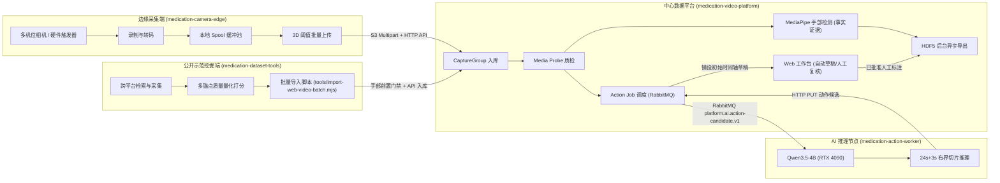

# 配药视频数据处理平台

配药视觉质检体系的**中心调度与数据管理平台**。接收外部采集端上传的音视频数据，在云端完成数据归组（`CaptureGroup`）、媒体质检、MediaPipe 手部姿态分析、GPU 动作时序候选调度、自动标注草稿铺设/人工复核与 HDF5 数据集标准化导出。

---

## 关联项目生态

本项目与公开挖掘源、边缘采集端及 GPU AI 推理节点构成端-云-算力闭环流水线：

| 角色 | 仓库 | 核心技术栈 | 职责定位 |
| :--- | :--- | :--- | :--- |
| **公开示范挖掘源** | [medication-dataset-tools](https://github.com/Soberis/medication-dataset-tools/tree/dev) | Python / Playwright / OpenCV | 第一人称及双手实操网络视频跨平台检索、批量采集、时序多锚点量化质检与去重 |
| **边缘采集端** | [medication-camera-edge](https://github.com/Soberis/medication-camera-edge/tree/dev) | RK3588 / Orbbec SDK / C++ | 多机位同步录制、硬件/HTTP 触发、本地 Spool 缓冲池与 S3 批量断网直传 |
| **中心平台** | **medication-video-platform**（本项目） | Java 21 / React / Docker | 接收归组、媒体质检、手部姿态事实、预标注调度、人机协同复核与 HDF5 导出 |
| **动作推理节点** | [medication-action-worker](https://github.com/Soberis/medication-action-worker/tree/dev) | RTX 4090 / PyTorch / Qwen | 监听 RabbitMQ 任务，执行 Qwen3.5-4B 有界切片动作时序推理与租约回传 |

### 系统整体拓扑与数据流向



---

## 核心业务基线（V1.36 Consolidated Baseline）

当前唯一需求入口：**V1.36 Consolidated Baseline**（冻结产品边界、主链、乐观自动核准与异常重新编辑 ADR-0006、AI/人工事实隔离和唯一 HDF5 导出语义；D1、D4 已在 dev 完成首轮收缩，D2、D3、D5 仍为 PENDING 约束待决实施项）。V1.36 正文自包含，不要求逐层阅读历史版本；V1.28 仍是上一正式运行时基线，需求收敛不表示现有 runtime 已全部实现或可随意删除兼容内容。

V1.36 的主链流水线：

```text
数据接收 (medication-camera-edge / medication-dataset-tools)
→ CaptureGroup → CameraStream / ClipAsset
→ Media Probe 媒体质检
  ├─ MediaPipe 手部事实 (platform.ai.hand-pose.v1) ────────┐
  └─ Action Candidate 动作候选 (medication-action-worker)    │
→ 自动标注草稿铺设 → 乐观自动核准 / 异常人工复核 ─────────┤
                                                          ↓
                           Export Eligibility → human-demonstration-hdf5.v2
                                        (后台异步任务池 + 实时悬浮监控)
```

- **数据建模边界**：`ClipAsset` 是不可变视频证据对象，不是独立的产品工作流对象；`CaptureGroup` 是一次采集记录；`CameraStream` 是视角。采集组内的所有机位均为等权观测者，**不设人为的主副机位之分**。Local Upload 的单视频场景统一建模为 `CaptureGroup → CameraStream #1 → ClipAsset`，不是第二条 single-video 流程。
- **设备与采集边界**：采集端负责采集、缓存和上传策略；平台不控制相机或边端设备。
- **全机位自动事实与双轨 AI 证据链条**：各机位手部骨骼（MediaPipe）与动作候选（Action Candidate）均为系统全自动并发检测生成，实事求是反映各视角的物理事实。系统自动为各机位铺设时间轴草稿，标注员核对多机位对应关系后显式提交整组标注成果包；复核员对各机位的动作呈现与手部质量进行全视角联合核验，审核通过后才进入 HDF5 最终准入。
- **规范导出**：当前唯一导出为 `human-demonstration-hdf5.v2`（具身智能双臂多视角规整格式，整合所有复核合格机位的动作对齐样本）。
- **提交与复核权限**：有效项目成员可准备和提交本项目标注，不以任务负责人作为操作门槛；管理员可提交并复核，包括自己提交的标注。项目隔离、质量准入和审计仍保留。
- **按机位处理、整组复核**：各机位独立保存、提交或排除，全部处理完成后提交整组复核；可切换机位查看对应标注和状态，退回时仅重置指定机位。排除不删除原视频。测试视频时长不同不代表动作已对齐，当前简化工作台保留独立区间及未确认原因，不按同名动作或相近时间自动确认跨机位对应。
- **本地多机位导入**：`tools/import-local-multicam.mjs` 在 `local` profile 下使用合成 admin token 选择并导入任意 ACTIVE 项目；不写入项目成员关系。该本地合成旁路不适用于生产或普通账号。
- **历史状态清理**：领域模型、状态机和异步协议中的历史产品段落仅供参考。媒体就绪后的 Action Candidate 自动派发已接线，真实 Worker 联调仍待验收；人工任务只在进入人工提交路径时准备。自动化准备不代替提交和复核，不覆盖人工修改。D1 已停止新的 Cleaning 写入与 recheck，历史 Cleaning 仅作只读兼容。

## 本地运行

要求 Java 21、Node.js 22、pnpm 11、Python 3.12、uv、ffmpeg 和 Docker Desktop。开发、测试和 CI 只使用合成或明确授权且隔离的数据。

Windows PowerShell 7：

```powershell
.\scripts\check-environment.ps1
.\scripts\start-local.ps1
cd apps\web
pnpm dev
```

macOS / Linux：

```bash
./scripts/check-environment.sh
./scripts/start-local.sh
cd apps/web
pnpm dev
```

`start-local` 启动本地基础设施、Core API、Media Worker，并在手部模型配置完整时启动 AI Worker；LEAN-P0 不启动已退役的 Export Worker。前端由 pnpm 单独启动。用 `status-local` 查看状态，用 `stop-local` 停止脚本启动的本地进程；停止不会删除数据卷。

### 默认管理端账号

Web 前端界面默认登录账号与密码配置在根目录 `.env`（与 `.env.example` 对应）：

- **账号**：`admin`
- **密码**：`admin12345678`
- **对应后端配置**：`services/core-api/src/main/resources/application.properties` 中的 `platform.security.bootstrap-admin-*`。

部署前的运行时拓扑、配置边界、合成 smoke、备份恢复和故障恢复检查见[部署就绪检查与边界手册](./docs/runbooks/production-readiness.md)。该手册区分本地 synthetic smoke 与真实环境/UAT，不把前者当作生产通过。

默认每类 Worker 启动 2 个进程：不同视频会由 RabbitMQ 自动分发给可用 Worker，因此上传多个视频后会并行完成媒体检测和手部候选检测；同一视频的任务仍受租约和幂等保护，不会被多个进程重复处理。每个 AI Worker 都会独立占用模型、CPU 和内存；开发机资源紧张时可显式降为 1 个进程：

```powershell
.\scripts\start-local.ps1 -MediaWorkerConcurrency 1 -AiWorkerConcurrency 1
```

```bash
./scripts/start-local.sh --media-worker-concurrency 1 --ai-worker-concurrency 1
```

如需更高吞吐量，可以在确认本机 CPU、内存和模型容量后提高到最多 8 个副本。副本数只提高后台吞吐量；不会创建批量预标注入口，也不会绕过媒体/组级质量、草稿初始化规则、异常人工接管或最终导出校验。

## 验证

Windows：

```powershell
.\scripts\quality-gate.ps1 -Strict
```

macOS / Linux：

```bash
./scripts/quality-gate.sh --strict
```

## 目录

```text
apps/web/                    React 管理端
services/core-api/           Java Core API
workers/                     Media 与 AI Worker
contracts/                   OpenAPI、事件、JSON Schema 和 profiles
api-tests/bruno/             服务核心场景
infra/docker-compose/        本地基础设施
docs/                        当前规范、需求基线与历史参考
tools/                       运维与质检工具箱（Web视频导入、手部前置门禁、具身数据质量分析）
exports/                     标准化 HDF5 导出产物仓库与质检报告
```

## 数据与安全

- 平台不接触生产数据库、医院生产账号、真实患者视频或生产密钥。
- 原视频、模型文件、令牌和预签名 URL 不得提交到仓库或写入日志。
- 视频普通删除为可审计软删除；彻底清理仅允许明确标识的合成测试数据，并需单独确认。
