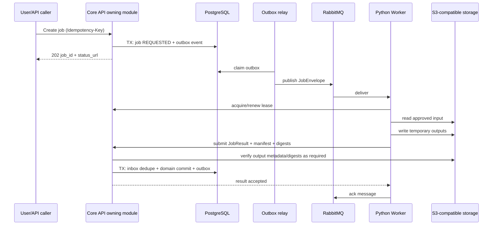

# 异步作业协议

> 文档状态：P0 详细设计（评审稿）  
> 适用范围：媒体探测/转码/抽帧、隐私处理、清洗、数据集导出；P1 AI 复用同一协议  
> 最后更新：2026-07-14

## 1. 核心决策

平台采用：

```text
模块自有作业聚合
+ 数据库事务与 Outbox
+ RabbitMQ 至少一次投递
+ Worker 幂等执行和租约
+ 临时对象输出
+ Core API 结果提交与验证
+ Inbox/结果去重
+ 原子业务发布
```

不宣称 exactly-once。目标是“至少一次投递 + 可识别 attempt + 幂等吸收 + 可恢复提交”。

Python Worker 不连接业务数据库。所有正式状态、AssetVariant、CleaningResult、DatasetExport、AIJob 和 CandidateAnnotation 都由拥有模块的 Core API 写入。

## 2. 作业所有权

不建立一个可任意承载全部业务状态的全局 `ProcessingJob` 表。各模块拥有自己的业务作业：

| 作业 | 所有模块 | 业务真值表 |
| --- | --- | --- |
| 媒体探测、转码、抽帧、脱敏 | `mediaprivacy` | media_job、media_job_attempt |
| 清洗和重复检测 | `qualitycleaning` | cleaning_run、cleaning_result |
| 数据集构建/导出 | `datasetexport` | dataset_export、export_artifact |
| AI 推理与评估 | `aicandidate` | ai_job、ai_job_attempt、ai_evaluation |

共享代码只提供 `JobEnvelope`、`JobResult`、状态枚举、错误分类和幂等工具，不拥有业务决策。

技术表：

| 表 | 所有权 | 说明 |
| --- | --- | --- |
| outbox_event | 平台基础设施 | 与业务事务同库写入，等待外发 |
| inbox_message | 平台基础设施 | 记录已处理外部消息 ID 和处理结果摘要 |
| adapter_delivery | `integration` | broker/CVAT 等外部投递状态，不是业务作业状态 |

## 3. 端到端时序



如果 Worker 无法调用 Core API，可使用版本化结果消息；Core API 消费者仍必须执行相同的 Inbox 去重、租约检查、对象验证和领域提交。两种回传方式不能在同一环境中无规则混用。

## 4. JobEnvelope V1

正式字段进入 `contracts/events/` 后冻结。计划最小结构：

```json
{
  "schema_version": "job-envelope.v1",
  "message_id": "uuid",
  "job_id": "uuid",
  "job_type": "MEDIA_PROBE",
  "attempt": 1,
  "lease_token": "opaque-random-token",
  "tenant_id": "uuid",
  "project_id": "uuid",
  "input": {
    "object_ref": "opaque-object-id",
    "asset_variant_id": "uuid",
    "sha256": "hex",
    "size_bytes": 123
  },
  "parameters": {},
  "parameter_digest": "hex",
  "output_prefix": "temporary/opaque-prefix",
  "requested_at": "RFC3339 UTC",
  "trace_id": "string"
}
```

规则：

- 消息只传对象引用、摘要、版本和短期参数，不传视频字节、预签名 URL、令牌或患者标识。
- Worker 通过受控凭证交换接口取得短期对象权限。
- `output_prefix` 只能写本 job/attempt 的临时范围。
- `parameter_digest` 使用规范化 JSON 计算，防止字段顺序造成不同幂等键。
- 任务类型和 schema version 必须采用 allowlist，未知类型进入不可重试失败。

## 5. JobResult V1

`MEDIA_PROBE` 的首个正式专用结果契约已经冻结在
`contracts/events/media-probe-result-v1.schema.json`，批准的输入配方位于
`contracts/profiles/media-probe-baseline-v1.json`。通用示例仍用于其他 job type 的后续设计，
不得覆盖专用契约。成功结果必须同时证明完整解码和输入 SHA-256 复核；失败结果只能携带
allowlist 中的错误分类、稳定错误码和安全摘要，不创建 MediaReport。

```json
{
  "schema_version": "job-result.v1",
  "message_id": "uuid",
  "job_id": "uuid",
  "attempt": 1,
  "lease_token": "opaque-random-token",
  "status": "SUCCEEDED",
  "input_sha256": "hex",
  "parameter_digest": "hex",
  "outputs": [
    {
      "artifact_role": "PREVIEW_VIDEO",
      "temporary_object_ref": "opaque-object-id",
      "sha256": "hex",
      "size_bytes": 123,
      "media_type": "video/mp4"
    }
  ],
  "metrics": {},
  "software_digest": "sha256:...",
  "started_at": "RFC3339 UTC",
  "completed_at": "RFC3339 UTC",
  "error": null
}
```

结果接受守卫：

1. job、attempt 和 lease token 匹配当前执行；
2. 输入摘要和参数摘要未变化；
3. schema version 和 job type 兼容；
4. 输出只位于批准的临时前缀；
5. 对象大小、摘要、媒体类型和数量满足 profile；
6. software/model digest 已批准；
7. job 未取消、未过期且结果未被先前 attempt 接受；
8. 业务状态仍允许提交。

任何守卫失败都不得把临时对象注册为正式 AssetVariant 或 ExportArtifact。

## 6. 幂等模型

### 6.1 创建作业

作业唯一键按业务类型定义。例如：

```text
media_job:
  job_type + input_variant_id + input_digest + recipe_digest

dataset_export:
  dataset_version_id + export_profile_digest

ai_job:
  algorithm_id + input_variant_id + sampling_profile_id + parameter_digest
```

相同唯一键：

- 已成功：返回既有结果；
- 运行中：返回既有 job；
- 可重试失败：创建新 attempt，不创建第二个业务 job；
- 输入或参数摘要不同：创建新 job。

### 6.2 消息和结果

- `message_id` 用 Inbox 去重。
- `(job_id, attempt)` 唯一。
- 每个业务 job 最多一个 accepted result。
- 重复结果返回第一次接受结果，不重复创建 variant、候选或导出记录。
- 迟到旧 attempt 结果返回 `STALE_ATTEMPT` 并安排临时对象清理。

## 7. 租约、心跳和并发

作业被 Worker 领取时生成不可预测的 `lease_token`，并保存：

```text
worker_id
attempt
lease_token_hash
lease_started_at
lease_until
last_heartbeat_at
```

- 心跳只延长同一 attempt 的租约，不能改变参数。
- 租约过期后，调度器经过 grace period 才允许新 attempt。
- 新 attempt 创建后，旧 lease token 永久失效。
- Worker 不能仅凭 broker delivery tag 证明自己仍持有业务租约。
- 同一 job 的并发结果以数据库唯一约束和当前 attempt 守卫裁决。

具体 lease、heartbeat 和 grace 时长按 job profile 配置并在负载测试后冻结。

## 8. 重试和错误分类

| 类别 | 示例 | 默认动作 |
| --- | --- | --- |
| RETRYABLE_TRANSIENT | broker/对象存储短暂不可用、网络超时 | 指数退避 + 抖动，受 max attempts 限制 |
| RETRYABLE_RESOURCE | 临时磁盘不足、Worker 被抢占 | 换 Worker/profile 后重试，记录资源原因 |
| NON_RETRYABLE_INPUT | 摘要不符、损坏媒体、schema 不兼容 | FAILED，人工修复输入后创建新 job |
| NON_RETRYABLE_POLICY | 隐私放行撤销、权限不足、算法未批准 | FAILED/BLOCKED，不自动重试 |
| CANCELLED | 用户/治理流程取消 | 清理临时输出，不作为失败率 |
| INTERNAL_BUG | 未分类异常 | 有限重试后 DLQ，告警并保留诊断摘要 |

错误响应只包含稳定 `error_code`、安全摘要和 `retryable`，不得包含堆栈、签名 URL、对象内部地址或敏感数据。

## 9. 取消协议

### 9.1 状态

```text
REQUESTED/QUEUED → CANCELLED
RUNNING → CANCEL_REQUESTED → CANCELLED
```

### 9.2 规则

- 取消接口幂等；重复取消返回当前状态。
- Worker 在帧批次、文件边界或其他安全检查点查询取消标志。
- 不使用强制杀进程作为正常取消机制；超时终止属于故障恢复。
- SUCCEEDED 且结果已提交后不能改为 CANCELLED；需要新治理命令撤销/销毁产物。
- 取消后的临时对象、临时本地文件和未完成 multipart 必须进入清理队列。

## 10. RabbitMQ 拓扑

计划队列：

```text
media_cpu
privacy_high_priority
export_cpu
ai_cpu        # P1
ai_gpu        # 未来
dead_letter
```

要求：

- 持久 exchange、queue 和 persistent message；
- publisher confirms；
- consumer manual ack；
- 合理 prefetch，避免大作业占满单个 Worker；
- 按 job type 设置最大消息大小和 allowlist；
- 重试使用延迟/重试队列或调度器，不在消费者进程中长时间 sleep；
- DLQ 消息包含 job/message ID 和安全错误摘要，不复制敏感 payload。

RabbitMQ 只保存传递状态，不是最终业务事实数据库。

## 11. DLQ 处理

DLQ 不自动无限重放。重放流程：

1. 运维确认失败类别和影响范围；
2. 业务模块确认 job 仍允许执行；
3. 修复配置/代码后创建新的 attempt 和 lease token；
4. 发布新 message ID；
5. 记录操作者、原因、旧/新 attempt 和变更版本；
6. 观察重复失败阈值并触发熔断。

原 DLQ 消息作为诊断证据保留到策略期限，不直接修改后重新入队。

## 12. 对象输出与原子发布

对象存储通常没有目录级原子 rename。发布采用两阶段：

```text
temporary/{job_id}/{attempt}/...
→ Worker 提交 manifest 和摘要
→ Core API 验证
→ 复制/写入不可变 final key 或注册内容寻址对象
→ 数据库事务注册正式 artifact
→ 发出 ArtifactPublished 事件
→ 异步清理 temporary
```

如果使用“注册现有不可变对象”而不复制，临时 key 必须在注册前转为不可被 Worker 修改的权限/版本；否则结果提交后仍可能被篡改。

导出包只有在文件集合、引用和 SHA256SUMS 校验通过后才进入 AVAILABLE。

## 13. S3 multipart 完整性

- 不把 multipart ETag 当作完整文件 MD5。
- 创建 multipart 时明确 checksum 能力和算法；不同 S3 兼容产品必须通过能力探测。
- 每个 part 记录 part number、大小、算法、checksum 和 ETag。
- complete 请求必须与已冻结 part 清单一致。
- 平台正式资产摘要为 SHA-256；若对象存储不能验证完整 SHA-256，由媒体 Worker 流式读取对象计算并在 INGESTED 前校验。
- 只校验边端自报 SHA-256 不足以证明对象存储中的字节一致，必须有服务端/Worker 独立验证或受批准的存储校验机制。

## 14. 安全边界

- Worker 使用独立服务身份和 job scoped 短期凭证。
- 输入只读，输出只能写指定临时前缀。
- AI Worker 默认禁止公网出站；DNS/连接尝试进入安全日志。
- 消息不含预签名 URL、密钥、真实身份映射或视频帧。
- 临时盘加密或采用受控节点，作业结束清理。
- Worker 镜像、依赖和模型使用摘要锁定，运行时不下载。

## 15. 可观测性

至少记录：

- queue wait、run、verify、commit 各阶段时长；
- attempt、retry 和取消次数；
- lease 过期、迟到结果和幂等命中；
- 临时对象数量/字节和清理积压；
- 按 error class 的失败率；
- broker publish/consume lag；
- Worker CPU、内存、临时盘和解码错误；
- trace ID 从创建命令贯穿到结果提交。

指标标签不得包含患者、操作者、处方、对象 key 或其他高基数敏感字段。

## 16. 最小测试矩阵

- [ ] 事务回滚时不产生可投递 Outbox。
- [ ] relay 重复发布被 Worker/Core API 幂等吸收。
- [ ] Worker 处理完成但 ack 前崩溃，重投不生成重复业务产物。
- [ ] Worker 写完临时对象但结果提交失败，可以安全重试。
- [ ] 结果提交成功但响应丢失，重复提交返回原结果。
- [ ] lease 过期后旧 attempt 迟到结果被拒绝。
- [ ] 运行中取消能停止并清理临时输出。
- [ ] non-retryable 输入不会进入重试风暴。
- [ ] DLQ 重放创建新 attempt 并保留审计。
- [ ] 对象摘要、输入摘要或参数摘要变化会阻断提交。
- [ ] Worker 无数据库写权限、无默认公网出站权限。
