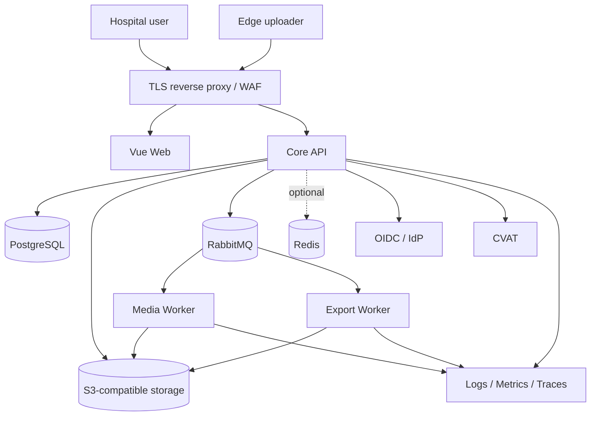

# 部署、容量与灾难恢复

> 文档状态：P0 运行设计（评审稿）  
> 最后更新：2026-07-14

## 1. 决策边界

- 需要本地基础设施时使用一个小型 Docker Compose；服务增多且存在可选组合后再引入 profile。
- P0 不预建 Kubernetes；生产是否采用 Kubernetes、虚拟机容器或医院平台由 SLA、运维能力、合规隔离和独立扩容证据决定。
- Docker Compose 可验证功能闭环，但不能自动证明生产高可用和灾难恢复能力。
- 精确 CPU、内存、存储、并发、RPO 和 RTO 在真实工作量与医院基础设施确认后冻结。
- 镜像不得使用 `latest`，使用准确版本和 digest。

## 2. 工作负载

### 2.1 P0 目标能力

下表是 P0 闭环最终可能使用的工作负载，不是 Sprint 0 默认启动清单。

| 工作负载 | 职责 | 是否保存业务真值 |
| --- | --- | --- |
| Web | Vue 管理端静态资源 | 否 |
| Core API | 状态、权限、审计、事务和公开 API | 是，通过 PostgreSQL |
| Media Worker | 探测、转码、抽帧、画质和脱敏作业 | 否，只写临时对象并回传结果 |
| Export Worker | 数据集文件生成和校验 | 否，只写临时对象并回传结果 |
| PostgreSQL | 关系业务真值、Outbox/Inbox 和审计索引 | 是 |
| S3 兼容存储 | raw、variant、frames、reports、exports | 保存字节事实，不保存关系状态 |
| RabbitMQ | 作业和事件传递 | 否 |
| Redis（可选） | 缓存、限流、短锁、短期进度；有测量证据后启用 | 否 |
| CVAT | Object 标注外部工具 | 外部工作副本，正式 revision 仍在平台 |
| OIDC/IdP | 用户和服务认证 | 身份事实由 IdP 管理 |
| Observability | metrics、traces、logs、alerts | 运维证据，不替代业务审计 |

### 2.2 渐进激活

| 阶段 | 默认启用 | 明确不在本阶段启用 |
| --- | --- | --- |
| Sprint 0 | Core API、Web、PostgreSQL、本地 S3 兼容对象存储 | RabbitMQ、Redis、CVAT、Worker、真实 IdP |
| 上传与资产 | 在业务代码中启用 PostgreSQL 和 S3 | RabbitMQ、Redis、CVAT、Export/AI Worker |
| 媒体处理 | RabbitMQ、Media Worker、单业务队列、DLQ | Redis、Export/AI Worker |
| 隐私与标注 | 开发认证适配器、CVAT；UAT 前真实 OIDC | Export/AI Worker、无证据的 Redis |
| 数据集与导出 | Export Worker | AI Worker、无证据的 Redis |
| P1 | AI Worker 和插件 | 不影响 P0 人工闭环 |

Redis 不属于 P0 默认运行清单。只有出现可量化的缓存、限流、短锁或短期进度需求，并验证失效后不影响正确性，才通过配置和部署变更加入。

### 2.3 P1

- AI Worker；
- AI Plugin SDK 和插件镜像；
- 模型离线仓库/批准清单；
- AI 评估作业。

## 3. 环境分离

| 环境 | 数据 | 外部连接 | 目标 |
| --- | --- | --- | --- |
| Local | 仅合成 | 本地容器/Mock | 开发和快速测试 |
| CI | 仅合成、短生命周期 | 默认无公网或最小依赖镜像源 | 构建、测试、契约和安全门禁 |
| UAT | 合成或明确批准的隔离样本 | UAT IdP/S3/CVAT | 端到端验收、容量和恢复演练 |
| Production | 经批准的真实数据 | 医院批准系统 | 正式运行 |

环境间禁止共享数据库、bucket、密钥、OIDC client、RabbitMQ vhost 和服务账号。生产数据不得回流开发/CI。

## 4. 逻辑部署拓扑



该图表示完整目标拓扑；未进入当前阶段的节点不部署。网络分区建议：

- 用户入口区：反向代理和 Web；
- 应用区：Core API 和适配器；
- Worker 区：媒体/导出/AI，按数据级别和网络策略隔离；
- 数据区：按阶段启用 PostgreSQL、对象存储、RabbitMQ，以及可选 Redis；
- 管理区：监控、备份、堡垒/运维入口。

具体区划服从医院网络架构和安全等级要求。

## 5. 容量模型

### 5.1 输入变量

上线前采集：

```text
S = sessions/day
C = enabled camera streams/session
D = average recorded duration seconds/session
B = average video bitrate bits/second/stream
P = peak-to-average ingest factor
R_raw = raw retention days
R_working = working variant retention days
F_preview = preview bytes/raw bytes
F_frames = exported frame bytes/raw bytes
F_export = export bytes/raw bytes
F_replica = storage replication/erasure overhead
F_backup = backup overhead
```

### 5.2 估算

每日 raw：

```text
raw_bytes_day = S × C × D × B / 8
```

在线对象容量：

```text
online_bytes ≈ raw_bytes_day ×
  (R_raw + F_preview × R_working + F_frames × R_working + F_export × export_retention_days)
  × F_replica
```

规划容量再乘增长、碎片和安全余量。安全余量比例必须由实际波动和扩容交付时间决定，不在本文凭空固定。

### 5.3 峰值上传

```text
peak_ingest_bps = average_ingest_bps × P
```

需要同时评估：

- 边端到对象存储带宽；
- multipart 并发和 part 数上限；
- API 生成凭证/complete 的 QPS；
- 校验 Worker 读取对象造成的第二次存储/网络流量；
- 上传与预览/导出竞争时的 QoS。

### 5.4 Worker 容量

按 Golden 视频基准测量每类 profile：

```text
realtime_factor = processing_seconds / video_seconds
worker_hours_day = S × C × D × realtime_factor / 3600
required_workers = worker_hours_day / effective_worker_hours_day
```

分别测量探测、转码、抽帧、隐私处理和导出。CPU、GPU、解码器、分辨率和编码格式必须分层，不用一个平均值覆盖全部场景。

## 6. P0 性能目标

### 6.1 已有需求基线

| 能力 | 目标 | 验收条件还需冻结 |
| --- | --- | --- |
| 分片上传 | 单文件至少 2GB；失败可恢复 | 并发上传数、链路带宽、丢包/延迟、S3 产品 |
| 常用列表 | 第一页不超过 3 秒 | 数据量、过滤组合、页大小、并发和 P95/最大值口径 |
| 视频预览 | 脱敏视频可播放并快速看缩略图 | 浏览器、编码、首帧和 seek 指标 |
| CVAT 同步 | 完成后不超过 5 分钟 | 正常/故障场景、统计分位和轮询/webhook 方式 |
| 清洗/导出 | 后台执行，可见进度和失败原因 | job profile、最大数据量和取消时限 |

### 6.2 测试口径

- API 时延使用服务端 P50/P95/P99，浏览器端到端时间单独报告。
- 不用空数据库或单用户开发机结果证明 3 秒目标。
- 固定数据规模、查询分布、并发、缓存冷热、硬件和网络条件。
- 上传测试包含断点、part 重传、complete 重放、checksum 冲突和临时对象清理。
- 预览测试在医院实际浏览器/终端上验证解码、Canvas 和多路同步。
- CVAT 同步从外部完成时间戳到平台正式 revision 可查询时间计算。

## 7. 数据库容量与性能

### 7.1 重点增长表

- audit_event；
- outbox_event/inbox_message；
- object_annotation 和 privacy_region_annotation；
- frame_manifest/抽帧索引；
- media_report/quality metrics；
- job attempt 和 adapter delivery。

### 7.2 原则

- 常用 tenant/project/status/time 筛选建立复合索引并以真实查询计划验证。
- cursor 分页优先，避免大 offset。
- 大型导出和统计使用只读投影/流式读取，不把全部结果加载进 JVM。
- 审计和时序大表的分区、归档门槛以规模测试决定，不在初期盲目分区。
- PostgreSQL major/minor、数据校验和、PITR、连接池和 vacuum 策略在环境基线冻结。
- Redis 缓存失效时系统仍能从事实库正确运行，只允许性能下降。

## 8. 对象存储运行要求

- S3 API 能力测试：multipart、checksum、versioning、object lock、lifecycle、SSE/KMS、range GET、并发和错误语义。
- 原始、工作、隔离和导出对象有独立生命周期策略。
- 未完成 multipart 和 job 临时前缀有清理任务及积压告警。
- 正式对象记录 version ID、size、SHA-256 和 storage class。
- 容量告警覆盖逻辑容量、物理容量、增长速率和清理失败。
- 不将单节点对象存储宣称为备份；副本、纠删码和备份是不同保护层。

## 9. 高可用决策

上线前根据批准 SLA 判断：

| 组件 | 单实例可接受条件 | 需要 HA 的信号 |
| --- | --- | --- |
| Core API | 维护窗口和短中断可接受 | 无计划中断目标、并发或发布要求提高 |
| PostgreSQL | 可从备份恢复且 RTO 允许 | RPO/RTO 要求无法靠单机+备份满足 |
| S3 存储 | UAT/可重建数据 | 正式 raw/数据集需节点故障持续可用和耐久性 |
| RabbitMQ | 可从 DB job/outbox 重建且停机可接受 | 作业连续性和积压恢复要求提高 |
| Redis | 可丢失、可重建 | 高可用只影响性能/限流连续性时按需配置 |
| CVAT | 标注可暂停 | 标注 SLA 或任务规模要求高可用 |

Kubernetes 不是 HA 的充分条件。数据库、对象存储、备份、网络和运维流程仍需各自设计。

## 10. 备份范围

| 数据 | 备份/保护方式 | 恢复验证 |
| --- | --- | --- |
| PostgreSQL | 基础备份 + WAL/PITR（生产候选） | 指定时间恢复、迁移版本和行数/摘要对账 |
| S3 对象 | 产品级副本/版本 + 独立备份或批准的等价方案 | version、size、SHA-256 和抽样可解码 |
| 配置/契约 | Git 和构建制品库 | 从 tag/commit 重建 |
| 密钥引用 | KMS/密钥系统备份与恢复 | 受控恢复后可解密批准样本 |
| RabbitMQ | 拓扑声明可重建；业务作业从 DB 恢复 | relay/consumer 恢复和积压处理 |
| Redis | 默认不作为必须恢复的业务事实 | 清空后系统正确性测试 |
| CVAT | 任务/标注工作副本按工具方案备份 | 平台正式 revision 不依赖 CVAT 单点恢复 |

备份必须与生产权限隔离，防止同一凭证同时删除主数据和备份。

## 11. RPO/RTO

当前 RPO/RTO 尚未批准，不能在文档中伪造数值。上线前逐项填写：

| 业务能力 | 最大可接受数据丢失 RPO | 最大可接受中断 RTO | 责任人 | 验证证据 |
| --- | --- | --- | --- | --- |
| 上传接收 | 待确认 | 待确认 | 待确认 | 恢复演练报告 |
| 标注/复核 | 待确认 | 待确认 | 待确认 | 恢复演练报告 |
| 数据集冻结/导出 | 待确认 | 待确认 | 待确认 | 重建和摘要校验 |
| 权限/审计 | 待确认 | 待确认 | 待确认 | PITR 和审计链校验 |

冻结数值后反推 WAL、快照、对象备份频率、异地副本、HA 和值班要求。

## 12. 恢复顺序

建议恢复依赖顺序：

```text
网络 / DNS / 时间服务 / 密钥
→ PostgreSQL
→ 对象存储
→ Core API
→ OIDC 连接
→ RabbitMQ / Outbox relay
→ Media/Export Worker
→ CVAT
→ Web
→ 监控和告警核验
```

恢复后执行：

1. 数据库 schema/Flyway 版本检查；
2. 对象引用、version、size 和 SHA-256 抽样/全量分层核验；
3. Outbox/Inbox 和作业 attempt 去重检查；
4. AnnotationRevision、CleaningRun 和 DatasetVersion 引用完整性；
5. 权限、审批、撤销和过期状态检查；
6. 审计链连续性；
7. 端到端合成 session 验证；
8. 经批准后恢复用户流量。

不得在未完成一致性检查时让 Worker 批量消费恢复后的积压。

## 13. 灾难场景

至少演练：

- PostgreSQL 节点/磁盘故障和指定时间恢复；
- 对象节点故障、对象误删和版本恢复；
- 数据库已提交但对象缺失；
- 对象存在但数据库注册事务失败；
- RabbitMQ 丢失后从 DB job/outbox 恢复；
- Worker 大量重投、lease 过期和 DLQ 积压；
- 密钥不可用/轮换失败；
- 错误数据集导出或隐私放行撤销；
- 整个站点不可用时的替代恢复位置；
- 从备份恢复出已销毁/已撤销数据后的再处置。

## 14. 可观测性与告警

### 14.1 指标

- API：请求量、错误率、P50/P95/P99、连接池和线程/内存；
- 上传：init/complete 成功率、checksum 冲突、未完成 multipart；
- Session：assembling 年龄、missing stream、sync warning；
- Worker：queue wait、运行/验证/提交时长、失败、重试、取消、lease 过期、临时盘；
- PostgreSQL：连接、锁、慢查询、WAL、复制/备份、磁盘和 vacuum；
- S3：容量、增长、错误、延迟、临时对象和生命周期失败；
- RabbitMQ：ready/unacked、消费者、publish confirm、DLQ；
- 数据集：构建时长、准入失败、泄漏冲突、导出校验失败；
- 安全：认证失败、越权拒绝、raw 访问、外连尝试和审计投递失败。

### 14.2 告警原则

- 告警有 owner、严重度、抑制/聚合、runbook 和升级路径。
- 阈值以 SLO/容量和错误预算为依据，不复制默认示例值。
- 指标标签不含患者、操作者、处方、对象 key 或预签名 URL。
- 审计/安全告警与普通性能告警分离处理。

## 15. 发布与回滚

- 数据库变更使用向前兼容的 expand/migrate/contract；P0 不依赖破坏性即时回滚。
- 应用回滚前确认旧版本能读取新 schema 和新事件。
- Worker、事件 schema 和 Core API 按兼容窗口滚动升级。
- 模型/插件使用独立批准和摘要，不跟随应用启动自动下载。
- 发布前执行合成数据 smoke、迁移、契约和备份可恢复性检查。
- 失败回滚不删除已经合法产生的不可变 revision/run/dataset；通过新状态或补偿流程处理。

## 16. 上线门禁

- [ ] 工作量、数据增长、并发和视频编码画像已测量。
- [ ] 2GB 上传、3 秒查询、五分钟 CVAT 同步有冻结测试条件和证据。
- [ ] 当前阶段实际启用的 PostgreSQL、S3、RabbitMQ、OIDC、CVAT 或可选 Redis 准确版本/镜像摘要已批准。
- [ ] S3 multipart/checksum/version/lifecycle 能力测试通过。
- [ ] RPO/RTO、备份频率、保留和恢复责任人已批准。
- [ ] 数据库 PITR、对象恢复、密钥恢复和整站演练通过。
- [ ] 网络分区、TLS、服务身份和 Worker 出站策略已验证。
- [ ] 监控、告警、runbook、值班和事件响应已准备。
- [ ] 浏览器兼容和多路预览在真实终端 UAT 通过。
- [ ] 容量达到扩容提前量前有可执行扩容方案。
