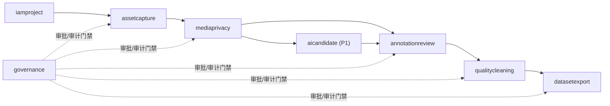

# 领域模型与数据所有权

> 文档状态：P0 详细设计（评审稿）  
> Java 根包：`com.medicationvideo.platform`  
> 最后更新：2026-08-09

## 1. 目标与边界

本文冻结模块命名、聚合边界、表所有权、跨模块引用和关键不变量。它不替代 Flyway、OpenAPI 或事件 Schema；实际字段类型、长度、索引和约束最终必须在这些可执行工件中一致体现。

当前业务事实来源是 V1.11；未变更条款按需求基线继承 V1.10 至 V1.1.13。医院边端只作为远端采集和自动上传来源；内部团队使用平台管理、筛选和生产训练数据。本文记录两种上传入口、项目成员直接审核播放、项目改名/归档、视频删除、项目内文件夹、两级角色和视频标注的已批准领域边界。

P0 是一个 Spring Boot + Spring Modulith 应用。下列模块是 Java 直接子包和业务所有权边界，不是独立服务：

```text
com.medicationvideo.platform
├── iamproject
├── assetcapture
├── mediaprivacy
├── annotationreview
├── qualitycleaning
├── datasetexport
├── aicandidate
├── governance
└── integration
```

`integration` 是端口、适配器和投递技术设施，不拥有资产、正式标注、清洗结论或冻结数据集等业务真值。

## 2. 通用持久化规则

### 2.1 标识与时间

- 业务主键使用不含业务含义的稳定 ID；是否采用 UUIDv7 在数据库基线冻结时决定。
- 外部系统 ID 必须与适配器、租户和外部系统实例共同限定唯一性。
- 时间点使用 UTC `timestamptz`；展示时区由用户或项目配置决定。
- 视频内时间使用整数毫秒；帧定位以 PTS 对应的 stream timestamp 为主，frame index 为辅。
- 低熵医院、患者、操作者、医嘱和任务标识不得裸哈希，使用 tenant scoped HMAC 或令牌服务。

### 2.2 版本与审计字段

可变聚合至少包含：

```text
created_at
created_by
updated_at
updated_by
row_version
```

不可变记录不提供通用 update 接口；更正通过新 revision/run/version 表达。高风险操作另写追加式 `audit_event`，业务表的更新时间不能替代审计日志。

### 2.3 JSONB 使用边界

可稳定查询、约束、关联和排序的字段必须结构化。JSONB 只用于：

- 外部系统原始 payload；
- 算法原始输出；
- 版本化但变化较快的参数快照；
- 不参与核心守卫的扩展属性。

任何进入准入规则、权限判断、任务队列或常用筛选的 JSONB 字段必须抽取为结构化列。

### 2.4 跨模块数据库引用

- 模块只能通过自己的 Repository 写本模块表。
- 跨模块只保存稳定 ID 和必要摘要，不复制可变业务真值。
- 默认禁止跨模块级联更新和级联删除。
- 跨模块物理外键仅在父对象生命周期稳定、不会阻断独立迁移且经 ADR 批准时使用；无外键时必须有应用守卫和一致性巡检。
- 查询需要跨模块组合时，使用公开查询接口或只读投影，不在 Web 控制器中拼装多个内部 Repository。

## 3. 模块依赖与事实流



箭头表示允许的公开能力依赖方向，不表示下游可写上游表。具体 `allowedDependencies` 必须在模块声明中显式配置并由 `ApplicationModules.verify()` 测试。

## 4. `iamproject`

### 4.1 所有权

| 聚合/实体 | 表 | 说明 |
| --- | --- | --- |
| Tenant | tenant | 批准的数据隔离域或数据来源边界；具体含义需在部署前冻结 |
| Project | project | 数据处理目的、范围和策略绑定单元 |
| Membership | membership | 用户在 tenant/project 中的成员关系 |
| RoleBinding | role_binding | RBAC 角色和 ABAC 条件引用 |
| PurposeGrant | purpose_grant | 数据用途、有效期和授权范围 |

### 4.2 不变量

- 用户有系统身份不等于拥有任何项目数据权限。
- 权限判断至少包含 tenant、project、classification、purpose、expiry 和 task assignment。
- 角色变更不能追溯性改变历史审计中的当时授权上下文。
- ARCHIVED 项目禁止新的项目内读取和操作；P0 不通过项目管理界面提供恢复或物理删除。
- P0 的界面角色只有 `ADMIN` 和 `MEMBER`，它们是细粒度权限项的模板，不是绕过 purpose、project、privacy、task assignment 或审批守卫的通行证。

### 4.3 当前实现边界

- Flyway V22 和 V29 已实现 `project`、`membership`、项目归档状态和幂等成员命令证据；项目创建原子建立首个 `ADMIN`，成员变更按 project 行锁串行并写追加式审计。
- 普通用户只能列出和读取其 `ACTIVE` Membership 对应的 Project；成员清单和变更要求项目内 `ACTIVE ADMIN`，且最后一个活动管理员不可移除或降级。
- ACTIVE 项目的管理员可修改显示名称或归档项目；两者保留稳定 project ID，归档不级联删除成员、视频、对象或审计记录。
- 当前没有从既有 UploadBatch、ClipAsset 或审计活动反推 Membership。既有资产 API 接入 Membership、Tenant 语义、RoleBinding、PurposeGrant、项目关闭和平台账号启停/密码重置生命周期属于后续经批准切片。

## 5. `assetcapture`

### 5.1 所有权

| 聚合根 | 子实体/表 | 关键职责 |
| --- | --- | --- |
| UploadBatch | upload_batch、upload_file、upload_part、upload_cleanup_task | 批次配额、文件清单、分片会话、幂等、完成/中止和临时对象清理 |
| CameraChannel | camera_channel、camera_alias | 稳定通道 ID 与带生效期的临时/正式别名 |
| CameraSet | camera_set、camera_set_member | 可生效的相机组配置 |
| CaptureSession | capture_session、camera_set_snapshot、camera_set_snapshot_member、camera_stream | 一次配药操作和创建时冻结的相机配置 |
| ClipAsset | clip_asset、asset_tag | 不可变媒体对象身份、摘要、存储引用和业务标签 |
| CaptureEventLog | capture_event_log | 边端事件日志对象索引及时间基准，不解析硬件控制逻辑 |
| AssetFolder | asset_folder、clip_asset.folder_id | 项目内一层视频分类；不承载权限、不映射对象存储目录 |

### 5.2 UploadBatch 不变量

- 开始 multipart 前，`upload_file` 数量和大小总和必须与批次声明完全一致。
- 对象键由 project、batch 和内部 upload file ID 生成，不接受客户端路径，不包含任何身份或医疗明文。
- `storage_upload_id` 只用于服务端恢复、完成和中止，不通过控制面响应直接暴露。
- `upload_part` 保存 part number、期望字节数、期望 SHA-256、状态和授权到期时间，不保存预签名 URL。
- 同一文件只能有一个活动 multipart 会话；同一 `(upload_file_id, part_number)` 只能有一个不可变期望摘要。
- Abort 仅允许批次发起人或项目管理员；TTL 到期必须记录 `EXPIRED`，不能降格成用户 `ABORTED`。
- 批次/文件终态、逐文件清理任务和追加式审计必须原子提交；对象存储 Abort/Delete 不占用该数据库事务。
- `upload_cleanup_task` 对每个 UploadFile 唯一，使用 claim lease 和有限重试；终态 `FAILED` 必须告警，不得假定对象已清理。
- 清理任务保留服务端对象引用能力但任何查询响应、日志和指标不得暴露对象 key、upload ID 或预签名 URL。
- Complete Batch 为每个已验证 VIDEO UploadFile 创建唯一的最小 RAW ClipAsset，并为每个已验证 EVENT_LOG UploadFile 创建唯一的不可变 CaptureEventLog 对象索引；METADATA 和 EVENT_LOG 均不伪装成视频资产。
- `CameraSetSnapshot` 与 `CaptureSession` 同事务创建，只能由服务器现行 CameraSet 冻结；RK3588 只上报稳定标识和观测元数据，不能覆盖服务器相机配置真值。
- UploadBatch 创建时冻结 project 和 `upload_source_type`；第一版只有 `HOSPITAL_REMOTE` 和 `PLATFORM_LOCAL`，不单独建来源表。
- Complete Batch 后不允许直接修改资产或 session 的 project；错误归属在完成前中止，完成后删除错误视频并重新上传。
- `PLATFORM_LOCAL` 表示用户在平台页面选择本机视频上传。生产环境按项目权限和上传规则开放；开发、测试和 CI 仍只使用合成数据。

### 5.3 CameraChannel 与 CameraSet 不变量

- `camera_channel_id` 由平台生成且不可变；当前 `provisioning_key` 只作为 project 内唯一的非敏感部署对接键，不是展示别名、密钥或硬件地址。
- CameraSet 以 `(project_id, camera_set_key, configuration_version)` 标识不可变版本；相同内容重复 PUT 返回原资源，不同内容不得覆盖既有版本。
- 同一 CameraSet 版本内 CameraChannel 与 `camera_index` 分别唯一，`camera_index` 范围为 0～63，至少一个成员 enabled。
- CameraSet 只能引用同一 project 的 CameraChannel；跨 project 引用按不存在处理，避免泄露其他项目标识。
- 配置由管理或部署流程创建并将精确 `camera_set_id` 配置给 RK3588。平台不通过该配置接口发现、探测或控制硬件，RK3588 也不能反向修改服务器配置。
- 当前 P0 用精确不可变版本建立后续 snapshot；定时生效、展示别名和自动设备发现只有出现批准需求时才增加。

### 5.4 CaptureSession 不变量

- `camera_set_snapshot` 在 session 创建时冻结；后续 CameraSet 变更不改历史。
- CaptureSession、CameraSetSnapshot、snapshot member 和首批 CameraStream 必须在同一数据库事务创建；任一对账或约束失败不得留下半成品。
- 每个完成批次必须恰好包含一个受支持且已验证的 METADATA 对象；平台重新核验读取结果的大小与 SHA-256，并按严格版本化 Schema 解析。
- 同一 session 中 `(camera_channel_id)` 唯一；同一 snapshot 中 `camera_index` 唯一。
- `expected_camera_count` 由 snapshot 中 `enabled=true` 的成员计算，不接受边端覆盖。
- `received_camera_count` 只统计已经 `INGESTED` 且通道唯一的 stream。
- 同一完成批次的每个 VIDEO ClipAsset 必须绑定一次且只能绑定一次；初始 `BOUND` 不等于 `INGESTED`。
- 边端同步状态和 offset 只作为来源明确的观测值保存，后续平台同步结论使用不可变 StreamSyncRevision，不覆盖原始观测。
- session 是 Step 标注、最低泄漏分组和数据集组织单元，但数据集必须额外冻结实际纳入的 stream/variant。

### 5.5 ClipAsset 不变量

- raw 内容一经摘要确认不可原地替换。
- 相同业务 ID、不同摘要必须返回冲突，不可覆盖。
- 对象路径只使用内部 ID，不包含姓名、病历号、处方号、工号或科室明文。
- 逻辑不可变不等于永久保留；批准销毁通过治理流程创建 tombstone 和销毁证明，不通过 update 改写媒体内容。

### 5.6 CaptureEventLog 不变量

- 每个已完成批次中的 EVENT_LOG UploadFile 至多形成一个索引，以 `source_upload_file_id` 和 `(batch_id, client_file_id)` 双重唯一约束防止重复绑定。
- 索引只保存项目、批次、设备、对象摘要、媒体类型、大小和服务端索引时间；内部存储引用不得通过目录 API、日志或指标暴露。
- `indexed_at` 是平台完成批次时的索引时间，不是边端事件发生时间，也不能替代设备时间基准。
- 当前切片不解析日志负载、不推断相机或工控机动作，也不把边端声明直接升级为平台事实；事件 Schema、逐事件索引和时间基准校验必须通过后续版本化契约引入。
- 列表与详情只能使用认证身份中的 project 范围；跨项目详情按不存在处理。

### 5.7 AssetFolder 不变量

- AssetFolder 与 ClipAsset 必须属于同一 project；禁止嵌套和跨项目归类。
- `clip_asset.folder_id` 可空；一个 ClipAsset 当前最多属于一个文件夹，不需要单独的归类历史表。
- “未分类”是查询投影，不创建可删除的系统文件夹记录。
- 移动视频只更新 `folder_id`，不移动对象、不改 project、不复制媒体，也不修改入库、隐私、标注、清洗或数据集事实。
- 删除文件夹时将其中视频改为“未分类”，不得级联删除视频。

当前实现：Flyway V23 使用 `(project_id, folder_id)` 复合外键固定 AssetFolder 与 ClipAsset 的同项目关系，表结构不含父文件夹字段；管理和视频分类命令通过 `iamproject` 公开 Membership 查询端口校验项目内 `ACTIVE ADMIN`。删除文件夹、批量取消分类、追加式审计和幂等命令证据在同一事务提交，故障注入测试证明审计失败不会留下部分取消分类。

### 5.8 视频删除不变量

- ClipAsset 使用可空的 `deleted_at`、`deleted_by` 和 `delete_reason` 表示视频已在平台删除，不创建独立处置聚合或状态机。
- 删除命令必须校验项目权限、目标视频和受控下游引用，并向既有 AuditEvent 写入结果。
- 已删除视频从普通查询、播放、新标注任务和新数据集候选中排除。
- 删除不得改写上传完整性、历史标注、冻结数据集引用或审计。
- 删除多视频 CaptureSession 中的一路视频时保留 session 和其他视频，并将 session 投影为缺流/不可用；不得级联删除。
- 对象和备份的最终销毁继续由 governance 按保留规则处理，不扩展为新的用户功能。

## 6. `mediaprivacy`

### 6.1 所有权

| 聚合根 | 子实体/表 | 关键职责 |
| --- | --- | --- |
| MediaJob | media_job、media_job_attempt | 探测、转码、缩略图、抽帧和质量指标作业 |
| AssetVariant | asset_variant、variant_lineage | PREVIEW、THUMBNAIL、DEIDENTIFIED、TRIMMED、DATASET_FRAME 等派生资产 |
| MediaReport | media_report | 容器、编码、解码、画质、音轨和时间基准报告 |
| PrivacyAssessment（后置） | privacy_assessment、privacy_finding | 历史迁移保留；P0 无运行接口 |
| DeidentifyRun（后置） | deidentify_run | 仅在真实合规需求成立后设计 |
| PrivacyRelease（后置） | privacy_release_decision | 仅在真实共享或用途隔离需求成立后设计 |

### 6.2 不变量

- 每个 variant 必须递归追溯到 raw，并保存输入摘要、配方版本、软件/镜像摘要。
- Worker 不直接写上述表；结果经 Core API 验证和提交。
- P0 播放不依赖 AssetVariant 或隐私放行；意外敏感内容通过质量 `REJECTED` 和管理员软删除处理。
- 历史隐私表不得由当前业务代码写入；如未来重新启用，必须创建新需求基线、契约和迁移。
- `mediaprivacy` 不得直接写 `qualitycleaning` 表。

## 7. `annotationreview`

### 7.1 所有权

| 聚合根 | 子实体/表 | 关键职责 |
| --- | --- | --- |
| LabelSchema | label_schema、label_definition、label_attribute_definition | 标签、属性、互斥/重叠规则和版本摘要 |
| AnnotationProject | annotation_project、annotation_guideline_version | 项目范围、工具、schema 和指南版本 |
| AnnotationTask | annotation_task（当前）；task_assignment、external_task_mapping（后续） | 当前按单个 ClipAsset 直接分配，状态启用 ASSIGNED/SUBMITTED/COMPLETED；后续再扩展 session Step、stream Object 和外部工具映射 |
| AnnotationRevision | annotation_revision、step_segment、object_annotation、observable_event_annotation、privacy_region_annotation | 一次不可变提交 |
| Review | annotation_review（当前）；adjudication_record（后续） | 当前每个 revision 一次独立 APPROVED/REJECTED；不覆盖原 revision |
| ValidationResult | annotation_validation_result | 时间、标签、几何、必填属性和隐私规则检查 |

### 7.2 LabelSchema 不变量

- schema 发布后不可原地改变标签含义；修改创建新版本和新 digest。
- 标签 ID 稳定，显示名可本地化；删除用 deprecated 状态和映射表达。
- `privacy_region` 属于独立标注层，不进入普通对象检测类别。
- `primary_step` 同一 session 时间点最多一个；secondary activity、observable event 和 quality interval 可重叠。
- revision 同时绑定 schema digest 和 guideline digest。

### 7.3 AnnotationRevision 不变量

- revision 创建后不可更新标注内容。
- Step 使用统一 session 时间轴和 `[start_ms, end_ms)`。
- Object 同时保存 stream PTS 时间、session 时间和 frame index；不能只用 `frame_index/fps` 推导。
- 人工不确定性使用明确字段，例如 `annotator_certainty` 或原因标签；不得与算法 score 混用。
- 复核员需要修正时，必须退回或创建裁决 revision，并保留来源链。
- V1.11 的受限单管理员规则允许 `ROLE_ADMIN` 在拥有 ACTIVE 项目 `ADMIN` Membership 时复核自己提交的 revision；同人决定必须照实记录 `SELF_ADMIN_APPROVAL`。`ROLE_MEMBER` 不能记录复核，项目、状态、摘要、幂等和追加式审计守卫不变。
- 当前 revision 获 `APPROVED` 时，AnnotationTask 在同一事务推进为 `COMPLETED`，并调用
  `qualitycleaning` 的公开应用服务写入绑定该 revision 的 post-clean run/result；
  `REJECTED` 只把任务退回 `ASSIGNED`，不产生 post-clean 结果。

## 8. `qualitycleaning`

### 8.1 所有权

| 聚合根 | 子实体/表 | 关键职责 |
| --- | --- | --- |
| QualityReview | quality_review | 保存每个项目视频当前有效的人工质量结论、固定原因、评审人和版本 |
| CleaningRuleSet | cleaning_rule_set、cleaning_rule | 版本化规则、阈值和适用范围 |
| CleaningRun | cleaning_run、cleaning_result | 对冻结输入执行的不可变运行；当前先覆盖单个 APPROVED 主 Step revision |
| DuplicateGroup | duplicate_group、duplicate_member | 完全重复和近重复证据 |
| Quarantine（后置） | quarantine_record | 历史迁移保留；P0 无运行接口 |
| AdmissionOverride | admission_override | warning/例外准入的批准人、理由、期限和版本范围 |

### 8.2 不变量

- 一个项目视频只有一条当前 QualityReview；修改使用版本号防止覆盖他人的并发判断，历史由追加式 `audit_event` 保留。
- QualityReview 只接受已入库、未删除且属于当前项目的视频；`QUALIFIED` 使用固定的 `MEETS_REQUIREMENTS`，`REJECTED` 和 `NEEDS_REVIEW` 使用与结论匹配的稳定原因码。
- 当前 post-clean 规则只产生 PASS、WARNING 或 REJECT：缺少已验证媒体时长为 WARNING；标签、
  摘要、时间范围或重叠等冻结事实非法为 REJECT；其余为 PASS。任何结果都不得自动物理删除。
- 完全重复以内容摘要为证据；近重复以版本化视频指纹/关键帧算法为证据，两者不能混为同一结论。
- 当前 CleaningRun 冻结 AnnotationRevision/document SHA-256、LabelSchema ID/digest、ClipAsset
  输入摘要、所选最新 MediaReport ID/input digest/recipe digest/时长、输入指纹和规则
  version/digest；后续引入独立执行程序时再增加软件/镜像摘要。同一输入指纹幂等复用，输入或规则
  变化时允许创建新 run，旧 run/result 不可覆盖；当前切片尚不暴露人工重跑入口。
- override 不改变原始清洗结论，只在特定数据集构建中作为附加批准证据。
- 当前轻量 post-clean 与 APPROVED review 在 Core API 的同一数据库事务中完成，不创建 Worker、
  Outbox 事件、RabbitMQ 路由或通用清洗页面。PASS 只是后续准入前提，不写 `datasetexport` 表。

## 9. `datasetexport`

### 9.1 所有权

| 聚合根 | 子实体/表 | 关键职责 |
| --- | --- | --- |
| DatasetVersion | dataset_version、dataset_member_session、dataset_member_stream、dataset_split_plan、dataset_split_assignment、dataset_build_specification、dataset_build_snapshot、dataset_version_validation | 选择、准入、防泄漏、构建配置、快照封印、验证和冻结 |
| ExportProfile | export_profile | 格式、采样、目录和字段版本 |
| DatasetExport | dataset_export、export_artifact | 后台导出、校验、发布、下载和过期 |

### 9.2 DatasetVersion 冻结内容

必须保存：

- session 成员；
- 每个 session 实际纳入的 stream；
- 每个 stream 使用的 asset variant ID 和 digest；
- AnnotationRevision ID 和 digest；
- LabelSchema、CleaningRuleSet 和 V1.6 当前适用的人工质量/删除状态事实；
- split policy、leakage group、seed 和实际分配结果；
- export/sampling profile；
- 构建软件和镜像摘要。

### 9.3 不变量

- `dataset_member_session` 决定组织和 split；`dataset_member_stream` 决定实际训练输入，不能只记录 session 而遗漏被排除的流。
- 当前单 ClipAsset AnnotationTask 和 post-clean 结果不能直接成为正式数据集成员；正式准入以
  CaptureSession 为成员与 split 最小单位，并聚合实际纳入的全部 CameraStream。
- 同一 `leakage_group_id` 不得跨 split。
- 当前 V39 仅在 `DRAFT` 内建立一次不可变 `CAPTURE_SESSION_HASH_RANK_V1` pilot/holdout 计划：
  CaptureSession 同时作为成员和泄漏组，算法版本、正整数 seed、排名与实际结果全部保存；计划不可更新，
  调整留出数量必须创建新 DatasetVersion。该计划不触发 `BUILDING`，也不代表准入、冻结或导出已完成。
- V40 允许管理员在已有 split 且候选 stream 的标签/清洗摘要各自统一时固定一次
  `DatasetBuildSpecification`：选择规则为当前显式候选快照，同时绑定 label digest、cleaning digest、
  split plan 与当时的 `p0-dataset-export-v1` 摘要。V46 将新配置切换为 Step-only
  `p0-dataset-export-v2`，并保留准确配对的 v1 历史事实。配置不可改写；创建成功仍保持 `DRAFT`，
  不会创建产物或作业。
- 构建准备检查是从草稿快照、划分和当前准入事实计算出的只读投影；它只解释
  `DRAFT → BUILDING` 阻断项，不拥有状态、不回写聚合，也不能代替冻结校验或审批。
- V41 的开始构建命令由 DatasetVersion 聚合拥有。它在项目管理员锁和单一数据库事务内重算上述投影，
  只有零阻断时才把状态改为 `BUILDING`，并在聚合上保存启动人、时间和幂等指纹，同时写追加式审计。
  该状态变化不创建独立空作业、文件或队列消息。
- V42 不复制已经不可变的成员关系。它验证 session、stream、原始 ClipAsset ID/摘要、revision、清洗证据、
  leakage group、split 和构建配置的完整关系，以 `DATASET_RELATIONAL_SNAPSHOT_V1` 生成确定性摘要并保存
  一条 `DatasetBuildSnapshot`，随后在同一事务把该快照引用绑定到 DatasetVersion 并进入 `VALIDATING`。
  V1.5 明确退出 P0 的派生隐私 Variant 不会因此被提前创建；`RAW_CLIP_ASSET_V1` 是当前输入策略而非放行结论。
- V43 允许项目管理员在 `VALIDATING` 内执行一次 `DATASET_FREEZE_VALIDATION_V1`。校验重算当前准入、
  引用完整性、关系快照摘要、CaptureSession 级 split 隔离和构建契约，保存不可变结果、稳定原因码、
  受检摘要、操作者、幂等指纹和时间。`PASS` 不推进状态或替代审批；`FAIL` 不得改写，修正必须创建新版本。
- V44 在 `PASS` 校验事务内通过 `governance` 创建一条绑定 validation 的冻结请求。拥有 ACTIVE 项目
  `ADMIN` Membership 的 `ROLE_ADMIN` 批准时再次执行全部 V43 检查，并在同一事务写唯一审批决定、DatasetVersion
  冻结事实和审计后进入 `FROZEN`；申请人与批准人可以是同一合格管理员，此时必须记录 `SELF_ADMIN_APPROVAL`。
  `ROLE_MEMBER` 不能执行冻结命令。证据变化时不写决定、不改变状态。该一次性请求只服务当前冻结命令，不是
  可复用的通用授权。
- V45 为 FROZEN 版本创建一次绑定构建配置、关系快照、PASS validation、用途和有效期的导出申请；
  V46 只扩展为准确配对的 v1/v2 Profile，不批准、不入队、不生成文件。
- V47 的导出批准同样只允许拥有 ACTIVE 项目 `ADMIN` Membership 的 `ROLE_ADMIN` 执行；同一管理员申请并批准时记录 `SELF_ADMIN_APPROVAL`，`ROLE_MEMBER` 不得申请或批准。首次 attempt、Outbox、审批决定和审计仍在同一事务创建。
- FROZEN 后不可修改成员、revision、规则和 split；任何变化创建新 DatasetVersion。
- 导出只读取 FROZEN 快照；导出失败不改变冻结版本。

## 10. `aicandidate`（P1）

### 10.1 所有权

| 聚合根 | 子实体/表 | 关键职责 |
| --- | --- | --- |
| AlgorithmRegistry | algorithm_registry | 算法、模型、镜像、输入/输出 schema 和审批状态 |
| AIJob | ai_job、ai_job_attempt | 不可覆盖的推理运行 |
| CandidateAnnotation | candidate_annotation、candidate_review_record | 候选几何、明确 score 语义和人工处置 |
| AIEvaluation | ai_evaluation、ai_evaluation_metric | 对照试验设计和结果 |

### 10.2 不变量

- AI 结果只能进入 CandidateAnnotation。
- handedness score 不能作为 bbox confidence。
- 接受或修改候选时创建新的 AnnotationRevision，并保存候选来源。
- 模型、输入 variant、参数或 sampling profile 任一变化都产生新 AIJob。
- AI 停用不得破坏人工 P0 闭环。

## 11. `governance`

### 11.1 所有权

| 聚合根 | 子实体/表 | 关键职责 |
| --- | --- | --- |
| ApprovalRequest | approval_request、approval_decision | 隔离解除、raw 访问、导出、冻结和删除审批 |
| AuditEvent | audit_event | 追加式安全和业务审计 |
| RetentionPolicy | retention_policy、legal_hold | 保留、到期、暂停销毁和适用范围 |
| DestructionCase | destruction_case、destruction_certificate | 对象/备份处理和证明 |

### 11.2 不变量

- 默认申请人与审批人分离；V1.11 仅允许合格项目管理员对 P0 标注复核、DatasetVersion 冻结和
  `MODEL_TRAINING` 导出执行同人审批，并记录 `SELF_ADMIN_APPROVAL`。物理销毁、密钥、权限提升等未被
  V1.11 放宽的高风险流程仍保持职责分离；紧急例外必须事后复核。
- 审批决定绑定对象版本，不是通用永久授权。V44 冻结请求绑定唯一 DatasetVersion validation，批准后立即
  原子消费为 `FROZEN`，因此不另设用途、范围或有效期；正式导出等可延迟使用的授权仍必须显式绑定这些事实。
- `audit_event` 只追加；修正通过补充事件，不原地改历史。
- legal hold 优先于普通保留到期；解除 legal hold 必须有授权记录。
- 销毁完成必须覆盖对象存储、数据库可识别映射、临时文件、搜索索引和备份处置状态。

## 12. Worker 与表所有权

Python Worker 只能：

1. 使用短期、最小权限凭证读取批准的输入对象；
2. 将输出写入指定临时前缀；
3. 计算并返回摘要、大小、媒体属性和结果清单；
4. 通过版本化结果契约向 Core API 提交结果。

Python Worker 禁止：

- 连接或直接写 PostgreSQL 业务表；
- 把 AI 输出写成正式 AnnotationRevision；
- 把未验证临时对象发布为正式 variant/export；
- 修改冻结数据集；
- 在日志中输出视频帧、敏感标识或预签名 URL。

## 13. 事务边界和跨模块流程

单模块命令在一个数据库事务内完成聚合变更和 Outbox 写入。跨模块流程通常使用显式编排器：

```text
读取必要公开快照
→ 调用拥有模块的应用服务
→ 每个步骤写自己的状态和审计
→ 失败时依据流程状态重试或补偿
```

编排器不得持有“万能 Repository”，也不得直接使用其他模块的 Repository。当前获批的
`APPROVED → COMPLETED → post-clean run/result` 是模块化单体内短小且无外部副作用的同步纵向
切片：`annotationreview` 只写自己的任务/复核表，并通过 `qualitycleaning` 公开应用服务在同一
数据库事务写清洗表；任何失败整体回滚。未来批量、耗时或跨进程清洗不得沿用该事务，必须升级为
有持久状态和重试语义的显式编排。

高风险流程至少包括：

- 隐私放行；
- 隔离解除；
- AI 候选转正式 revision；
- DatasetVersion freeze；
- 数据集导出授权；
- raw 访问和物理销毁。

## 14. 数据模型验收清单

- [ ] 每张表有唯一所属模块和 Flyway 迁移。
- [ ] 每个可变聚合有乐观锁或等价并发控制。
- [ ] 每个不可变对象没有通用覆盖更新路径。
- [ ] 常用守卫字段结构化并有必要索引。
- [ ] 跨模块无 Repository 注入和级联删除。
- [ ] DatasetVersion 冻结到 stream、variant 和 revision 摘要。
- [ ] LabelSchema、AnnotationProject、作业和审批实体已进入契约与测试。
- [ ] Worker 结果只能经 Core API 提交。
- [ ] Spring Modulith 结构验证在 CI 中执行。
