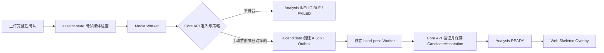
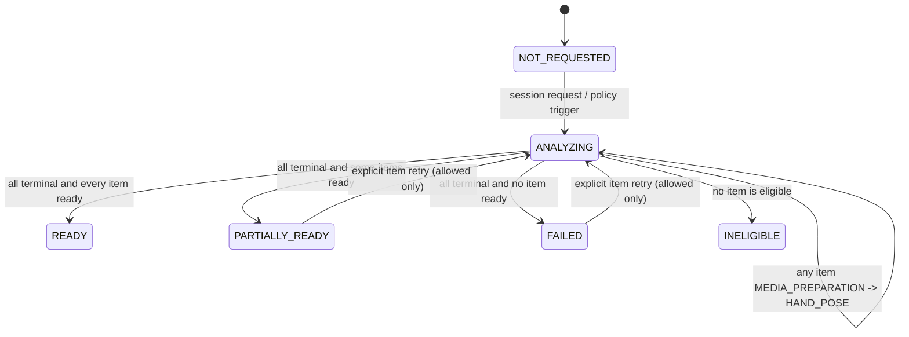

# 舱内多机位 Hand Pose Analysis 编排技术设计

> 版本：TD-HP-ANALYSIS-V1  
> 状态：V1.16 实施前设计；受 V1.15 Phase A `GO` 门禁约束  
> 对齐需求：[V1.16](../../requirements/baselines/V1.16/配药视频数据管理平台需求文档_V1.16.md) 与 [V1.15 Phase B](./hand-pose-candidate-phase-b.md)
> 日期：2026-08-10

> 历史状态：SUPERSEDED。当前单视频优先、归组、权限、状态和容量规则以 [V1.18 当前技术设计](../video-hand-pose-mvp-technical-design.md) 为准。

## 1. 目的与边界

本文在不改变 V1.15 候选事实、安全和人工审核边界的前提下，定义“自动媒体技术检查 + 单一手部姿态
检测入口”的服务端编排。它不是第二套 AI 平台：`assetcapture` 继续拥有资产和媒体检查，`aicandidate`
继续拥有 AIJob、候选和分析意图，`integration` 只负责 Outbox/RabbitMQ 适配。

设计目标是浏览器只请求或读取产品语义，Core API 持久化并恢复整个流程。浏览器不是工作流引擎，不能串联
媒体检查、AIJob 创建和 Worker 调用。



本文中的输入是获批舱内固定/多机位 `CameraStream`，不是佩戴在操作者身上的相机。一次采集的
`CameraSetSnapshot` 定义动态数量 `N`，每条 `ClipAsset` 独立产生一个分析与候选结果，前端在该视频自身
的播放器上叠加；多路相机同时采集不改变这一边界。本版本不做跨相机同步、同一只手跨机位身份关联、三角化
或结果融合。任何实现不得假定 `N = 3`。

用户可见名称不新建第二个相机 ID：同一 `CameraSetSnapshot` 中按持久化 `camera_index` 升序排列后，
第 1、2、3 路分别显示为“相机 1、相机 2、相机 3”。`camera_index`、`camera_channel_id` 和 UUID 继续
承担内部关联与审计；显示号码是稳定的派生值，不能因上传到达顺序、媒体状态或分析状态重新编号。

没有书面 Phase A `GO`、获批模型/Golden Set 证据和 V1.15 的 Phase B 冻结项时，所有触发器必须保持关闭。
本文不授权向用户启用自动分析。

## 2. 所有权与持久化模型

### 2.1 Session 批量分析与单路投影

在 `aicandidate` 模块增加 `SessionHandPoseAnalysis` 批量聚合和其下的 `HandPoseAnalysis` 单路投影，
保存面向产品的分析意图和公开状态，而不复制 AIJob、媒体任务或候选真值。它们是等待媒体准备、页面离开、
自动策略恢复和聚合进度所必需的持久化事实。

`SessionHandPoseAnalysis` 在创建时冻结本次 CaptureSession 的 CameraStream/ClipAsset 快照。最小字段：

```text
analysis_id
project_id / capture_session_id
profile_sha256 / profile_schema_version（创建后冻结）
trigger = MANUAL | PROJECT_POLICY
policy_snapshot = MANUAL | AUTO_FOR_APPROVED_CAMERA
requested_by（人工触发）/ requested_at
public_state / public_stage / public_reason_code
total_camera_count / completed_count / ready_count / failed_count / ineligible_count
created_at / updated_at / terminal_at / correlation_id
```

每个批量分析包含一项不可变的 `camera_stream_id / clip_asset_id / camera_index / input_sha256` 快照；它不因
之后新增、删除或重排序的相机而变化。`HandPoseAnalysis` 是每项的单路投影，字段包含单路输入摘要、公开
状态/stage/reason、`retry_allowed`、媒体任务引用和 AIJob 引用。单路自然键至少为
`(project_id, clip_asset_id, input_sha256, profile_sha256)`；批量自然键至少为
`(project_id, capture_session_id, camera_set_snapshot_id, profile_sha256)`。同一自然键只能有一个非终态分析；
终态重试使用同一冻结输入/profile 的明确重试语义，profile 或输入变化必须创建新自然键。`AIJob` 仍是执行
真值，`CandidateAnnotation` 仍是候选真值；这两个 Analysis 记录只投影用户可见过程。

为 HTTP 命令保留 Idempotency receipt，键为 `(project_id, idempotency_key)`，记录请求指纹和 analysis ID。
自然键命中与并发冲突必须在事务内读取既有分析并建立 receipt，不能向调用方暴露数据库约束异常。

### 2.2 模块协作

| 事实 | 所有模块 | 允许协作方式 |
| --- | --- | --- |
| 上传、ClipAsset、CameraStream、媒体任务/报告 | `assetcapture` | 公开应用服务与版本化领域事件/只读摘要。 |
| 分析意图、AIJob、候选、候选审核 | `aicandidate` | 本模块事务；正式 revision 仅调用 `annotationreview` 公开服务。 |
| Outbox、RabbitMQ publisher、外部 Worker transport | `integration` | 适配器；不拥有业务状态。 |
| 网页状态与 Overlay | Web | 只消费公开 REST 投影和候选读取合同。 |

禁止 `aicandidate` 直接写媒体表，也禁止 `assetcapture` 直接写 AIJob/候选表。跨模块事件携带最小、脱敏的资产/媒体
结果引用；接收方再次读取授权的只读摘要并在自身事务内决定状态。

## 3. 编排与状态机

### 3.1 触发器

1. 上传完整性确认后，`assetcapture` 在其资产事务内 `ensureMediaProbe` 并创建/复用相应 Outbox 事实。
   重复上传完成事件只得到既有或等价的媒体任务。
2. `MANUAL`：用户调用 Session analysis facade。`aicandidate` 记录本次相机快照和每路
   `ANALYZING/MEDIA_PREPARATION` 意图，并请求 `assetcapture` 确保各路媒体检查；不等待 Worker，不由
   浏览器逐路继续调用。
3. `AUTO_FOR_APPROVED_CAMERA`：CaptureSession 的相机快照可确定后，Core API 以 `PROJECT_POLICY` 幂等地
   创建/复用批量分析及其相机路项；每路媒体结果事件只更新对应项。这样即使媒体陆续到达、进程重启或页面从未
   打开，服务端仍保存完整批量意图。策略、相机角色、授权或媒体条件不满足的路不创建 AIJob，但必须保留安全原因。
4. 某路媒体成功事件到达已有批量意图后，`aicandidate` 重新检查该路输入摘要、CameraStream、项目/角色
   授权与 profile，成功才在同一 `aicandidate` 事务创建该路 AIJob、attempt、Outbox 与审计。

所有事件处理都使用消费端幂等记录；事件乱序、重复、服务重启和延迟不改变已经更高版本的终态。

### 3.2 公开状态



`NOT_REQUESTED` 可以由查询按“无 Session analysis 记录且当前 Session 可判断”为合成状态返回，不要求预先
给每个 Session 建空记录。`INELIGIBLE` 是业务守卫拒绝，`FAILED` 是本次可执行流程的失败；两者不得混用。
`PARTIALLY_READY` 是批量分析的明确终态，不以一个绿色“完成”掩盖其他相机路的失败。

内部 `media_job`、`AIJob`、attempt、lease、message 和 Worker 生命周期映射为上表，不能直接成为 REST
状态枚举。`ANALYZING` 只暴露 `MEDIA_PREPARATION` 或 `HAND_POSE`。状态更新使用乐观版本或条件更新，
AI 迟到结果只能在对应 analysis/attempt 仍有效时把状态迁移到 `READY`。

### 3.3 故障与重试

| 情况 | 编排行为 | 对外结果 |
| --- | --- | --- |
| 媒体尚未完成 | 保持意图并等待媒体结果事件 | `ANALYZING/MEDIA_PREPARATION` |
| 媒体永久失败 | 不创建 AIJob | `FAILED`，安全媒体错误码 |
| 非获批舱内相机 / 无授权 | 不创建 AIJob | `INELIGIBLE`，稳定原因码 |
| 可重试 Worker 失败 | 按 V1.15 既定 attempt/lease 策略重试 | 持续 `ANALYZING/HAND_POSE` 或最终 `FAILED` |
| 失联或迟到回传 | 回收旧 attempt；Core 拒绝过期 lease 的提交 | 不出现错误 READY |
| 用户显式重试 | 事务内重验准入和冻结输入/profile | 新 attempt 或既有活动分析 |

禁止用前端轮询触发重试，禁止以重新发布旧 lease body 实现恢复。Outbox publisher confirm 后，所有 AI
payload 必须按 V1.15 脱敏 capability；日志、DLQ、审计和 REST 均不保留明文 token/URL。

## 4. API 和事件契约

实现前更新 `contracts/openapi/openapi.yaml`；任何跨进程消息新增或变化同步更新 JSON Schema 和兼容性测试。
以下为形状约束，字段名以最终 OpenAPI 为准：

```http
POST /api/v1/projects/{projectId}/capture-sessions/{sessionId}/hand-pose-analysis
Idempotency-Key: <opaque client key>

GET /api/v1/projects/{projectId}/capture-sessions/{sessionId}/hand-pose-analysis
```

查询响应只含：

```json
{
  "state": "ANALYZING",
  "stage": "HAND_POSE",
  "completed_count": 4,
  "total_camera_count": 6,
  "cameras": [{"camera_stream_id": "<opaque id>", "display_name": "相机 1", "state": "READY"}],
  "updated_at": "2026-08-10T00:00:00Z"
}
```

`state`、`stage`、`reason_code` 和错误响应须枚举化；`reason_code` 同时服务用户安全文案与测试断言。
允许的媒体完成事件应包含事件 ID、资产 ID、冻结输入摘要、结果版本和安全状态，不携带播放 URL、对象存储
位置或 capability。事件消费者验证摘要仍与当前资产一致后才能推进分析。

项目策略管理 API 仅在书面 `GO` 后加入。命令要求项目 ADMIN Membership、版本并发保护、原因和审计；
策略读取面向管理入口，不放进普通用户资产卡片。

## 5. Worker 与候选事实

AIJob 创建、Worker 领取/心跳、输入下载大小/SHA-256 验证、严格 PTS、完整 profile、帧级结果语义、
结果回传、人工审核和 capability 脱敏完全继承 [Phase B 技术设计](./hand-pose-candidate-phase-b.md)。本设计
不得通过“产品 facade”降低这些门槛。

Worker 成功只代表候选已被 Core API 验证并持久化；只有在候选完整性、input/profile 摘要和有效 attempt
均校验通过后，才可发布 analysis `READY`。一份部分或重复回传不得覆盖已存在的候选事实。

### 5.1 二维手部 Overlay 的输出边界

每个被选中的视频帧按冻结 profile 调用 MediaPipe Hand Landmarker。结果必须保留三种不同事实：

| 帧事实 | 结果要求 | 网页效果 |
| --- | --- | --- |
| 未执行推理 | `inference_performed=false` | 不绘制，不能伪装为无手。 |
| 已推理、未检测到手 | `inference_performed=true` 且 `hands=[]` | 不绘制手框或骨架。 |
| 已推理、检测到 1/2 手 | 每只手含 handedness、分数、bbox、21 个 landmark 和有效点数 | 绘制 bbox、骨架、点位和左右手标签。 |

这是“视频中有手就标出手”的二维候选效果，和参考图中原始画面上的手部骨架一致。bbox 来自冻结的
landmark 包络算法，handedness score 仅为类别分数，不能被表述成 bbox 检测置信度。无效 NaN/Inf 点及其
连接线不绘制，但同一帧其余有效点仍可展示。

本设计不实现参考图可能包含的三维/空间视图：V1.16 不启用 world landmarks、跨相机匹配、相机标定、
三角化或 3D 轨迹重建。它们需要独立的输入标定事实、时间同步精度、坐标系、误差阈值和人工验收，不能由
二维 MediaPipe Overlay 隐式推断。

## 6. Web 交互与 Overlay

### 6.1 分析卡片

CaptureSession 详情新增或收敛为一个“手部姿态检测”区域；相机列表按服务端返回的实际 `N` 路动态生成，
不写死 Tab 数量。资产详情只呈现当前选中相机路的状态、播放和单路重试：

| 返回状态 | 页面内容 |
| --- | --- |
| `NOT_REQUESTED` | “待检测”与唯一主按钮“检测全部相机手部姿态”。 |
| `ANALYZING` | “已完成 4/6；正在准备视频/正在识别手部”；不显示内部任务号。 |
| `READY` | “全部可分析相机已完成”；选择任一相机查看 Overlay。 |
| `PARTIALLY_READY` | “部分相机已完成”；逐路显示安全失败原因及可用的“重试此相机”。 |
| `FAILED` | 安全文案；仅失败相机 `retry_allowed=true` 时显示“重试此相机”。 |
| `INELIGIBLE` | “没有符合手部姿态检测条件的相机”，使用 reason_code 映射文案。 |

页面在可见且 `ANALYZING` 时以有上限、退避的低频刷新读取查询接口；终态、页面隐藏和卸载时停止。刷新只更新
视图，不能驱动业务转换。

同一采集包含多路视频时，资产/Session 页面先按 `camera_index` 固定顺序列出接口返回的“相机 1 … 相机 N”，
用户选择其中一路后才播放该路原始视频及该路 Overlay。相机较多时用可横向滚动的相机选择栏或下拉选择；
不得将不同相机的 landmark 同时叠加到一个播放器，也不得因其中一路失败遮蔽其他路的状态。

### 6.2 Skeleton Overlay

新增独立 `HandPoseOverlay` 展示组件，不在页面组件内复制坐标/骨架算法。组件接收当前视频元数据、最近帧
候选和 Overlay 开关，按以下顺序绘制：bbox、骨架连线、有效 landmark、左右手与分数标签。骨架拓扑固定为：

```text
0-1-2-3-4
0-5-6-7-8
5-9-10-11-12
9-13-14-15-16
13-17-18-19-20
0-17
```

使用 SVG `viewBox="0 0 image_width image_height"`，以 landmark 归一化坐标乘原视频宽高得到像素坐标。
stage 的宽高比从 `videoWidth/videoHeight` 动态取得，不能硬编码 16:9。若播放器有 `object-fit: contain`
黑边，Overlay 必须测量并使用真实视频内容矩形（`ResizeObserver` 或等价方式），而不是简单覆盖外层容器。

候选按 `frame_timestamp_ms` 分组；播放时只取当前播放时刻最近的一组，超过已冻结容忍窗口则不绘制。
优先 `requestVideoFrameCallback()` 同步视频帧，浏览器不支持时降级到 `requestAnimationFrame`/`timeupdate`，并在
卸载时取消回调。播放刷新频率不能伪造超过候选采样率的推理事实。

页面默认只播放用户选中的一路原视频；其余相机路只作为动态选择项及状态摘要，不自动同时播放或预加载。
参考图中的多面板布局不是首版验收要求：首版以“选中相机的视频 + 同步二维 Overlay”完成可用闭环。

## 7. 实施顺序与验证

1. 完成 V1.15 Phase A 加固、Golden Set 评估、书面 `GO`，并冻结 V1.15 Phase B 未决项；未完成前不启用。
2. 更新 OpenAPI、事件 schema、状态机、错误码与契约测试；新增 `HandPoseAnalysis` 迁移、所有权和审计测试。
3. 在 `assetcapture` 实现上传完整性确认后的幂等 `ensureMediaProbe`，验证重复/并发上传完成不重复入队。
4. 在 `aicandidate` 实现 Session facade、批量/单路持久化意图、媒体完成事件消费、自动策略、舱内相机守卫和每路 AIJob/Outbox 原子创建。
5. 完成 Worker 与 Core API 的回传、lease、脱敏、帧级事实和人工审核闭环；不得跳过 V1.15 验收。
6. 收敛 Web 为一个分析卡片和 `HandPoseOverlay`，添加组件、错误映射、键盘/动态状态和浏览器测试。
7. 用 2、4、6、8 路合成 MP4 执行跨进程 E2E：上传、自动媒体检查、Session 手动及自动策略、RabbitMQ、
   Worker、回传、刷新/离页恢复、动态相机选择、1/2 手 Overlay、单路失败/重试和无 capability 泄露。

每一项只在前一项有可执行证据后推进；不得因已有草稿 Worker 或页面而跳过 `GO`、契约、迁移或 E2E。
