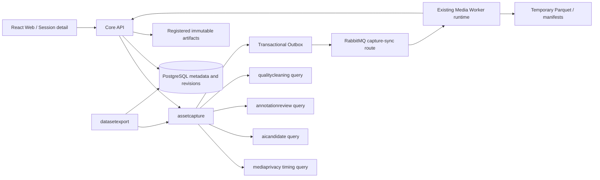
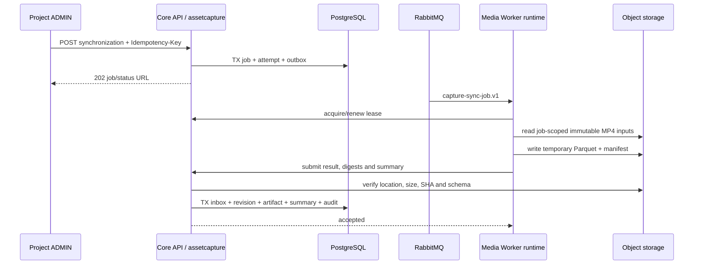

# 固定多相机同步逐帧训练数据技术设计（V1.19 草案）

> 版本：TD-MULTICAMERA-SYNC-V1.19-DRAFT.3<br>
> 状态：草案；尚非当前规范，不授权开始 V1.19 编码  
> 日期：2026-08-12  
> 对齐需求：[V1.19 需求草案](../requirements/drafts/V1.19/配药视频数据管理平台需求文档_V1.19_DRAFT.md)  
> G0 证据：[V1.19 G0 Golden Capture 验证报告](../validation/v1.19-g0-golden-capture.md)
> 当前正式设计：[V1.18 手部预标注优先技术设计](./video-hand-pose-mvp-technical-design.md)  
> 相关规范：[时间基准与多相机同步](./timebase-and-multicamera-sync.md)、[异步作业协议](./asynchronous-job-protocol.md)、[领域模型与数据所有权](./domain-model-and-data-ownership.md)
> 修订说明：DRAFT.3 依据 G0 冻结有理数 half-even 时间换算、nearest tie-break、Canonical logical row v1、排序和 provenance；timeline rate、reference、tolerance 数值、正式同步 profile、Parquet 物理布局和 Worker 容量仍为 `PENDING`，因此尚不授权 S2。

## 1. 设计结论

V1.19 在现有 Spring Modulith、PostgreSQL、S3-compatible storage、RabbitMQ 和 Python Worker 拓扑内增加一个纵向切片：

```text
CaptureSession + CameraSetSnapshot + CameraStream + immutable MP4
→ Capture synchronization job
→ immutable CaptureSyncRevision
→ canonical synchronized-frame Parquet
→ bounded Core API query
→ [P1] Session detail synchronized playback
→ [P1] DatasetVersion freezes the accepted sync revision
```

本设计冻结以下方向：

1. `capture_id` 是现有 `capture_session_id` 的产品别名，`video_id` 是 `clip_asset_id` 的产品别名；不创建第二套身份。
2. 现有 OpenAPI 已有 `/capture-sessions` 列表和详情。V1.19 在该资源下增加同步子资源，不再创建语义重复的 `/captures` 路由。
3. Capture 同步由 `assetcapture` 拥有；`integration` 只负责消息和对象存储适配，不拥有同步真值。
4. 同步结果以不可变 revision 表达。重新同步创建新 revision，旧标注和冻结数据集继续引用旧 revision。
5. PostgreSQL 保存作业、状态、摘要、revision、工件元数据和有界查询索引；完整 Frame Slot 矩阵进入版本化 Parquet。
6. V1.19 只做基于时基和 PTS 的时间对齐，不做图像内容对齐、跨相机关联或三维融合。
7. Canonical synchronized-frame artifact 只证明同步结构与血缘，不自动成为可用训练标签。

## 2. 与现状的兼容处理

### 2.1 身份与编号

现有数据库使用 `capture_session_id`、`camera_index`（0～63）和 `clip_asset_id`；V1.18 产品语言使用 `capture_id`、`camera_number`（1～64）和 `video_id`。映射固定为：

```text
capture_id   = capture_session_id
camera_number = camera_index + 1
video_id     = clip_asset_id
```

`camera_number` 只能从冻结的 `CameraSetSnapshotMember.camera_index` 投影，不从实际到达顺序计算。外部 manifest 的 `expected_camera_numbers` 必须在接入/对账阶段与冻结 snapshot 的启用成员一致；冲突时拒绝绑定或进入明确异常状态，不选择任一方静默覆盖。

### 2.2 时间单位

现有标注和播放器规范以整数毫秒表达 `t_stream_ms`、`t_session_ms`；V1.19 Canonical Artifact 使用整数纳秒字段以避免交换格式丢失媒体时基信息。兼容规则为：

- 同步计算内部使用有理数 PTS，最终按 G0 已验证的 `ROUND_HALF_EVEN` 转换为 `int64 ns`；
- `_ns` 表示存储单位，不表示设备具备纳秒测量精度；必须同时保存 `time_basis_source`、`time_precision_ns` 或不确定度；
- 现有 AnnotationRevision 继续使用整数毫秒，不做破坏性迁移；从同步纳秒到既有标注毫秒的投影规则是独立决策，本轮没有 AnnotationRevision 往返证据，继续为 `PENDING` 并进入后续 profile digest；
- 原始 `pts`、`time_base_num`、`time_base_den` 和同 PTS ordinal 保存在输入/工件 manifest 中，不能只保留换算后值。

### 2.3 现有数据集能力

现有 `DatasetVersion`、member session/stream、build specification、snapshot、validation、freeze、export 和审批流程继续使用。V1.19 只向冻结证据增加已接受的 `CaptureSyncRevision` 和 Canonical Artifact 摘要；不得创建第二套 DatasetVersion 或绕过现有冻结审批。

生成同步 Parquet 不会放宽当前 dataset admission。缺路 Capture 可以生成结构化同步证据，但能否进入正式 DatasetVersion 仍由版本化准入 profile、人工标注、Review 和 Cleaning 守卫决定。

### 2.4 交付优先级

核心 P0 只闭合 `Capture → Timeline → Frame Slot → Sync Revision → Canonical Parquet → Artifact Provenance`。有界查询只服务验收、排障和后续消费者。完整多机位同步播放与 DatasetVersion 深度集成为 P1，不能与核心 P0 同时铺开。

## 3. 组件与事实流



### 3.1 模块所有权

| 模块 | 新增/扩展责任 | 禁止事项 |
| --- | --- | --- |
| `assetcapture` | 同步命令、job/attempt、同步 profile 引用、`CaptureSyncRevision`、逐路映射摘要、同步工件注册和查询端口 | 不写 AI Candidate、正式 Annotation、Cleaning 或 DatasetVersion 表 |
| `mediaprivacy` | 通过公开查询提供已验证 MediaReport、PTS/time-base 摘要和媒体可读性 | 不写 Capture 同步状态 |
| `aicandidate` | 通过公开查询返回 AIJob、Attempt、采样时间和 Candidate 血缘 | 不把 Frame Slot 变成正式标注 |
| `annotationreview` | 继续拥有正式 revision；只有同步多机位场景创建/投影的 revision 才可选引用 `sync_revision_id` | 不强制既有或单视频 AnnotationRevision 绑定同步修订；不写同步工件或数据集 |
| `qualitycleaning` | 提供当前 CleaningRun/Result 事实 | 不因同步成功自动 PASS |
| `datasetexport` | 在既有 DatasetVersion 构建快照中冻结同步 revision/artifact 引用，生成正式训练数据包 | 不重新计算或覆盖 Capture 同步真值 |
| `governance` | 同步重跑、高风险工件/数据集操作的审计和既有审批 | 不拥有业务状态 |
| `integration` | RabbitMQ、对象存储和 Worker 端口/适配器 | 不拥有同步 revision 或 Frame Slot 业务真值 |

跨模块写入只通过公开应用服务或版本化事件；跨模块读取使用公开查询接口或明确只读投影。Worker 不连接业务数据库。

## 4. 领域模型

以下是 S1 拟冻结的逻辑模型。表名和列约束必须在实现阶段通过新的前向 Flyway migration 落地；当前仓库尚不存在这些表。

### 4.1 CaptureSyncJob

一个业务 job 表示对一组冻结输入按一个 profile 生成一个同步 revision。建议字段：

```text
capture_sync_job_id
project_id
capture_session_id
input_manifest_sha256
sync_profile_key
sync_profile_sha256
algorithm_key
algorithm_version
status                    QUEUED | RUNNING | SUCCEEDED | FAILED
idempotency_key
request_fingerprint
requested_by
created_at / updated_at
row_version
```

唯一业务键：

```text
project_id
+ capture_session_id
+ input_manifest_sha256
+ sync_profile_sha256
+ algorithm_version
```

相同冻结输入和 profile 复用既有 job；可重试失败创建新 Attempt，不创建第二个业务 job。输入、profile 或算法版本变化时创建新 job 和新 revision。

### 4.2 CaptureSyncJobAttempt

```text
capture_sync_job_attempt_id
capture_sync_job_id
attempt
message_id
status                    QUEUED | LEASED | RUNNING | SUCCEEDED | FAILED | LOST
lease_token_hash
worker_id
lease_started_at / lease_until / last_heartbeat_at
error_class / error_code / safe_error_message / retryable
started_at / completed_at
```

`(capture_sync_job_id, attempt)` 和 `message_id` 唯一。租约、heartbeat、恢复、迟到结果和 DLQ 语义完全复用现有异步作业协议。

### 4.3 CaptureSyncRevision

只有被 Core API 验证并接受的成功结果才能创建 revision：

```text
capture_sync_revision_id
capture_sync_job_id
capture_sync_job_attempt_id
project_id
capture_session_id
supersedes_sync_revision_id nullable
reference_camera_number nullable
reference_clock_source
time_basis_source
capture_origin_utc nullable
time_precision_ns nullable
timeline_rate_numerator / timeline_rate_denominator
timeline_step_numerator_ns / timeline_step_denominator
allowed_tolerance_ns
algorithm_key / algorithm_version
sync_profile_key / sync_profile_sha256
input_manifest_sha256
artifact_id
logical_content_sha256
camera_count_expected / camera_count_received
sync_frame_count
present_frame_count / missing_frame_count / invalid_frame_count
max_sync_error_ns nullable
p95_sync_error_ns nullable
processing_duration_ms
created_at / created_by
```

Revision 不提供 update 接口。`supersedes_sync_revision_id` 只表达演进链，不使旧 revision 失效或被删除。Capture 读模型可以指向当前接受的 revision。DatasetVersion 使用同步数据时必须保存实际采用的 sync revision ID；`AnnotationRevision.sync_revision_id` 为 nullable，只有同步多机位视图中创建、编辑或投影的标注才保存实际使用的 revision ID，既有和单视频标注保持为空。

### 4.4 CaptureSyncStreamRevision

每个冻结的预期相机保留一行，包括完全缺路的相机：

```text
capture_sync_stream_revision_id
capture_sync_revision_id
camera_set_snapshot_member_id
camera_number
camera_stream_id nullable
clip_asset_id nullable
stream_presence_state       PRESENT | MISSING | INVALID
source_input_sha256 nullable
source_media_report_id nullable
source_time_base_digest nullable
anchor_source_pts_ns nullable
anchor_capture_timestamp_ns nullable
drift_ppm nullable
present_frame_count
missing_frame_count
invalid_frame_count
max_sync_error_ns nullable
p95_sync_error_ns nullable
```

`drift_ppm = null` 表示未测量，不得用 `0` 伪装成已确认无漂移。

### 4.5 CaptureSyncArtifact

```text
capture_sync_artifact_id
capture_sync_revision_id
artifact_role              SYNCHRONIZED_FRAME_PARQUET
schema_version
file_name
media_type                 application/vnd.apache.parquet
size_bytes
sha256                     physical artifact digest
logical_content_sha256
storage_bucket / object_key
artifact_manifest
artifact_manifest_sha256
created_at
```

对象位置仅限服务端和获授权 Worker 使用，普通产品 API 不返回。工件注册后不可覆盖；对象键和摘要必须唯一，销毁走既有 governance 保留流程。

`artifact_manifest` 保存可支持有界查询的分段范围摘要，以及 writer/runtime、Schema、排序、压缩、输入 manifest 和 profile digest。具体采用 row group、sidecar 或其他索引方式在 Golden Capture 后冻结；manifest 不复制每一行 Frame Slot。

## 5. 输入冻结

创建同步 job 前，`assetcapture` 在一个 Core API 事务中冻结规范化输入 manifest。至少包括：

```text
capture_session_id
camera_set_snapshot_id + snapshot digest
expected camera members and camera_number
each CameraStream ID / ClipAsset ID / raw SHA-256 / size / content type
each accepted MediaReport ID / input digest / timing digest
edge-declared clock observations with explicit source
selected sync profile key + SHA-256
algorithm key/version
```

缺路相机仍进入 manifest，但没有 `camera_stream_id`、`clip_asset_id` 或媒体摘要。只有属于同一 project/Capture、未删除且输入摘要稳定的视频可以进入 job。

输入 manifest 使用字段排序、UTF-8、LF 和无多余空白的规范化序列计算 SHA-256。Worker 返回的 `input_manifest_sha256` 必须与 job 一致；任何媒体摘要、snapshot、profile 或算法变化都拒绝结果提交。

## 6. 同步算法设计（G0 已验证部分规则）

### 6.1 支持范围

本节给出经 Golden Capture 验证的算法形状和仍待确认的生产参数。方向是“基于媒体 PTS 与获批准 offset/drift/anchor 的固定有理数时间步 + 有误差记录的邻近帧映射”；它支持固定 FPS、不同 FPS 和 VFR，不使用文件数组 index、时间邻近猜测或未经批准的图像内容对齐。

G0 后以下内容仍为 `PENDING`：

```text
algorithm_key / algorithm_version
timeline rate/step 的具体值
allowed_tolerance_ns
warning/reject tolerance
reference clock/stream rule
capture-sync profile key/version
```

G0 已冻结：有理数 PTS/timeline/affine 计算使用 `ROUND_HALF_EVEN`；每个 timeline position 从
`origin + exact rational index × step` 独立换算，禁止反复累加已舍入的整数 interval；nearest
同误差按 earlier PTS、较小 source frame index、较小 same-PTS ordinal 消歧；
`abs(sync_error_ns) <= allowed_tolerance_ns` 才允许 `PRESENT`。最终参数值进入服务器批准且有
摘要的 profile；调用方始终不能提交任意算法参数。生产 rate/reference/tolerance 未冻结，因此
正式 profile v1 仍为 `PENDING`。

### 6.2 媒体时间

对每路视频保存并验证：

```text
raw_pts
time_base_num / time_base_den
pts_ordinal
source_pts_ns = ROUND_HALF_EVEN((raw_pts - pts_origin) × time_base_num / time_base_den × 1e9)
```

`pts_origin`、舍入方式和重复 PTS 处理进入 profile/manifest。DTS 只作解码诊断；展示和同步使用 PTS。PTS 缺失、非单调、重复、回退和 gap 按现有时间基准规范生成明确质量证据。

### 6.3 映射到 Capture 时间

每路使用带锚点的仿射映射：

```text
scale = 1 + drift_ppm / 1_000_000

t_capture_ns =
    anchor_capture_ns
    + ROUND_HALF_EVEN((source_pts_ns - anchor_source_pts_ns) × scale)
```

只有一个可靠锚点时 `drift_ppm = null`，计算按 offset-only 规则执行。多锚点拟合必须保存方法、残差、异常点规则和测量误差。

### 6.4 Reference 与时间轴边界候选

reference 可以来自可靠公共 Capture clock，也可以来自一条获批准的已验证 stream。选择哪一种、stream 的选择优先级以及 reference 缺失时的处理均为 `PENDING`；“最小可用 `camera_number`”只能作为 Golden Capture 的对照候选，不能在评审前成为正式规则。最终选择必须写入 revision，不能在页面查询时重新计算。

时间轴采用已冻结的有理数换算形状，但 rate/step 具体值仍为 `PENDING`：

```text
capture_timestamp_ns(i) =
    origin_ns
    + ROUND_HALF_EVEN(i × timeline_step_numerator_ns / timeline_step_denominator)
sync_frame_index(i) = i, i >= 0
```

revision/profile 必须保存准确的 rate/step 分子、分母。只有 step 可被整数纳秒精确表达时才可仅
保存 `timeline_interval_ns`；G0 的 30 Hz `100,000,000/3 ns` 证明该字段不能作为通用唯一事实。

无论最终选择何种 reference，都不得使用服务器接收时间补齐。reference 不可用时是失败、降级还是改用另一个获批准来源，必须由 Golden Capture 结果和版本化 profile 冻结。

### 6.5 Frame 选择规则与待确认参数

G0 已用以下 nearest-frame 流程完成对照：

1. 缺少 CameraStream：生成 `MISSING`；
2. 将目标 Capture 时间反向映射到 source time；
3. 在该 stream 中选择绝对误差最小的可展示 PTS；
4. 同误差按 earlier PTS、较小 source frame index、较小 same-PTS ordinal 选择；
5. `abs(sync_error_ns) > allowed_tolerance_ns`：生成 `MISSING`；等于边界仍允许 `PRESENT`；
6. 命中媒体位置但解码/PTS 校验失败：生成 `INVALID` 和稳定原因码；
7. 其余生成 `PRESENT`，保存源帧定位和带符号 `sync_error_ns`。

G0 已验证 nearest-frame、tie-breaker 和边界包含关系；tolerance 数值未冻结。其他已冻结不变量为：误差必须记录；超出获批准误差时明确 `MISSING`；禁止线性插帧、静默复用上一帧/下一帧、压缩 `sync_frame_index` 或改变 Camera 编号。

### 6.6 状态不变量

```text
frame_state = MISSING or INVALID
→ hand_detection_state = NOT_RUN

hand_detection_state = HANDS_DETECTED
→ ai_job_id, model_sha256, profile_sha256 and candidate reference are non-null

hand_detection_state = NO_DETECTION
→ accepted AI attempt proves inference ran successfully

hand_detection_state = NOT_RUN
→ no AI conclusion is inferred
```

V1.18 Candidate 使用 `clip_asset_id + frame_timestamp_ms`。V1.19 通过明确的时间换算和容忍窗口投影到 Frame Slot；匹配规则、窗口和 tie-breaker 进入 artifact schema/profile。映射不修改原 `CandidateAnnotation`。

## 7. Canonical Logical Row V1 与 Parquet 候选

本节与可执行 [`synchronized-frame-v1.schema.json`](../../contracts/schemas/synchronized-frame-v1.schema.json) 冻结逻辑粒度、身份、状态、空值、排序和 provenance。G0 的 Python/PyArrow 物理类型验证没有覆盖跨语言或目标规模，不冻结文件名、具体物理类型、压缩、dictionary、row group、partition 或 writer/runtime。

### 7.1 主表粒度与排序

一行表示一个同步修订中一个 Sync Frame 的一个预期 Camera Slot。`synchronized-frames.parquet` 仅为候选文件名。

主键语义和物理排序：

```text
(capture_id, sync_revision_id, sync_frame_index, camera_number)
```

单个 artifact 只属于一个 Capture 和一个 sync revision，但仍在行内保留二者以支持独立读取、拼接和血缘校验。任何主键重复、Camera 数不等于冻结预期数、排序不稳定或行数不等于 `sync_frame_count × expected_camera_count` 都使结果不可接受。

### 7.2 字段

字段存在性、可空性与逻辑规则已冻结；下表 Parquet 物理类型仍为候选，必须在目标规模、Java/
跨语言和对象存储验证后另行批准。

| 字段 | 候选 Parquet 逻辑类型 | 可空 | 逻辑规则 |
| --- | --- | --- | --- |
| `schema_version` | UTF8 | 否 | 逻辑契约值 `synchronized-frame.v1` |
| `capture_id` | UTF8 UUID | 否 | 等于 `capture_session_id` |
| `capture_group_key` | UTF8 | 是 | 外部显式归组存在时填写；平台本地上传可空 |
| `sync_revision_id` | UTF8 UUID | 否 | 不可变同步修订 |
| `sync_frame_index` | INT64 | 否 | 从 0 连续递增 |
| `capture_timestamp_ns` | INT64 | 否 | revision 相对时间轴；精度见工件 metadata |
| `camera_number` | INT32 | 否 | 1～64，等于冻结 `camera_index + 1` |
| `camera_stream_id` | UTF8 UUID | 是 | 缺路时空 |
| `video_id` | UTF8 UUID | 是 | 缺路时空；等于 `clip_asset_id` |
| `source_frame_index` | INT64 | 是 | `PRESENT` 时非空，辅助定位 |
| `source_pts_ns` | INT64 | 是 | `PRESENT` 时非空 |
| `source_pts_ordinal` | INT32 | 是 | 同 PTS 多帧时消歧 |
| `frame_state` | UTF8 enum | 否 | `PRESENT/MISSING/INVALID` |
| `frame_reason_code` | UTF8 | 是 | `INVALID` 必填，`MISSING` 可记录稳定原因 |
| `sync_error_ns` | INT64 | 是 | `PRESENT` 必填；带符号 |
| `hand_detection_state` | UTF8 enum | 否 | `HANDS_DETECTED/NO_DETECTION/FAILED/NOT_RUN` |
| `ai_job_id` | UTF8 UUID | 是 | 实际运行 AI 时填写 |
| `candidate_count` | INT32 | 否 | 默认 0；最多 2 |
| `candidate_artifact_ref` | UTF8 | 是 | 仅为不含对象 key 的逻辑引用 |
| `annotation_revision_id` | UTF8 UUID | 是 | 有正式人工 revision 时填写 |
| `model_sha256` | FIXED_LEN_BYTE_ARRAY(32) | 是 | 实际运行 AI 时填写 |
| `profile_sha256` | FIXED_LEN_BYTE_ARRAY(32) | 是 | 实际运行 AI 时填写 |
| `artifact_created_at` | TIMESTAMP(MICROS, UTC) | 否 | 使用 job 冻结时间，所有行相同以保证重试稳定 |

21 点 landmark 不展开进主表。若容量评审决定输出 dense Candidate，则使用独立 `hand-candidates.v1` Parquet，以主键四元组加 `hand_index` 关联，并冻结 landmarks 的坐标系、形状和模型/profile 摘要。

### 7.3 文件与逻辑摘要

系统分别保存：

- `artifact_sha256`：最终 Parquet 文件字节摘要；
- `logical_content_sha256`：按 Schema 字段顺序、主键排序和规范空值编码计算的逻辑行摘要；
- `artifact_manifest_sha256`：Schema、row group、writer/runtime、压缩和输入血缘 manifest 摘要。

要使字节摘要可复现，writer/runtime 版本、ZSTD/其他压缩参数、dictionary、row-group 切分和 metadata 顺序必须进入 profile。未冻结这些参数前，只能承诺逻辑内容可复现，不能声称 Parquet 字节完全相同。

### 7.4 Row group 与查询索引候选

为了支持有界 Frame Slot 查询，artifact 必须提供可验证的区间索引，但是否使用 row group 边界、sidecar index 或其他 Parquet metadata 由 Golden Capture 测试决定。优先验证“不要拆散同一 Sync Frame 的 Camera slots”是否能降低查询复杂度和读放大；在取得数据前它不是正式约束。

索引方式、row-group 切分、目标行数和文件大小均为 `PENDING`。不得在没有目标相机数、时长和查询窗口数据时编造固定值。

## 8. 异步执行与结果提交

### 8.1 契约

G0 后只新增并冻结了 Canonical logical row v1。正式同步事件和 profile 因生产参数仍
`PENDING` 而不得创建；以下事件/profile 名称仍是草案候选：

```text
contracts/events/capture-sync-job-v1.schema.json
contracts/events/capture-sync-result-v1.schema.json
contracts/events/capture-sync-dead-letter-v1.schema.json
contracts/profiles/capture-sync-baseline-v1.json
```

当前已存在的逻辑契约：

```text
contracts/schemas/synchronized-frame-v1.schema.json
```

事件只携带 job、attempt、项目/Capture ID、输入/profile 摘要、批准算法版本和一次性租约令牌，不携带视频字节、对象 key、存储端点、患者信息或预签名 URL。

### 8.2 时序



复用现有 Media Worker 运行时，避免为了一个 job type 新建进程；RabbitMQ 使用独立 allowlisted routing key、并发和 DLQ。同步计算属于 `assetcapture` 的业务 job，Worker 运行时归属不改变表所有权。

### 8.3 结果接受守卫

1. job、attempt、租约、message ID 与当前执行匹配；
2. Capture、snapshot、streams、raw SHA、MediaReport 和 profile 摘要未变化；
3. 输出位于批准的临时前缀，大小、媒体类型和 SHA-256 匹配；
4. Parquet Schema、排序、唯一性、行数、状态/空值不变量通过；
5. summary 与实际行统计一致，P95/max 由有值样本计算；
6. writer/runtime 和算法版本位于批准清单；
7. 迟到、重复或旧 Attempt 结果由 Inbox 幂等吸收，不覆盖已接受 revision；
8. 审计和 revision/artifact 注册在同一数据库事务提交。

任何守卫失败都不得把临时对象注册为正式工件。临时对象清理由有界重试任务完成，不在业务事务中阻塞对象存储调用。

## 9. 状态机

### 9.1 Job

```text
QUEUED → RUNNING → SUCCEEDED
            └────→ FAILED(retryable) → new Attempt
            └────→ FAILED(final)
```

### 9.2 Capture 同步读模型

| 条件 | `sync_status` | 说明 |
| --- | --- | --- |
| 无接受 revision、无活动 job | `NOT_SYNCHRONIZED` | 尚未同步 |
| 无接受 revision、有 `QUEUED/RUNNING` job | `SYNCHRONIZING` | 正在生成首个 revision |
| 有接受 revision | `SYNCHRONIZED` | 继续展示当前 revision；另返回 `latest_job_status` |
| 无接受 revision、最新 job 最终失败 | `FAILED` | 返回稳定错误码和可重试性 |

已有 accepted revision 后重跑失败，不隐藏仍有效的旧 revision；读模型保持 `SYNCHRONIZED`，同时显示 `latest_job_status=FAILED`。新 revision 只有完整接受后才原子替换 `current_sync_revision_id` 投影。

## 10. Core API

OpenAPI server base 保持 `/api/v1`。现有资源：

```text
GET /projects/{project_id}/capture-sessions
GET /projects/{project_id}/capture-sessions/{capture_session_id}
```

V1.19 追加以下路径，不新增重复的 `/captures` 列表/详情：

```text
POST /projects/{project_id}/capture-sessions/{capture_session_id}/synchronizations
GET  /projects/{project_id}/capture-sessions/{capture_session_id}/synchronizations/{sync_job_id}
GET  /projects/{project_id}/capture-sessions/{capture_session_id}/timeline
GET  /projects/{project_id}/capture-sessions/{capture_session_id}/frames
```

### 10.1 Start synchronization

- 仅 ACTIVE project `ADMIN`；要求 `Idempotency-Key`；
- 请求只选择服务器已批准的 `sync_profile_key`，不能提交任意 tolerance/算法参数；
- 返回 `202`、job ID、状态和 status URL；相同业务键返回既有 job；
- 缺少可用 reference、snapshot/manifest 冲突、跨项目或输入不稳定使用稳定错误码。

### 10.2 Timeline

返回当前 accepted revision 的有界摘要，不返回全部 Frame Slot：

```text
capture_id
sync_status
current_sync_revision_id
latest_job_status
time_basis_source
capture_origin_utc
timeline_rate_numerator / timeline_rate_denominator
timeline_step_numerator_ns / timeline_step_denominator
sync_frame_count
first_capture_timestamp_ns
last_capture_timestamp_ns
expected_cameras[]
summary
```

无 accepted revision 时返回当前状态而不是伪造空时间轴。

### 10.3 Frames

稳定排序为 `(sync_frame_index ASC, camera_number ASC)`。查询参数：

```text
sync_revision_id optional; omitted = current accepted revision
from_sync_frame_index optional
camera_number optional repeatable
cursor optional
limit optional
```

`limit` 计 Frame Slot 行，默认值和最大值在 G0 测量、S1 评审后冻结。cursor 必须绑定 `sync_revision_id + sync_frame_index + camera_number + filters`，不能在 revision 变化后静默继续。响应只返回产品字段和逻辑引用，不返回 bucket、object key、row group、Worker 或租约。

Core API 通过 `SynchronizedFrameQueryPort` 读取 artifact manifest 和目标数据范围；具体索引/范围读取策略在 Golden Capture 后冻结。Web 不直接下载完整 Parquet，不在浏览器自行扫描或拼装业务真值。

### 10.4 安全与缓存

- 每个请求校验认证会话、ACTIVE Membership、project/Capture/revision 一致性；
- 跨项目详情按既有安全策略隐藏为 `404`，不泄露存在性；
- 动态状态响应 `Cache-Control: no-store`；不可变 revision 可使用显式 ETag，但仍逐请求鉴权；
- 内部对象地址、预签名 URL 和低层错误不进入普通响应、日志或指标 label。

所有路径、Schema、错误码和兼容规则必须同步更新 OpenAPI 与契约测试。

## 11. P1 Web 设计

不新增一套顶层信息架构。扩展现有：

```text
/projects/:projectId/sessions
/projects/:projectId/sessions/:sessionId
```

### 11.1 Session detail

在现有采集概况和 CameraStream 列表后增加“同步时间轴”区：

- 首次加载、同步中、同步失败、已同步、无 revision 和刷新中分别处理；
- 按冻结 snapshot 展示 Camera 1…N，缺路、未入库、无效和局部缺帧文案不同；
- 默认显示当前 accepted revision 和摘要；旧 revision 仅管理员在渐进披露区查看；
- 普通成员可读；管理员在输入就绪时看到“生成同步时间轴”或稳定失败后的重试入口；
- 不展示伪造百分比。没有可靠 total/progress 时只显示阶段和更新时间。

### 11.2 同步播放

1. 由 reference stream 驱动公共 playhead；
2. 客户端按当前 Capture 时间查询/缓存一个有界 Frame Slot 窗口；
3. 每路视频使用该 slot 的 source PTS seek；
4. `MISSING` 显示“该时刻无对应帧”，`INVALID` 显示稳定质量原因；
5. 不用上一帧静默冒充当前帧；若产品选择保留最近帧作视觉辅助，必须标成 stale preview，不能改变 Frame Slot 事实；
6. UI 解码/seek 偏差单独测量，不回写同步 revision。

优先使用现有播放器和浏览器能力，不引入新的播放器框架或状态管理库，除非第二个真实用例和性能证据证明必要。

### 11.3 可访问性与性能

- 相机状态不能只用颜色表达；矩阵、时间轴和错误必须有文本/图标双重表达；
- 键盘可切换机位、播放/暂停和移动时间窗口；状态变化通过已有 live region 规则通知；
- 首屏不预加载所有相机完整视频或完整 Frame Slot；采用服务端分页、窗口缓存和取消过期请求；
- 技术 ID、PTS、误差、模型/profile 摘要默认折叠，普通用户主线只显示业务状态。

## 12. P1 DatasetVersion 与正式训练数据

S7 扩展既有构建快照，使每个 `dataset_member_session` 冻结：

```text
capture_sync_revision_id
capture_sync_artifact_id
sync_profile_sha256
logical_content_sha256
```

构建前重验：

- revision 与 Capture/project 一致且未被销毁；
- artifact SHA、logical digest 和 Schema version 可验证；
- 每个纳入 stream 的 raw SHA 与既有 dataset member evidence 一致；
- DatasetVersion 同时冻结实际采用的 `capture_sync_revision_id` 和 `annotation_revision_id`；如果 AnnotationRevision 的 nullable `sync_revision_id` 有值，它必须与 DatasetVersion 选择一致；如果为空，则按 DatasetVersion 冻结的同步修订和获批准的换算 profile 生成导出投影，不回写原 AnnotationRevision；
- Review `APPROVED`、Cleaning `PASS` 和 LabelSchema digest 仍满足现有准入；
- missing/invalid camera 是否允许由 dataset build profile 明确，不能从同步成功推断。

现有 DatasetVersion 状态、管理员冻结审批、导出审批和短期下载授权不变。AI Candidate 只作为可选辅助列；没有人工正式标签的行不能标记为 ground truth。

## 13. 容量与运维

### 13.1 估算

```text
frame_slots_per_capture =
    duration_seconds × timeline_rate_hz × expected_camera_count

frame_slots_per_day =
    sessions_per_day × frame_slots_per_capture

parquet_bytes_per_day =
    frame_slots_per_day × measured_compressed_bytes_per_row

worker_hours_per_day =
    sessions_per_day × duration_seconds × measured_realtime_factor / 3600
```

上线前按平均/P95 时长、相机数、FPS/VFR、缺帧率、AI 采样率、查询窗口、保留期和对象存储复制开销测量。PostgreSQL 行数只随 job/revision/stream/工件分段索引摘要增长，不随每个 Frame Slot 线性增长。

### 13.2 指标

至少记录低基数指标：

```text
capture_sync_jobs_total{status,error_class}
capture_sync_duration_seconds{profile}
capture_sync_realtime_factor{profile}
capture_sync_frame_slots_total{state}
capture_sync_error_ns{profile,quantile}
capture_sync_artifact_bytes{schema_version}
capture_sync_result_rejections_total{reason_code}
capture_sync_lease_recoveries_total
```

不得把 project ID、Capture ID、对象 key、文件名或人员标识作为指标 label。详细 ID 只进入受控审计/trace 上下文。

### 13.3 恢复与保留

- Core API/Worker 重启通过 lease 和 attempt 恢复；RabbitMQ 不保存最终状态；
- 临时输出失败后进入有界清理，正式 artifact 只按 governance 保留/销毁流程处理；
- PostgreSQL 备份恢复后必须与对象存储 artifact manifest/摘要巡检；
- active revision 指针丢失或不一致时只允许管理员经审计修复，不能重新计算并覆盖旧 revision；
- RPO/RTO 继承当前部署与灾备规范，V1.19 增量值在容量演练后冻结。

## 14. 验证策略

### 14.1 单元与属性测试

- 经 Golden Capture 批准后的 PTS 有理数到 ns 舍入、非零 origin、重复/回退 PTS、VFR 和 gap；
- offset-only、正/负 drift、单/多锚点映射；
- 获批准映射算法的 tie-break、tolerance 边界和 `MISSING/INVALID` 互斥；
- N 路动态矩阵、缺路不重编号、行数不变量；
- `NOT_RUN/NO_DETECTION/FAILED/HANDS_DETECTED` 不变量；
- Canonical 排序、逻辑摘要和重试确定性。

### 14.2 Contract 与数据库测试

- OpenAPI 新路径、权限、错误码、cursor/revision 绑定和响应不泄密；
- job/result/DLQ JSON Schema 兼容性和未知版本拒绝；
- Parquet/Arrow Schema golden 文件兼容性；
- Flyway 前向迁移、唯一/检查/外键、历史 migration 未修改；
- Spring Modulith 验证无跨模块 Repository 注入。

### 14.3 集成与 E2E

使用合成 Golden Capture 覆盖：

1. 3 路完整固定 FPS；
2. Expected `[1,2,3,4,5]`、Actual `[1,3,5]`；
3. 单路局部 gap 和损坏帧；
4. 30 FPS、25 FPS 和 VFR 混合；
5. 已知 offset、正/负 drift 和非零 PTS origin；
6. AI 10 FPS 对源视频高 FPS 的 `NOT_RUN` 投影；
7. Core API → RabbitMQ → Worker → temporary artifact → result → accepted revision；
8. duplicate delivery、lease expiry、Retry、迟到结果、篡改 digest 和 DLQ；
9. Frame Slot API 跨工件分段分页、revision 变化和项目隔离；
10. P1 Session Web 同步播放、缺帧提示、键盘操作和无障碍名称；
11. 原 MP4 前后 SHA-256 一致；
12. P1 DatasetVersion 冻结后可追溯到 accepted sync revision、人工 revision、Review 和 Cleaning。

### 14.4 容量验收

至少使用目标 P50/P95 时长和相机数的合成数据测量：

- Worker realtime factor、CPU/内存/临时磁盘和对象存储吞吐；
- Parquet 压缩比、候选索引策略的查询放大和 Frame API P50/P95/P99；
- PostgreSQL job/revision/index 增长；
- RabbitMQ backlog、lease 超时和恢复时间；
- P1 多视频浏览器解码和 UI 对齐误差；该项不阻塞核心 P0 数据闭环。

没有这些测量时，timeline rate、tolerance、page limit、索引/row group、并发、超时和保留期继续为 `PENDING`。

### 14.5 草案需求追踪

本表只服务于 V1.19 草案评审，不替代仍指向 V1.18 的当前需求追踪矩阵。

| 需求 | 设计落点 | 最小自动化证据 |
| --- | --- | --- |
| V19-FR-001 唯一身份 | 2.1、2.3 | Capture/Video ID 别名契约；无重复表/ID 的 migration review |
| V19-FR-002 动态相机矩阵 | 4.4、6.5、7.1 | N 路属性测试；缺路不重编号 Golden Capture |
| V19-FR-003 公共时间轴 | 4.3、5、6.2～6.4 | PTS/VFR/offset/drift 测试；输入/profile 摘要确定性 |
| V19-FR-004 Frame Slot 三态 | 6.5、7.2 | 三态互斥、空值守卫、缺路/局部缺帧/无效帧测试 |
| V19-FR-005 作业与同步修订 | 4.1～4.5、8、9 | 幂等、租约恢复、迟到结果、revision 不可变和摘要复核 |
| V19-FR-006 AI sample 分离 | 6.6、7.2 | 30 FPS 源视频/10 FPS inference 的 `NOT_RUN` 投影测试 |
| V19-FR-007 Candidate 隔离 | 6.6、16 | 无自动 Annotation/Review/Cleaning 的集成守卫 |
| V19-FR-008 Canonical Parquet | 7、8.3 | Schema golden、排序/唯一/行数、逻辑与物理摘要测试 |
| V19-FR-009 Artifact Provenance | 5、7.2、8.3 | 结构化行到 MP4、源帧、同步修订和可选 AI/人工引用的追溯测试 |
| V19-FR-010 查询 | 10 | 项目隔离、revision-bound cursor、跨工件分段分页和无泄密测试 |
| V19-FR-011 P1 Web 查看 | 11 | 状态/gap/同步播放、键盘、可访问性与浏览器 E2E |
| V19-FR-012 容量门禁 | 7.4、13、14.4 | P50/P95 合成规模基准；PostgreSQL 无逐 Frame Slot 线性增长 |
| V19-FR-013 P1 DatasetVersion 集成 | 2.3、12 | 同时冻结 sync/annotation revision；nullable 标注引用和既有准入回归 |

## 15. 实施切片

| 顺序 | 改动 | 完成门槛 |
| --- | --- | --- |
| G0 Golden Capture | 使用一次性、非生产验证工具比较时间轴、reference、tolerance、舍入、索引/row group 和容量候选 | 保存合成输入、理论真值、测试环境、测量结果和推荐结论；不创建生产表或正式 API |
| S1 Domain/Contract | 需求/技术评审、OpenAPI 草案、事件/profile、Parquet Schema、ADR（如需新依赖） | G0 支持的算法/profile/Schema 获批准；仍无证据的值保持 `PENDING` 并阻止相关实现 |
| S2 Sync index | `assetcapture` job/revision、Worker PTS mapping、artifact 注册 | Golden Capture 同步矩阵与重试闭环通过 |
| S3 Canonical artifact | 完整 Schema、逻辑/物理摘要、兼容性验证 | 相同冻结输入可复现，不静默覆盖 |
| S4 Artifact provenance | MP4/Frame/Sync Revision 及可选 AI/Annotation 只读关联 | 任一结构化行端到端追溯通过 |
| S5 P0-late minimum query | timeline/frames query port、有界数据范围读取、项目隔离 | 核心 P0 完成；稳定分页、revision 绑定和容量验证通过 |
| S6 P1 Web | Session detail 同步摘要和简单多机位查看 | 核心 P0 完成；状态、gap、权限、可访问性和性能验收通过 |
| S7 P1 Dataset | 既有 DatasetVersion 同时冻结 sync/annotation revision 和 artifact | 核心 P0 完成；准入、审批、冻结、导出和原流程回归通过 |

每一切片独立合入并通过严格质量门禁后再开始下一项。V1.19 不修改 V1.18 历史 Flyway migration，不用未完成的后续抽象阻塞当前纵向闭环。

## 16. 明确非目标

- 不控制边端相机、采集、缓存、删除或上传时机；
- 不通过文件名、时间邻近或数组下标推断 Capture/Camera；
- 不做图像特征同步、人员追踪、跨相机 ReID 或全局 hand identity；
- 不管理相机内参/外参，不做 triangulation、3D 或真实深度；
- 不把 MediaPipe relative z 解释为物理单位；
- 不要求 AI 对每个源帧运行，不把 `NOT_RUN` 解释为无手；
- 不让 Candidate 自动成为 AnnotationRevision、Review、Cleaning 或 ground truth；
- 不把 dense Frame Slot 默认全量写 PostgreSQL；
- 不建立第二套 Capture、Video、Camera、DatasetVersion 或 Annotation 真值；
- 不自动冻结、导出或下载数据集。

## 17. 设计冻结清单

进入 S2 生产实现前必须由 G0 和 S1 关闭以下适用的 `PENDING`：

| 决策 | 所需证据 | Owner |
| --- | --- | --- |
| timeline interval/rate | Golden Capture 的源 FPS/VFR 与训练用途 | 产品 + 算法 + 数据工程 |
| reference 选择 | 相机角色、缺路概率和共同 clock 能力 | 产品 + 边端 + 算法 |
| allowed/warning/reject tolerance | 同步误差分布与标注边界容忍度 | 算法 + 标注负责人 |
| clock/anchor/drift 来源 | 边端协议、媒体探测和误差测量 | 边端 + 平台 |
| Parquet writer/Schema/row group | Python/Java 兼容和容量基准 | 数据工程 + 平台 |
| Frame API page/window | 候选索引策略的查询放大与 Web 场景 | 后端 + Web |
| Worker lease/retry/concurrency | P95 时长和故障注入 | 平台运维 |
| artifact retention | 数据用途、容量和治理要求 | 数据负责人 + governance |
| Web UI 对齐误差 | 目标浏览器与硬件解码测试 | Web + QA |

如任一值没有证据，保留 `PENDING` 并阻止对应 Contract/实现冻结，不以示例值代替批准结论。P1 专属的 Web UI 对齐误差不阻塞核心 P0，但必须在开始 S6 前关闭。
