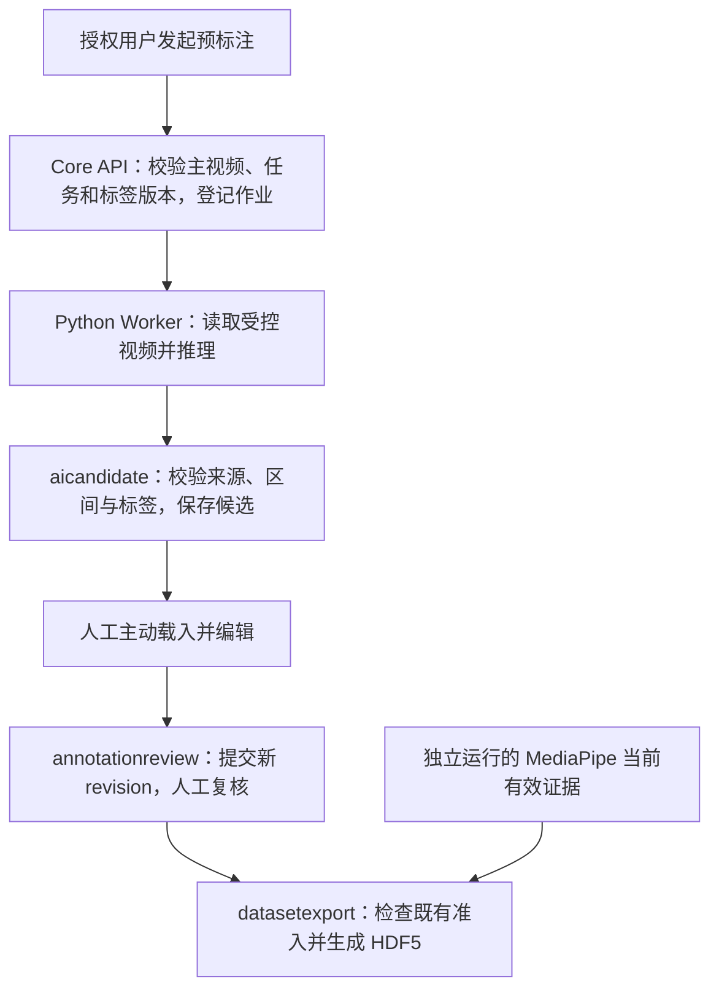

# 视频动作预标注与人工修正技术设计

日期：2026-09-09

状态：DRAFT / 待实现与实测。本文解释如何实施 [V1.34 需求基线](../requirements/baselines/V1.34/配药视频数据处理平台需求文档_V1.34.md)，不另行定义业务规则，不代表模型或新增功能已部署。

## 1. 决策摘要

用 Qwen3-VL 生成动作时间段候选，人工主动载入、修改并提交；复核通过后，复用已有 HDF5 导出。动作预标注不依赖 MediaPipe 成功，配套导出才同时要求两类数据就绪。

首轮采用用户提供的 RTX 4090 24GB，评估 `Qwen/Qwen3-VL-8B-Instruct`、BF16、单任务。先跑离线合成视频，再接平台。YOLO、模型训练、新微服务与批量自动触发均不在首版范围。

| 已有基础 | 本次拟增加 | 尚待证明 |
| --- | --- | --- |
| 人工时间段提交、版本及复核 | 动作候选生成、查询与采纳来源关联 | 配药动作准确率、边界误差和漏检率 |
| 同源手部样本与标签的 HDF5 关联 | 时间轴编辑及空白补标交互 | 4090 峰值显存、速度及人工节省比例 |

代码存在不等于新链路通过测试。现有入口见 [AnnotationTaskService](../../services/core-api/src/main/java/com/medicationvideo/platform/annotationreview/AnnotationTaskService.java)、[标注面板](../../apps/web/src/features/capture-group/CaptureGroupAnnotationPanel.tsx)、[HDF5 服务](../../services/core-api/src/main/java/com/medicationvideo/platform/datasetexport/HumanDemonstrationHdf5ExportService.java)。

## 2. 模块职责与处理流程



- `assetcapture` 提供媒体与视频身份事实；不负责创建动作候选业务真值。
- `aicandidate` 管理推理作业和候选；通过现有公开查询读取其他模块事实。
- [ai-worker](../../workers/ai-worker) 只推理并回传结果，不直接写业务表。作业投递、回传与重试优先复用已有机制。
- `annotationreview` 管理人工版本及复核；保存采纳来源，不允许候选模块直接写正式标注。
- 复核沿用 V1.32 的受限管理员同人确认规则，提交不自动确认；对照试验的独立质量复核不改变日常审批权限。
- `datasetexport` 继续读取已批准人工标注与当前 MediaPipe evidence，不消费动作模型原始输出。

实施前检查现有 job 类型、Worker 分派、Candidate 查询及手部 evidence 过滤点，确保动作候选不会被当作手部关键点。需要增加的 API、消息或 Schema 随实现评审并完成契约测试；本文不预设不存在的 URL、事件名或数据库表。`action-candidate.v1` 仅为拟议格式名称。

## 3. 数据、来源与校验

### 3.1 最小标注内容

```json
{
  "segments": [
    { "start_ms": 10000, "end_ms": 25000, "label": "DRAW_LIQUID" }
  ]
}
```

这是结构示例，标签从任务绑定的不可变 schema 获取，不内置固定五类。时间采用主视频原始时间轴、整数毫秒和半开区间 `[start_ms, end_ms)`。主步骤不重叠，允许空白；空白不自动等于空闲。标签定义和人工规则以 V1.34 第 2 节为准。

首版不要求模型输出 `confidence`；模型生成的数值不具备经过校准的正确率含义。模型描述也不构成质量或操作合规结论。

### 3.2 可信来源

以下信息由服务端作业上下文及受控运行环境提供，不能相信模型自行生成的身份或哈希：

| 信息 | 用途 |
| --- | --- |
| project、CaptureGroup、主 clip 身份及视频 SHA-256 | 防止结果关联错误视频 |
| 任务输入版本、label schema 版本及摘要 | 防止旧输入或旧标签结果冒充当前结果 |
| job、attempt、模型 revision 与权重摘要 | 区分运行尝试并复现模型来源 |
| 提示词、采样、像素和生成配置版本 | 复现推理条件与定位性能差异 |
| 原始输出、校验结果、候选身份 | 排查解析失败并关联人工采纳 |

复用现有字段和审计结构；新增字段及来源关联方式在契约设计中确定，不为每项信息单独建表。人工修改保留原始候选与新 revision；责任人记录采用既有身份审计，不宣称提供密码学签名。

### 3.3 输出校验顺序

1. 校验回传作业与当前 attempt、视频及任务来源；拒绝过期或错配结果。
2. 严格解析 JSON，校验结构、数值类型、有限值、标签成员资格和输出是否截断。
3. 将窗口时间映射回原视频，校验 `0 ≤ start_ms < end_ms ≤ duration_ms`。
4. 校验重复、重叠与窗口覆盖完整性；不能静默裁剪越界、合并重复动作或丢弃失败窗口。
5. 完整通过才发布可采纳候选；原始失败信息可追溯，人工标注入口始终可用。

重试沿用既有幂等和 attempt 语义，不重复创建可采纳结果。候选在载入和提交时再次检查当前来源，不能只在推理开始时检查。

## 4. 4090 部署与视频处理

### 4.1 首轮配置

| 项目 | 试验起点 | 限制 |
| --- | --- | --- |
| 模型 | Qwen3-VL-8B-Instruct | 通用视频能力见官方资料，配药效果待测 |
| 精度与并发 | BF16，1 个任务 | BF16 不称作“无损”；不承诺严格 JSON 输出 |
| GPU | RTX 4090 24GB | 需测实际可用显存，记录其他进程占用 |
| 主机内存 | 建议 32GB，64GB 更宽裕 | 工程建议，非实测最低要求 |
| 环境 | Python 3.12、CUDA PyTorch、Transformers、FFmpeg | Linux 或 Windows＋WSL2；固定驱动与依赖版本 |
| 输入 | 先测 15–30 秒、2 fps | 非质量标准；快速动作可能需要更密集采样 |

按约 8B 参数、每参数 2 字节粗算，权重量级约 16GB，不能据此扣出固定可用显存。视觉编码、中间结果、KV cache、缓存分配与其他进程都影响峰值。22GB 可作为试验时考虑的余量目标，但不是本设计承诺或统一验收门槛。

### 4.2 部署步骤

1. **准备**：在获准环境下载固定模型 revision，记录权重与配置摘要，审批后存放在仓库外；预先安装依赖，使用 uv lockfile 固定实际验证组合。运行时本地加载并禁止自动联网下载。
2. **加载**：采用官方视觉模型示例中的 `Qwen3VLForConditionalGeneration` 或受支持的 `AutoModelForImageTextToText`，不使用旧草稿的 `AutoModelForCausalLM`。设置 BF16、本地文件加载，评估时确认模型实际设备分布；不要把自动 CPU offload 的结果称作单卡全 GPU 性能。
3. **控制输入**：按固定 Processor 版本配置视频总像素或视觉 token 预算，并记录实际帧数与输入张量。官方视频 Processor 区分图像与视频预算，不能直接照搬旧版 `448 * 28 * 28` 作为有效视频上限。
4. **执行**：推理模式下生成有界输出；超时、OOM、解码或解析失败明确结束该 attempt，不发布完整候选。保留错误与配置，按既有重试规则处理。
5. **接入**：离线样本通过后，才将同一推理逻辑接入 Worker；首版不额外部署通用模型服务。

加载和输入预算依据 [Qwen3-VL 官方仓库](https://github.com/QwenLM/Qwen3-VL)；模型身份见 [8B-Instruct 模型卡](https://huggingface.co/Qwen/Qwen3-VL-8B-Instruct)。资料核对日期：2026-09-09，官方资料不证明本机性能。

FlashAttention-2 是可评估的优化选项，不是首版强制依赖或防 OOM 保证；先用所选版本支持的默认注意力实现建立基线。若资源不足，调整输入并复测质量，再与 4B-Instruct BF16 比较，最后才评估量化。

### 4.3 时间映射与长视频

- 保留解码帧的真实时间戳及窗口来源；可变帧率视频不能用帧序号除以假定 30 fps 定位。
- 若模型使用窗口内时间，回映射应使用已验证的源时间映射；只有窗口时间基准正确时，才能采用“窗口起点＋局部时间”。
- 保留窗口边缘上下文，测试跨窗口动作、重复动作及末尾短窗口。同名且相交不是同一动作的充分证据，不能只按 IoU 自动合并。
- 拼接存在无法消除的冲突或某窗口失败时，首版不将部分结果发布为完整草稿。
- 先测单轮基线。只有已确认边界问题增加人工成本时，再增加局部精修；调整采样后重新检查短动作召回。

### 4.4 测量口径

离线脚本是后续交付物，本文不附未经执行、容易被误认为可运行成品的脚本。

脚本需同时记录：

- 冷启动模型加载耗时与加载显存峰值；热启动端到端耗时，包括解码、预处理、推理、解析。
- GPU 测量边界同步；设备级显存占用与 PyTorch allocated/reserved 峰值分开报告，并明确 GB/GiB 单位。
- 每段实际帧数、像素预算、生成参数、输出长度、运行配置、失败原因与时间映射。
- 固定集上的重复运行分布，不用一次成功推理推断“无 OOM”或固定吞吐。

不写入“30 秒视频必在 15 秒内完成”等未经测试的验收数值。试验完成后，用真实记录确定配置和容量上限。

## 5. 人工编辑与失败恢复

复用 [标注面板](../../apps/web/src/features/capture-group/CaptureGroupAnnotationPanel.tsx)，遵守[设计系统](../DESIGN_SYSTEM.md)和[前端 UX 规范](./web-ux-and-frontend-guidelines.md)。

| 场景 | 行为 |
| --- | --- |
| 没有候选、推理运行或失败 | 显示真实状态，人工仍可创建和提交片段 |
| 候选完整有效 | 用户主动载入；已有编辑时不得静默替换 |
| 时间或类别错误 | 拖动或输入起止时间、设为播放时刻、更换任务 schema 内标签 |
| 漏标或误标 | 所有空白可见；支持新增、删除、拆分、合并和撤销 |
| 过长候选内部漏动作 | 可播放区间上下文并在播放位置拆分 |
| 输入变化或旧结果迟到 | 提示失效，保留人工成果，不覆盖当前内容 |
| 复核驳回 | 按既有流程形成新的人工 revision，保留被驳回版本和审计 |

Tab 保持原生焦点导航。时间轴顺序巡检提供独立按钮，快捷键在编辑器聚焦且非文本输入时才生效，均有按钮等价操作。暂不承诺浏览器倒放或精确逐帧步进；若只有时间 seek，应如实显示时间步进，不能固定假定一帧 33ms。

查看过的区间不自动视为人工确认，无候选不自动视为无动作。界面颜色只辅助表达状态。

## 6. 配套导出

沿用 [HDF5 服务](../../services/core-api/src/main/java/com/medicationvideo/platform/datasetexport/HumanDemonstrationHdf5ExportService.java)：

1. 校验所选记录权限、当前输入、已批准人工 revision 和既有 synthetic-only 准入。
2. 校验主视频身份、文件 SHA-256 及当前 MediaPipe evidence provenance。
3. 对现有主视频手部样本按 `start_ms ≤ frame_timestamp_ms < end_ms` 匹配人工标签。
4. 按既有结构写出 `samples` 和来源信息；任一所选记录失效时拒绝整次选择，不静默遗漏。

`samples` 不是完整视频帧表：未检测到手的帧不补造坐标，区间外样本不进入该标签样本表。参考机位不自动对齐；`landmarks[21,3]` 不称作经过标定的真实世界三维轨迹。文件采用平台自定义格式，不包含 MP4，也不改变现有导出契约。

## 7. 实施与验收

| 顺序 | 交付 | 完成条件 |
| --- | --- | --- |
| 1. 离线 PoC | 固定环境、推理脚本、3–5 段合成样本与测量记录 | 能定位原视频时间，输出通过结构及语义校验，失败可解释；不据此宣称准确率 |
| 2. 最小集成 | 作业、候选、人工编辑、来源关联及相关契约 | V34-FR-001 至 V34-FR-005 的受影响行为与契约检查通过 |
| 3. 对照评估 | 独立质量复核与人工耗时报告 | 按 V1.34 第 6 节预先固定质量容差，报告样本量、不确定性与失败率 |
| 4. 用户验收 | 可评审结果和运行限制 | 用户验收后才考虑冻结基线，不因一次达到 30% 目标自动成为 CURRENT |

相关测试覆盖错误标签、时间越界、输入换源、重复回传、窗口失败、人工编辑保护、键盘操作、权限，以及导出区间端点、无匹配样本和 provenance 失效。测试复用既有 fixtures，全部使用合成数据；实际实施才运行受影响应用检查。

若未达标，先按证据归因：时间整体偏移先查映射，类别混乱先查标签定义，短动作漏检先查采样。不要仅凭症状断定模型或提示词是原因。人工节省至少 30% 是试点目标，质量门槛和统计口径见 V1.34，不在本设计重复设定。

## 8. 当前结论

本方案可进入离线验证；动作模型集成、时间轴交互和 4090 性能仍待实现或实测。开发与 CI 不接触真实患者数据；脱敏样本需另行明确授权和隔离，内网部署本身不等于已获得数据使用授权。
