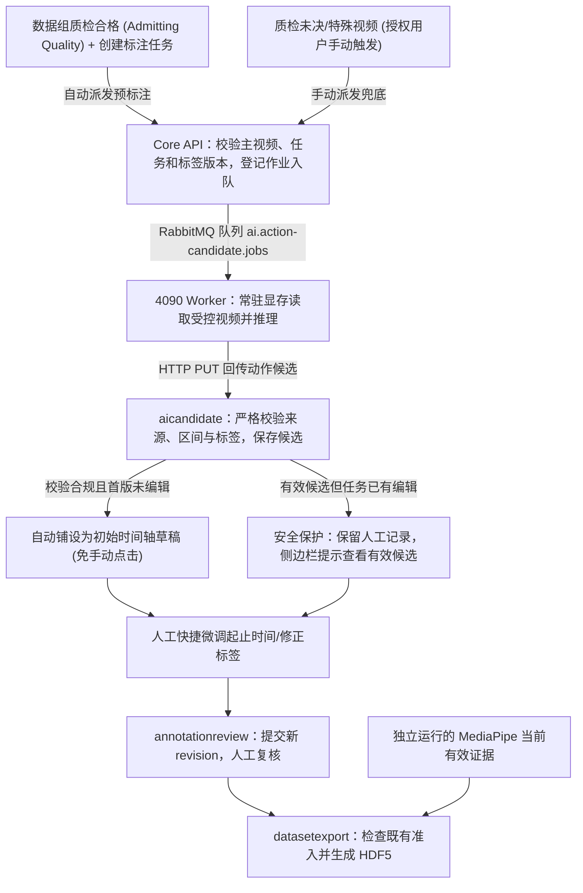

# 视频动作预标注与人工修正技术设计

日期：2026-09-09

状态：支持性 DRAFT / 待实现与实测。本文解释 V1.35 中 Action Candidate 相关要求的实现边界，不另行定义业务规则，不代表模型或新增功能已部署。

## 1. 决策摘要

用 Qwen3-VL 生成动作时间段候选，通过校验后自动呈现待确认草稿，人工核对、修改并提交；复核通过后，复用已有 HDF5 导出。动作预标注不依赖 MediaPipe 成功，配套导出才同时要求两类数据就绪。

首轮采用用户提供的 RTX 4090 24GB，评估 `Qwen/Qwen3-VL-8B-Instruct`、BF16、单任务。先跑离线合成视频，再接平台。YOLO、模型训练、新微服务与历史任务批量回填均不在首版范围。

| 已有基础 | 本次拟增加 | 尚待证明 |
| --- | --- | --- |
| 人工时间段提交、版本及复核 | 动作候选生成、查询与采纳来源关联 | 配药动作准确率、边界误差和漏检率 |
| 同源手部样本与标签的 HDF5 关联 | 时间轴编辑及空白补标交互 | 4090 峰值显存、速度及人工节省比例 |

代码存在不等于新链路通过测试。现有入口见 [AnnotationTaskService](../../services/core-api/src/main/java/com/medicationvideo/platform/annotationreview/AnnotationTaskService.java)、[标注面板](../../apps/web/src/features/capture-group/CaptureGroupAnnotationPanel.tsx)、[HDF5 服务](../../services/core-api/src/main/java/com/medicationvideo/platform/datasetexport/HumanDemonstrationHdf5ExportService.java)。

## 2. 模块职责与处理流程



- `assetcapture` 提供媒体与视频身份事实；不负责创建动作候选业务真值。
- `qualitycleaning` / `annotationreview` 建立质检准入与任务；数据组通过质检（`admitting group quality`）并创建标注任务时，自动触发动作预标注调度。质检未决或废弃数据不自动消耗 GPU，保留授权用户手动触发入口。
- `aicandidate` 管理推理作业和候选；通过现有公开查询读取其他模块事实。
- 4090 节点运行常驻 Python Worker（每卡单消费者、串行执行，`prefetch_count=1`，模型加载后复用），只推理并回传结果，不直接写业务表。作业投递、回传与重试复用 Transactional Outbox 与 RabbitMQ。
- 前端标注面板实现**智能初始化与安全保护**：合规候选在未编辑任务中直接呈现在时间轴上，标注员直接开始核对微调；已有编辑记录或候选存疑时绝不静默覆盖，降级为侧边栏提示。
- `annotationreview` 管理人工版本及复核；保存采纳来源，不允许候选模块直接写正式标注。
- 复核沿用 V1.35 的受限管理员同人确认规则，提交不自动确认；对照试验的独立质量复核不改变日常审批权限。
- `datasetexport` 继续读取已批准人工标注与当前 MediaPipe evidence，不消费动作模型原始输出。

实施前检查现有 job 类型、Worker 分派、Candidate 查询及手部 evidence 过滤点，确保动作候选与 MediaPipe 手部事实按类型、查询及校验隔离，无须为此拆数据库。`action-candidate.v1` 为拟议格式名称。

## 3. 数据、来源与校验

### 3.1 最小标注内容

```json
{
  "segments": [
    { "start_ms": 10000, "end_ms": 25000, "label": "DRAW_LIQUID" }
  ]
}
```

这是结构示例，标签从任务绑定的不可变 schema 获取，不内置固定类别。Action Worker 在执行推理前，优先使用任务绑定的 schema 快照并将其语义注入提示词；未来标准库新增标签时，VLM 模型无需重训或修改代码即可按 Schema 进行评估，但不保证新增概念可被正确识别。时间采用主视频原始时间轴、整数毫秒和半开区间 `[start_ms, end_ms)`。主步骤不重叠，允许空白；空白不自动等于空闲。标签定义和人工规则以 V1.35 为准。

首版不要求模型输出 `confidence`；模型生成的数值不具备经过校准的正确率含义。模型描述也不构成质量或操作合规结论。

### 3.2 可信来源

以下信息由服务端作业上下文及受控运行环境提供，不能相信模型自行生成的身份或哈希：

| 信息 | 用途 |
| --- | --- |
| project、CaptureGroup、主 clip 身份及视频 SHA-256 | 防止结果关联错误视频 |
| 任务输入版本、label schema 版本及摘要 | 防止旧输入或旧标签结果冒充当前结果 |
| job、attempt、模型 revision 与权重摘要 | 区分运行尝试并复现模型来源 |
| 提示词、采样、像素和生成配置版本 | 复现推理条件与定位性能差异 |
| 原始输出、校验结果、候选身份 | 排查解析失败并关联人工采纳 |

复用现有字段和审计结构；新增字段及来源关联方式在契约设计中确定，不为每项信息单独建表。人工修改保留原始候选与新 revision；责任人记录采用既有身份审计，不宣称提供密码学签名。

### 3.3 输出校验顺序

1. 校验回传作业与当前 attempt、视频及任务来源；拒绝过期或错配结果。
2. 严格解析 JSON，校验结构、数值类型、有限值、标签成员资格和输出是否截断。
3. 将窗口时间映射回原视频，校验 `0 ≤ start_ms < end_ms ≤ duration_ms`。
4. 校验重复、重叠与窗口覆盖完整性；不能静默裁剪越界、合并重复动作或丢弃失败窗口。
5. 完整通过才发布可采纳候选；原始失败信息可追溯，人工标注入口始终可用。

重试沿用既有幂等和 attempt 语义，不重复创建可采纳结果。候选在载入和提交时再次检查当前来源，不能只在推理开始时检查。

## 4. 4090 部署与视频处理

### 4.1 首轮配置

| 项目 | 试验起点 | 限制 |
| --- | --- | --- |
| 模型 | Qwen3-VL-8B-Instruct | 通用视频能力见官方资料，配药效果待测 |
| 精度与并发 | BF16，1 个任务 | BF16 不称作“无损”；不承诺严格 JSON 输出 |
| GPU | RTX 4090 24GB | 需测实际可用显存，记录其他进程占用 |
| 主机内存 | 建议 32GB，64GB 更宽裕 | 工程建议，非实测最低要求 |
| 环境 | Python 3.12、CUDA PyTorch、Transformers、FFmpeg | Linux 或 Windows＋WSL2；固定驱动与依赖版本 |
| 输入 | 先固定 15–30 秒、1 fps 基线，2 fps 作对照 | 非质量标准；快速动作可能需要更密集采样 |

按约 8B 参数、每参数 2 字节粗算，权重量级约 16GB，不能据此扣出固定可用显存。视觉编码、中间结果、KV cache、缓存分配与其他进程都影响峰值。22GB 可作为试验时考虑的余量目标，但不是本设计承诺或统一验收门槛。

### 4.2 Worker 接入：复用既有机制

复用 [ai-worker](../../workers/ai-worker) 的消费、租约、心跳和回传流程，为动作推理增加独立类型和模型执行器；不另建通用模型服务。现有回传路径为 `/api/v1/internal/ai-jobs/{jobId}/attempts/{attempt}/result`，现有消息使用整数 `attempt`。动作载荷需扩展并版本化，不能直接塞进现有手部结果 Schema；具体路由、队列和字段在契约实现时确定，不将示例当作已上线接口。

- 固定获批的模型 revision、权重摘要与验证过的依赖，运行时仅本地加载。模型启动加载一次并复用，进程重启仍需冷启动；实际加载时间和显存必须测量。
- 每卡只部署一个串行推理消费者，设置 `prefetch_count=1`；该设置只限制单个消费者的未确认消息数，不能阻止多个进程同时占卡，也不能保证单任务不 OOM。限制实际帧数、像素和生成长度，分别记录 allocated/reserved 与设备占用。
- 作业携带受控媒体身份、输入版本、任务 schema 及配置来源；媒体授权通过既有受控读取机制处理，不把长期有效访问地址硬编码进队列。服务端再次核验当前来源和 attempt。
- 成功或失败结果获 Core API 持久化确认后，才 ACK 消息。网络失败沿用既有重试、租约和退避；重复投递不得重复发布候选，旧 attempt 不得覆盖新 attempt。不可重试消息沿用已有死信处置。
- Worker 崩溃、OOM、解码失败和部分窗口失败均须可观察；队列重投不等于业务状态已恢复。Core API 保持作业事实，人工标注入口始终可用。

### 4.3 时间映射与长视频

- 保留解码帧的真实时间戳及窗口来源；可变帧率视频不能用帧序号除以假定 30 fps 定位。
- 若模型使用窗口内时间，回映射应使用已验证的源时间映射；只有窗口时间基准正确时，才能采用“窗口起点＋局部时间”。
- 保留窗口边缘上下文，测试跨窗口动作、重复动作及末尾短窗口。同名且相交不是同一动作的充分证据，不能只按 IoU 自动合并。
- 拼接存在无法消除的冲突或某窗口失败时，首版不将部分结果发布为完整草稿。
- 先测单轮基线。只有已确认边界问题增加人工成本时，再增加局部精修；调整采样后重新检查短动作召回。

### 4.4 测量口径

已有 `tools/action-poc/` 试验脚本及用户终端记录：30.2 秒样本报告 8.19 秒，156.2 秒分段样本报告 55.07 秒，PyTorch 峰值约 19.86 GiB。记录不含完整环境锁定、窗口证据及独立质量复核，不构成验收；旧日志标为 GB 的值需按脚本除以 1024³ 的口径解释。

脚本需同时记录：

- 冷启动模型加载耗时与加载显存峰值；热启动端到端耗时，包括解码、预处理、推理、解析。
- GPU 测量边界同步；设备级显存占用与 PyTorch allocated/reserved 峰值分开报告，并明确 GB/GiB 单位。
- 每段实际帧数、像素预算、生成参数、输出长度、运行配置、失败原因与时间映射。
- 固定集上的重复运行分布，不用一次成功推理推断“无 OOM”或固定吞吐。

不写入“30 秒视频必在 15 秒内完成”等未经测试的验收数值。试验完成后，用真实记录确定配置和容量上限。

## 5. 人工编辑与失败恢复

复用 [标注面板](../../apps/web/src/features/capture-group/CaptureGroupAnnotationPanel.tsx)，遵守[设计系统](../DESIGN_SYSTEM.md)和[前端 UX 规范](./web-ux-and-frontend-guidelines.md)。

| 场景 | 行为 |
| --- | --- |
| 没有候选、推理运行或失败 | 显示真实状态（未启动/队列排队/失败），人工仍可从零创建和提交片段 |
| 候选完整合规且首版未编辑 | **智能初始化**：时间轴自动铺设 AI 候选色块，无需点击直接进入微调 |
| 候选冲突/部分失败/来源失效 | 不发布可采纳候选；展示失败原因，支持人工从零标注或授权重试，原始输出仅供诊断 |
| 任务已有编辑记录或历史版本 | **防覆盖保护**：保留已有工作成果，绝不静默覆盖，仅在侧边栏提示有新候选可对比 |
| 时间或类别错误 | 拖动或输入起止时间、设为播放时刻、更换任务 schema 内标签 |
| 漏标或误标 | 所有空白可见；支持新增、删除、拆分、合并和撤销 |
| 过长候选内部漏动作 | 可播放区间上下文并在播放位置拆分 |
| 输入变化或旧结果迟到 | 提示失效，保留人工成果，不覆盖当前内容 |
| 复核驳回 | 按既有流程形成新的人工 revision，保留被驳回版本和审计 |

Tab 保持原生焦点导航。时间轴顺序巡检提供独立按钮，快捷键在编辑器聚焦且非文本输入时才生效，均有按钮等价操作。暂不承诺浏览器倒放或精确逐帧步进；若只有时间 seek，应如实显示时间步进，不能固定假定一帧 33ms。

### 5.1 人机协同“大道至简”剪辑级交互规约

为彻底降低人工复核成本、避免频繁滚动与认知负荷，工作台落实以下人机协同交互：
- **纯净可读时间格式优先（去冗余 `.000`）**：卡片标题与输入框下方辅助文字优先以人类直观的 `分:秒` 展示（如 `02:32`）；仅在存在真实非零毫秒精细度时才展示毫秒小数（如 `00:12.345`），整秒一律去除冗余 `.000` 尾缀，彻底消除视觉杂音。
- **单键区间试看（▶ 播放片段）**：每个动作卡片常驻独立播放按钮，点击后主播放器瞬间跳转至 `start_ms` 自动起播，并在 `end_ms` 精准暂停，标注员 2 秒即可核对动作真实边界。
- **全片彩色动作轨（Action Timeline Strip）**：在片段列表顶部常驻 0%~100% 全片时间轴色块分布图，按动作类别分配专业色系（`ACTION_PALETTE`），实时联动当前播放进度红线游标，鼠标悬停展示动作名称与区间并支持一键跳播，点击轨上任意空白区域亦可快速 seek 至目标时间。
- **剪辑级实时播放跟随高亮**：主播放器起播或拖动时，当前播放时刻所在的动作切片在时间轨（`is-active-slice` 微浮发光）与对应动作卡片（`is-playing-active` 柔和主题蓝描边）实现毫秒级双向跟随高亮，操作体验与专业剪辑软件看齐。
- **紧凑型时间辅助控制行**：输入框下方的可读时间与“设为开始 / 设为结束”按钮采用弹性两端对齐排布（`.capture-group-segment-time-helper`），大幅压缩卡片垂直留白，视觉规整紧凑。
- **顶部常驻一键提交栏**：工作台顶部展示动作段数总览、全片覆盖秒数与【一键完成并提交审核】按钮，无需在编辑多段动作后逐屏翻滚至底部提交。
- **模型标签自动归一与中文映射**：前端解析模型返回的标签编码（如 `DRAW_LIQUID`），大小写容错映射至不可变 Schema 对应项并呈现友好中文名称（如 `抽取药液`），杜绝下拉选择框显示灰色未匹配原词。

查看过的区间不自动视为人工确认，无候选不自动视为无动作。界面颜色只辅助表达状态。

## 6. 配套导出

沿用 [HDF5 服务](../../services/core-api/src/main/java/com/medicationvideo/platform/datasetexport/HumanDemonstrationHdf5ExportService.java)：

1. 校验所选记录权限、当前输入、已批准人工 revision 和既有 synthetic-only 准入。
2. 校验主视频身份、文件 SHA-256 及当前 MediaPipe evidence provenance。
3. 对现有主视频手部样本按 `start_ms ≤ frame_timestamp_ms < end_ms` 匹配人工标签。
4. 按既有结构写出 `samples` 和来源信息；任一所选记录失效时拒绝整次选择，不静默遗漏。

`samples` 不是完整视频帧表：未检测到手的帧不补造坐标，区间外样本不进入该标签样本表。参考机位不自动对齐；`landmarks[21,3]` 不称作经过标定的真实世界三维轨迹。文件采用平台自定义格式，不包含 MP4，也不改变现有导出契约。

## 7. 实施与验收

| 顺序 | 交付 | 完成条件 |
| --- | --- | --- |
| 1. 离线 PoC | 固定环境、推理脚本、3–5 段合成样本与测量记录 | 能定位原视频时间，输出通过结构及语义校验，失败可解释；不据此宣称准确率 |
| 2. 最小集成 | 作业、候选、人工编辑、来源关联及相关契约 | V1.35 第 16 节 V35-FR-002 至 V35-FR-005 的受影响行为与契约检查通过 |
| 3. 对照评估 | 独立质量复核与人工耗时报告 | 按 V1.35 第 16 节预先固定质量容差，报告样本量、不确定性与失败率 |
| 4. 用户验收 | 可评审结果和运行限制 | 用户验收后才考虑冻结基线，不因一次达到 30% 目标自动成为 CURRENT |

相关测试覆盖错误标签、时间越界、输入换源、重复回传、窗口失败、人工编辑保护、键盘操作、权限，以及导出区间端点、无匹配样本和 provenance 失效。测试复用既有 fixtures，全部使用合成数据；实际实施才运行受影响应用检查。

若未达标，先按证据归因：时间整体偏移先查映射，类别混乱先查标签定义，短动作漏检先查采样。不要仅凭症状断定模型或提示词是原因。人工节省至少 30% 是试点目标，质量门槛和统计口径见 V1.35，不在本设计重复设定。

### 7.1 下一步最小纵向切片

1. 先修复并用合成测试验证离线窗口映射、跨边界动作保留、异常结果拒绝及原始输出追溯；冻结可复现配置，不继续凭终端输出评分。
2. 接通一条“单个现有任务 → 作业 → Worker → 有效候选 → 人工提交”的链路，复用现有权限、租约和 attempt。先通过合成 Worker 结果的契约测试，再用获准测试视频验证 4090。
3. 在同一链路加自动派发和初次草稿呈现，验证先创建任务/先质检两种顺序、重复事件只派发一次、候选晚到不覆盖正在编辑的内容。自动派发是最终验收要求，不因先接通手动入口而省略。
4. 完成编辑、复核和既有 HDF5 回归后开展对照试验。先确认最终质量，再衡量人工总耗时；不提前增加自动批准、模型评分路由或局部重试框架。

## 8. 当前结论

本方案可进入离线验证；动作模型集成、时间轴交互和 4090 性能仍待实现或实测。开发与 CI 不接触真实患者数据；脱敏样本需另行明确授权和隔离，内网部署本身不等于已获得数据使用授权。
