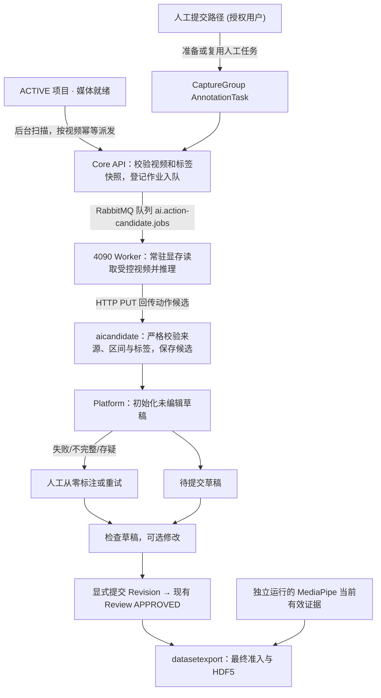

# 视频动作预标注与人工修正技术设计

日期：2026-09-15

状态：支持性 DRAFT / 与 V1.35 自动化策略对齐。本文解释 V1.35 中 Action Candidate、草稿准备与显式提交和人工接管的实现边界；自动派发已在 Platform dev 接线，真实 Worker、候选质量和生产运行仍须实测，不代表模型能力已部署。

## 1. 决策摘要

动作 Worker 生成时间段候选，Platform 初始化可编辑草稿；用户可直接提交正确草稿，或先修改再提交。沿用现有 Review 与 HDF5。动作派发不等待 MediaPipe，样本要求属于导出阶段。

2026-09-16 实施修订：所有 ACTIVE 项目的媒体就绪视频默认自动派发，不要求人工任务、负责人或人工质量。无任务时冻结已发布全局 schema，有任务时使用绑定版本。已有未派发媒体也纳入后台扫描；实现与部署影响见[自动动作分析](./automatic-action-preparation.md)，真实 Worker 推理仍须独立验收。

首轮采用用户提供的 RTX 4090 24GB，评估 `Qwen/Qwen3-VL-8B-Instruct`、BF16、单任务。先跑离线合成视频，再接平台。YOLO、模型训练和新微服务不在首版范围；既有媒体仅补派发尚未分析的输入，不因扫描重跑已有作业。D1 已停止新的独立 Cleaning 写入，历史 Cleaning 只读保留。

| 已有基础 | 当前已接线 | 尚待证明 |
| --- | --- | --- |
| 人工时间段提交、版本及复核 | 自动派发、动作候选、草稿准备与显式提交与异常接管 | 配药动作准确率、边界误差、漏检率和候选误标率 |
| 同源手部样本与标签的 HDF5 关联 | 时间轴编辑及空白补标交互 | 4090 峰值显存、速度及人工节省比例 |

代码存在不等于新链路通过测试。现有入口见 [AnnotationTaskService](../../services/core-api/src/main/java/com/medicationvideo/platform/annotationreview/AnnotationTaskService.java)、[标注面板](../../apps/web/src/features/capture-group/CaptureGroupAnnotationPanel.tsx)、[HDF5 服务](../../services/core-api/src/main/java/com/medicationvideo/platform/datasetexport/HumanDemonstrationHdf5ExportService.java)。

## 2. 模块职责与处理流程



- `assetcapture` 提供媒体与视频身份事实；不负责创建动作候选业务真值。
- `qualitycleaning` / `annotationreview` 提供人工质量、唯一任务、Revision 与 Review 事实。Action Candidate 自动派发不依赖人工任务、负责人或人工质量；人工任务只在提交路径准备。历史 Cleaning 只读查询保留，不产生新的 Cleaning 事实。
- `aicandidate` 管理推理作业和候选；通过现有公开查询读取其他模块事实。
- 4090 节点运行常驻 Python Worker（每卡单消费者、串行执行，`prefetch_count=1`，模型加载后复用），只推理并回传结果，不直接写业务表。作业投递、回传与重试复用 Transactional Outbox 与 RabbitMQ。
- 标注面板展示待提交草稿，用户可修改或直接提交整份；所有自动初始化均须保护已有编辑和未保存内容。
- `annotationreview` 管理人工版本及复核；保存采纳来源，不允许候选模块直接写人工 Revision 或 Review。
- 草稿不等于提交或批准；沿用受限管理员 Review 和 append-only Revision。
- `datasetexport` 读取当前已提交且 Review APPROVED 的 Revision 与 MediaPipe evidence，不消费未提交草稿。

实施前检查现有 job 类型、Worker 分派、Candidate 查询及手部 evidence 过滤点，确保动作候选与 MediaPipe 手部事实按类型、查询及校验隔离，无须为此拆数据库。下文方案不直接修改公开契约；现有动作消息见 [ai-action-job.v1 schema](../../contracts/events/ai-action-job-v1.schema.json)，实际接口以 OpenAPI 为准。自动派发、草稿准备与显式提交和人工接管仍须分别完成契约与真实运行验收，不能把代码已接线写成模型能力已完成。

## 3. 数据、来源与校验

### 3.1 最小标注内容

```json
{
  "segments": [
    { "start_ms": 10000, "end_ms": 25000, "label": "DRAW_LIQUID" }
  ]
}
```

这是结构示例，标签从派发时冻结的不可变 schema 获取，不内置固定类别。Action Worker 在执行推理前，使用作业冻结的 schema 快照（无任务时取派发当时的已发布全局版本）并将其语义注入提示词；未来标准库新增标签时，VLM 模型无需重训或修改代码即可按 Schema 进行评估，但不保证新增概念可被正确识别。时间采用主视频原始时间轴、整数毫秒和半开区间 `[start_ms, end_ms)`。主步骤不重叠，允许空白；空白不自动等于空闲。标签定义和人工规则以 V1.35 为准。

首版不要求模型输出 `confidence`；模型生成的数值不具备经过校准的正确率含义。模型描述也不构成质量或操作合规结论。

### 3.2 可信来源

以下最小信息由服务端作业上下文及受控运行环境提供，不能相信模型自行生成的身份或哈希：

| 信息 | 用途 |
| --- | --- |
| project、CaptureGroup、主 clip 身份及视频/输入 SHA-256 | 防止结果关联错误视频；只在输入身份边界校验时使用 |
| 任务输入版本、label schema 版本及摘要 | 防止旧输入或旧标签结果冒充当前结果 |
| job、attempt、模型 revision 与必要的权重摘要 | 区分运行尝试并复现模型来源 |
| 草稿来源与提交记录 | 区分机器候选、人工提交 Revision 与 Review |
| 原始输出、校验结果、候选身份 | 排查解析失败并关联人工采纳；不为每个字段另建摘要 |

复用现有字段和审计结构；新增字段及来源关联方式在契约设计中确定，不为每项信息单独建表。人工修改保留原始候选与新 revision；责任人记录采用既有身份审计，不宣称提供密码学签名。代码文件、每个 JSON 字段和每次查询不重复计算哈希；模型制品或视频身份所需的 SHA-256 仍按安全与幂等要求保留。

### 3.3 输出校验顺序

1. 校验回传作业与当前 attempt、视频及任务来源；拒绝过期或错配结果。
2. 严格解析 JSON，校验结构、数值类型、有限值、标签成员资格和输出是否截断。
3. 将窗口时间映射回原视频，校验 `0 ≤ start_ms < end_ms ≤ duration_ms`。
4. 校验重复、重叠与窗口覆盖完整性；不能静默裁剪越界、合并重复动作或丢弃失败窗口。
5. 完整通过才发布可采纳候选；原始失败信息可追溯，人工标注入口始终可用。

6. 完整有效候选只初始化未编辑草稿；不自动提交或批准。部分结果保留诊断，人工可从零标注。

重试沿用既有幂等和 attempt 语义，不重复创建可采纳结果。候选在载入和提交时再次检查当前来源，不能只在推理开始时检查。

## 4. 4090 部署与视频处理

### 4.1 首轮配置

| 项目 | 试验起点 | 限制 |
| --- | --- | --- |
| 模型 | Qwen3-VL-8B-Instruct | 通用视频能力见官方资料，配药效果待测 |
| 精度与并发 | BF16，1 个任务 | BF16 不称作“无损”；不承诺严格 JSON 输出 |
| GPU | RTX 4090 24GB | 需测实际可用显存，记录其他进程占用 |
| 主机内存 | 建议 32GB，64GB 更宽裕 | 工程建议，非实测最低要求 |
| 环境 | Python 3.12、CUDA PyTorch、Transformers、FFmpeg | Linux 或 Windows＋WSL2；固定驱动与依赖版本 |
| 输入 | 先固定 15–30 秒、1 fps 基线，2 fps 作对照 | 非质量标准；快速动作可能需要更密集采样 |

按约 8B 参数、每参数 2 字节粗算，权重量级约 16GB，不能据此扣出固定可用显存。视觉编码、中间结果、KV cache、缓存分配与其他进程都影响峰值。22GB 可作为试验时考虑的余量目标，但不是本设计承诺或统一验收门槛。

### 4.2 Worker 接入：复用既有机制

复用 [ai-worker](../../workers/ai-worker) 的消费、租约、心跳和回传机制；平台内合成占位执行与外部动作 Worker 的真实模型推理分开验证，不另建通用模型服务。动作回传与手部回传按各自公开契约隔离，现役动作回传见 [OpenAPI](../../contracts/openapi/openapi.yaml) 与 [AiWorkerController](../../services/core-api/src/main/java/com/medicationvideo/platform/aicandidate/AiWorkerController.java) 的 `action-result`；不将历史通用 result 路径当作动作接口，也不在此预定新增字段或 migration 编号。

- 固定获批的模型 revision、权重摘要与验证过的依赖，运行时仅本地加载。模型启动加载一次并复用，进程重启仍需冷启动；实际加载时间和显存必须测量。
- 每卡只部署一个串行推理消费者，设置 `prefetch_count=1`；该设置只限制单个消费者的未确认消息数，不能阻止多个进程同时占卡，也不能保证单任务不 OOM。限制实际帧数、像素和生成长度，分别记录 allocated/reserved 与设备占用。
- 作业携带受控媒体身份、输入版本、任务 schema 及配置来源；媒体授权通过既有受控读取机制处理，不把长期有效访问地址硬编码进队列。服务端再次核验当前来源和 attempt。
- 成功或失败结果获 Core API 持久化确认后，才 ACK 消息。网络失败沿用既有重试、租约和退避；重复投递不得重复发布候选，旧 attempt 不得覆盖新 attempt。不可重试消息沿用已有死信处置。
- Worker 崩溃、OOM、解码失败和部分窗口失败均须可观察；队列重投不等于业务状态已恢复。Core API 保持作业事实，人工标注入口始终可用。

### 4.3 时间映射与长视频

- 保留解码帧的真实时间戳及窗口来源；可变帧率视频不能用帧序号除以假定 30 fps 定位。
- 若模型使用窗口内时间，回映射应使用已验证的源时间映射；只有窗口时间基准正确时，才能采用“窗口起点＋局部时间”。
- 保留窗口边缘上下文，测试跨窗口动作、重复动作及末尾短窗口。同名且相交不是同一动作的充分证据，不能只按 IoU 自动合并。
- 拼接存在无法消除的冲突或某窗口失败时，首版不将部分结果发布为完整草稿。
- 先测单轮基线。只有已确认边界问题增加人工成本时，再增加局部精修；调整采样后重新检查短动作召回。

### 4.4 测量口径

已有 `tools/action-poc/` 试验脚本及用户终端记录：30.2 秒样本报告 8.19 秒，156.2 秒分段样本报告 55.07 秒，PyTorch 峰值约 19.86 GiB。记录不含完整环境锁定、窗口证据及独立质量复核，不构成验收；旧日志标为 GB 的值需按脚本除以 1024³ 的口径解释。

脚本需同时记录：

- 冷启动模型加载耗时与加载显存峰值；热启动端到端耗时，包括解码、预处理、推理、解析。
- GPU 测量边界同步；设备级显存占用与 PyTorch allocated/reserved 峰值分开报告，并明确 GB/GiB 单位。
- 每段实际帧数、像素预算、生成参数、输出长度、运行配置、失败原因与时间映射。
- 固定集上的重复运行分布，不用一次成功推理推断“无 OOM”或固定吞吐。

不写入“30 秒视频必在 15 秒内完成”等未经测试的验收数值。试验完成后，用真实记录确定配置和容量上限。

## 5. 人工编辑与失败恢复

复用 [标注面板](../../apps/web/src/features/capture-group/CaptureGroupAnnotationPanel.tsx)，遵守[设计系统](../DESIGN_SYSTEM.md)和[前端 UX 规范](./web-ux-and-frontend-guidelines.md)。

| 场景 | 行为 |
| --- | --- |
| 没有候选、推理运行或失败 | 显示真实状态（未启动/队列排队/失败）；结果进入人工兜底时仍可从零创建和提交片段 |
| 候选完整有效且任务未编辑 | 自动呈现草稿；用户无需逐片段采纳，可修改，最后显式提交 |
| 候选冲突/部分失败/来源失效/策略拒绝 | 进入 待人工处理，展示失败原因，支持人工从零标注、编辑或授权重试，原始输出仅供诊断 |
| 任务已有编辑记录或历史版本 | **防覆盖保护**：保留已有工作成果，绝不静默覆盖，仅在侧边栏提示有新候选可对比 |
| 时间或类别错误 | 拖动或输入起止时间、设为播放时刻、更换任务 schema 内标签 |
| 漏标或误标 | 所有空白可见；支持新增、删除、拆分、合并和撤销 |
| 过长候选内部漏动作 | 可播放区间上下文并在播放位置拆分 |
| 输入变化或旧结果迟到 | 提示失效，保留人工成果，不覆盖当前内容 |
| 自动结果被人工接管或复核驳回 | 形成新的人工 revision，保留机器结果、被驳回版本和审计；不原地覆盖自动结果 |

Tab 保持原生焦点导航。时间轴顺序巡检提供独立按钮，快捷键在编辑器聚焦且非文本输入时才生效，均有按钮等价操作。暂不承诺浏览器倒放或精确逐帧步进；若只有时间 seek，应如实显示时间步进，不能固定假定一帧 33ms。

### 5.1 人机协同“大道至简”剪辑级交互规约

为彻底降低人工复核成本、避免频繁滚动与认知负荷，工作台落实以下人机协同交互：
- **纯净可读时间格式优先（去冗余 `.000`）**：卡片标题与输入框下方辅助文字优先以人类直观的 `分:秒` 展示（如 `02:32`）；仅在存在真实非零毫秒精细度时才展示毫秒小数（如 `00:12.345`），整秒一律去除冗余 `.000` 尾缀，彻底消除视觉杂音。
- **区间试看**：动作卡片提供播放按钮，用户点击后主播放器定位到 `start_ms` 并播放，在 `end_ms` 附近按浏览器能力停止；不承诺精确帧边界或固定核对耗时。
- **全片彩色动作轨（Action Timeline Strip）**：在片段列表顶部常驻 0%~100% 全片时间轴色块分布图，按动作类别分配专业色系（`ACTION_PALETTE`），实时联动当前播放进度红线游标，鼠标悬停展示动作名称与区间并支持一键跳播，点击轨上任意空白区域亦可快速 seek 至目标时间。
- **播放跟随高亮**：当前动作在时间轨与卡片中采用设计系统已有的低饱和选中样式与文字提示，不使用发光装饰，也不承诺毫秒级播放器响应。
- **紧凑型时间辅助控制行**：输入框下方的可读时间与“设为开始 / 设为结束”按钮采用弹性两端对齐排布（`.capture-group-segment-time-helper`），大幅压缩卡片垂直留白，视觉规整紧凑。
- **顶部常驻一键提交栏**：工作台顶部展示动作段数总览、全片覆盖秒数与【一键完成并提交审核】按钮，无需在编辑多段动作后逐屏翻滚至底部提交。
- **标签显示**：从任务绑定的不可变 schema 读取 label_id、display_name 和说明，调色板仅负责颜色；任何兼容归一必须在合法性校验下进行，无法匹配时显示错误，不靠前端猜测补齐业务标签。

查看过的区间不自动视为人工确认，无候选不自动视为无动作。界面颜色只辅助表达状态。

## 6. 配套导出

沿用 [HDF5 服务](../../services/core-api/src/main/java/com/medicationvideo/platform/datasetexport/HumanDemonstrationHdf5ExportService.java)：

1. 校验所选记录权限、当前输入、已提交且 Review APPROVED 的 Revision 和既有 synthetic-only 准入。
2. 校验主视频身份、文件 SHA-256 及当前 MediaPipe evidence provenance。
3. 对现有主视频手部样本按 `start_ms ≤ frame_timestamp_ms < end_ms` 匹配人工标签。
4. 按既有结构写出 `samples` 和来源信息；任一所选记录失效时拒绝整次选择，不静默遗漏。

`samples` 不是完整视频帧表：未检测到手的帧不补造坐标，区间外样本不进入该标签样本表。参考机位不自动对齐；`landmarks[21,3]` 不称作经过标定的真实世界三维轨迹。文件采用平台自定义格式，不包含 MP4，也不改变现有导出契约。

## 7. 实施与验收

| 顺序 | 交付 | 完成条件 |
| --- | --- | --- |
| 1. 离线 PoC | 固定环境、推理脚本、3–5 段合成样本与测量记录 | 能定位原视频时间，输出通过结构及语义校验，失败可解释；不据此宣称准确率 |
| 2. 最小集成 | 作业、候选、人工编辑、来源关联及相关契约 | V1.35 第 16 节 V35-FR-002 至 V35-FR-005 的受影响行为与契约检查通过 |
| 3. 对照评估 | 独立质量复核与人工耗时报告 | 按 V1.35 第 16 节预先固定质量容差，报告样本量、不确定性与失败率 |
| 4. 用户验收 | 可评审结果和运行限制 | V1.35 已是当前需求入口；实现/发布验收单独记录，不因一次达到 30% 目标宣布通过 |

相关测试覆盖错误标签、时间越界、输入换源、重复回传、窗口失败、草稿准备与显式提交条件、异常转人工、人工编辑保护、键盘操作、权限，以及导出区间端点、无匹配样本和 provenance 失效。测试复用既有 fixtures，全部使用合成数据；实际实施才运行受影响应用检查。

若未达标，先按证据归因：时间整体偏移先查映射，类别混乱先查标签定义，短动作漏检先查采样。不要仅凭症状断定模型或提示词是原因。人工节省至少 30% 是试点目标，质量门槛和统计口径见 V1.35，不在本设计重复设定。

### 7.1 下一步最小纵向切片

1. 先修复并用合成测试验证离线窗口映射、跨边界动作保留、异常结果拒绝及原始输出追溯；冻结可复现配置，不继续凭终端输出评分。
2. 验收一条“媒体就绪视频 → 作业 → Worker → 有效候选 → 可编辑草稿 → 人工提交”的链路；人工任务只在提交路径按权限准备，复用现有租约和 attempt。先通过合成 Worker 结果的契约测试，再用获准测试视频验证 4090。
3. 在同一链路验收媒体就绪自动派发、草稿准备与显式提交；验证无人工任务、未做人工质量时也可分析，重复扫描只收敛一次，候选晚到不覆盖人工编辑，异常保留人工入口。
4. 完成草稿准备与显式提交、人工接管和既有 HDF5 回归后开展对照试验。先确认最终质量、候选误标率和人工兜底率，再衡量人工总耗时；不增加通用工作流或复杂评分路由。

## 8. 当前结论

本方案可进入离线验证；动作模型集成、时间轴交互和 4090 性能仍待实现或实测。开发与 CI 不接触真实患者数据；脱敏样本需另行明确授权和隔离，内网部署本身不等于已获得数据使用授权。
