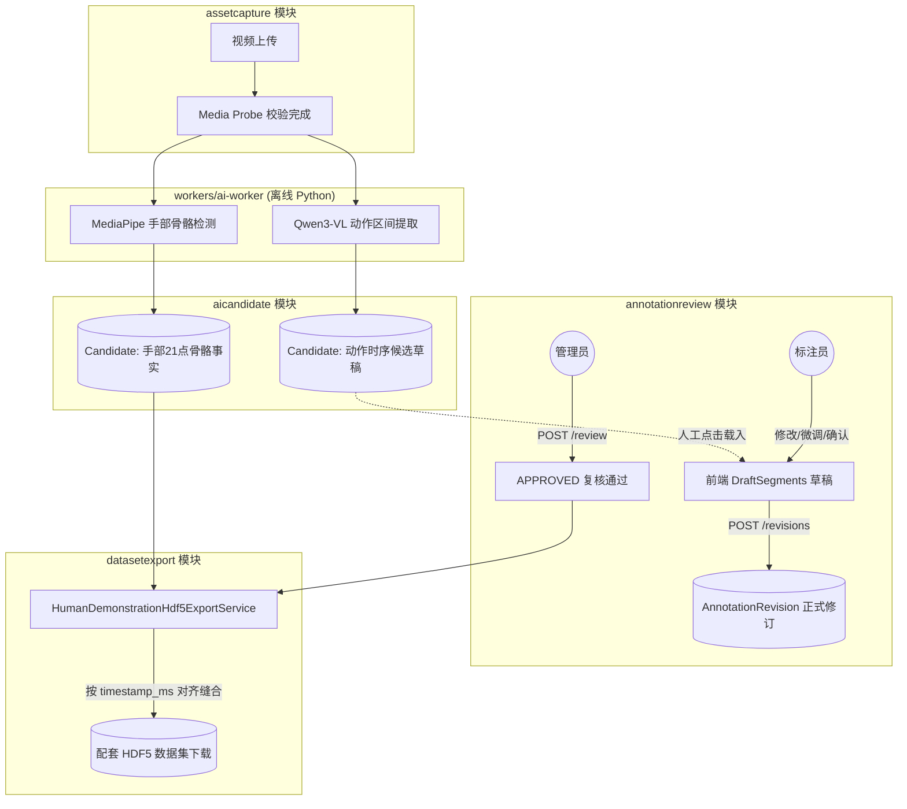

# 配药视频时序动作预标注与人机协同技术设计方案

> 版本：DRAFT / 方案提案<br>
> 日期：2026-09-09<br>
> 关联需求基线：[V1.33 需求基线](../requirements/baselines/V1.33/配药视频数据处理平台需求文档_V1.33.md)、[V1.30 需求基线](../requirements/baselines/V1.30/配药视频数据处理平台需求文档_V1.30.md)<br>
> 关联代码实现：[`AnnotationTaskService.java`](../../services/core-api/src/main/java/com/medicationvideo/platform/annotationreview/AnnotationTaskService.java)、[`CaptureGroupAnnotationPanel.tsx`](../../apps/web/src/features/capture-group/CaptureGroupAnnotationPanel.tsx)、[`HumanDemonstrationHdf5ExportService.java`](../../services/core-api/src/main/java/com/medicationvideo/platform/datasetexport/HumanDemonstrationHdf5ExportService.java)

---

## 1. 背景与业务目标

### 1.1 业务痛点
配药视频数据的核心标注诉求是：**在视频时序上，准确标记出各个时间段内具体发生了什么操作（“视频段内做了什么”）**。
传统纯人工从零标注面临严重的效率瓶颈：标注员必须从第 0 秒开始逐帧寻找动作起止点、手动拖拉区间并输入动作标签，单个 1~3 分钟的视频往往需要耗费 10~15 分钟以上的人工时间。

### 1.2 方案目标与边界收敛
本方案旨在构建**“AI 自动生成初稿 + 人工界面快速核验微调 + 手部关键点配套导出”**的人机协同（Human-in-the-Loop）闭环：
1. **业务清晰解耦**：底层手部检测（MediaPipe Hand Landmarker）作为客观机器证据独立运行；标注任务纯粹聚焦于“动作时序打标”，两者不产生强耦合。
2. **大幅降低人工量**：将人工从“填空题（从零寻找并标注）”解放为“选择/判断题（基于 AI 建议快速确认或修正）”，以“节省 30% 以上人工工时”为基准目标。
3. **极简工程实现**：初期坚决不引入复杂的空间目标检测（如 YOLO）和多模型堆叠，采用单一大模型离线推理基线，通过错误归因驱动后续优化。
4. **配套导出打通**：复用平台现有的 HDF5 导出引擎，以时间戳为纽带，将手部 21 点 3D 骨骼轨迹与人工最终确认的动作标签逐帧对齐打包导出。

---

## 2. 动作标签体系与数据契约

### 2.1 单层互斥原子动作流（Primary Step）
对齐 Core API 服务端核心校验规则 `ANNOTATION_PRIMARY_STEP_OVERLAP`（主步骤时间区间严禁重叠），第一版标签体系严格限定为**单层、时间上连续且互斥的原子动作流**：

| 动作标识（`label_id`） | 显示名称 | 物理起止判据与说明 |
| :--- | :--- | :--- |
| `CHECK_INFO` | 核对信息 | 药师手持药单/处方或核对药瓶标签文字的开始至脱离 |
| `OPEN_CAP` | 操作瓶盖 | 手指接触西林瓶盖/安瓿瓶颈部施力开始，至瓶盖脱落或开启完成 |
| `DRAW_LIQUID` | 抽取药液 | 注射器针尖进入药瓶/安瓿，拉动活塞抽取药液开始至针头脱离 |
| `INJECT_MIX` | 注入混匀 | 注射器注入输液袋/另一药瓶或摇晃振荡混匀开始至动作结束 |
| `LABEL_SEAL` | 贴签封包 | 打印/粘贴成品标签、套袋或装盒的开始至动作结束 |
| `IDLE`（隐式） | 空闲等待 | 无特定配药动作的过渡期，在时间轴上体现为未覆盖空白区 |

> **设计准则**：不将宏观复合概念（如“配药阶段”）与微观操作（如“抽取药液”）混入同一标签层级。所有动作区间均满足 $Start\_ms < End\_ms$ 且相邻区间不重叠。

### 2.2 标注数据模型（对齐现有契约）
```typescript
export interface AnnotationSegment {
  start_ms: number;  // 起始毫秒（从 0 开始）
  end_ms: number;    // 结束毫秒
  label: string;     // 动作标签 ID（如 DRAW_LIQUID）
}
```

---

## 3. 算法模型与硬件部署方案

### 3.1 硬件与模型基线选型

| 维度 | 方案选型 | 决策依据与边界 |
| :--- | :--- | :--- |
| **计算硬件** | **单卡 NVIDIA RTX 4090 (24GB VRAM)** | 拥有完整的 Ada 架构第 4 代 Tensor Core，原生支持 BF16 计算。 |
| **基础模型** | **`Qwen/Qwen3-VL-8B-Instruct`** | 具备原生视觉时序理解与时间戳对齐能力；Instruct 版本严格遵循 JSON 指令输出，不选用产生长推理链的 Thinking 版本。 |
| **推理精度** | **BF16（原生无损）** | 8B 权重固定占用 ~16GB 显存，无需折腾复杂的量化编译，保留最高时序敏感度。 |
| **部署方式** | Python + Transformers 离线运行 | 100% 局域网本地运行，符合医疗数据离线脱敏与安全隔离要求；严禁在运行时在线自动下载模型。 |
| **降级兜底** | `Qwen3-VL-4B-Instruct` | 若长视频显存紧张或需要更高吞吐，作为同批次对照降级方案。 |

### 3.2 显存预算与防 OOM 工程参数

在 24GB 显存总容量下：
* 8B BF16 权重：~16.0 GB
* CUDA 运行时与中间环境：~1.2 GB
* **安全可用余量**：~6.8 GB（用于承载视频 Token、KV Cache 和 Activation）

为确保显存绝对安全（峰值控制在 20GB ~ 22GB 内），离线推理必须严格约束三个参数：
1. **视频片段预算**：单次推理输入控制在 **15 ~ 30 秒片段**。
2. **采帧率（FPS）**：固定为 **1 fps**（即每秒采 1 帧），30 秒片段仅 30 帧，足以捕获动作级区间。
3. **单帧像素上限**：设置 `max_pixels = 448 * 28 * 28`，防止原画高分辨率导致视觉 Token 爆炸。
4. **注意力加速**：显式指定 `attn_implementation="flash_attention_2"`，避免传统 Attention 随序列长度呈二次方内存增长。

---

## 4. 人机协同（Human-in-the-Loop）交互体验设计

```text
[ 视频入库 & 媒体就绪 ]
         │
         ▼
[ 后台 AI Worker 离线推理 ] ──> 生成 Candidate 动作草稿
         │
         ▼
[ 标注员打开 CaptureGroupAnnotationPanel ]
         │
         ├─ 一键载入 AI 建议草稿（或初次自动预填）
         ├─ 时间轴直观可视化（彩色色块显示动作区间）
         ├─ 拖拽左右 Handle 毫秒级微调起止点
         ├─ 下拉框一键切换标签（支持快捷键）
         ├─ 显式呈现未覆盖空白区（Gaps），按 Tab 键顺序巡检防漏检
         ▼
[ 标注员点击提交 ] ──> 生成正式 AnnotationRevision（附带 Candidate Provenance 审计追踪）
```

### 4.1 防漏检机制（Anti-False-Negative）
不能仅让人工审核 AI 已标出的片段（避免“确认偏误”导致遗漏）：
* **未覆盖空白区显性化（Gap Highlighting）**：时间轴上大于 2.0 秒未被任何动作覆盖的空白段，以灰色虚线纹理显式呈现。
* **顺序全流程巡检流**：标注员按 `Tab` 键时，播放焦点在 `[动作片段] -> [空白区间] -> [动作片段]` 间顺序跳转，强制人眼对全视频完成快速扫描。

### 4.2 高效编辑操作
* **拖动微调**：鼠标直接拖动动作色块边缘即可微调起止时间；
* **快捷切分/合并**：当前播放头位置按快捷键切分片段，或合并相邻片段；
* **播放联动**：点击动作色块，播放器自动跳至对应时刻并预留前后 0.5 秒缓冲播放。

---

## 5. 系统架构与模块集成

严格遵守平台 [AGENTS.md](../../AGENTS.md) 的 Spring Modulith 模块所有权规范与数据流边界：



### 5.1 候选隔离与人工真值（Provenance 溯源）
* AI 模型的输出只能作为 `CandidateAnnotation` 暂存入库，**绝不允许越权直接成为正式标签或自动通过复核**；
* 标注员从 Candidate 载入草稿并修正后提交，系统生成由人工签名负责的 `AnnotationRevision`，并在元数据中记录所参考的 `candidate_annotation_id` 与模型哈希，确保科研和监管的完整审计溯源。

### 5.2 配套导出机制（以时间戳对齐）
复用 [`HumanDemonstrationHdf5ExportService.java`](../../services/core-api/src/main/java/com/medicationvideo/platform/datasetexport/HumanDemonstrationHdf5ExportService.java)：
* MediaPipe 每一帧包含精准的毫秒时间戳 `frame_timestamp_ms` 及 21 个 3D 骨骼坐标；
* 导出引擎以 `segmentAt(orderedSegments, timestampMs)` 判定该帧所属的人工审核区间；
* 最终导出的 HDF5 文件同时包含完整手部时序轨迹与对齐的配药动作标签。

---

## 6. 实施路线与阶段验证

| 阶段 | 实施内容 | 交付产物与成功指标 |
| :--- | :--- | :--- |
| **阶段 0：离线单卡 PoC 摸底**<br>*(1~2 天)* | 1. 编写独立离线 Python 脚本 `tools/poc-qwen-video/poc_action_detect.py`；<br>2. 在单张 RTX 4090 上加载 `Qwen3-VL-8B-Instruct` (BF16)；<br>3. 选取 3~5 段 30 秒配药合成演示视频执行推理。 | 1. 显存峰值稳定在 22GB 以内，无 OOM；<br>2. 30 秒视频推理耗时在 15 秒以内；<br>3. 打印起止时间 JSON，肉眼比对视频，评估时序误差。 |
| **阶段 1：平台全链路闭环 (MVP)**<br>*(3~5 天)* | 1. `ai-worker` 增加 action-candidate 消费者；<br>2. `aicandidate` 模块支持时序候选入库；<br>3. 前端 [`CaptureGroupAnnotationPanel.tsx`](../../apps/web/src/features/capture-group/CaptureGroupAnnotationPanel.tsx) 增加【载入建议】按钮及可视化时间轴微调。 | 标注员可在界面一键载入 AI 建议，修改并提交，复核通过后能正常下载配套 HDF5 文件。 |
| **阶段 2：A/B 对照评估与决策**<br>*(1~2 天)* | 针对同一批测试视频，组织对照试验：<br>- 方式 A：纯人工从零标注；<br>- 方式 B：AI 生成草稿后人工微调。 | **核心 ROI 指标**：相同最终质量下，**每分钟视频人工标注时间减少 $\ge 30\%$**。达标则冻结正式基线，未达标则通过错误归因表针对性优化。 |

---

## 7. 错误归因与后续优化矩阵（Error Attribution）

若阶段 0 或阶段 2 出现准确率瓶颈，严格遵循如下“按需迭代”策略，严禁提前复杂化：

| 发现的主要问题 | 归因分析 | 针对性优化动作 | 严禁采取的动作 |
| :--- | :--- | :--- | :--- |
| **动作名称判定混乱** | Prompt 描述有歧义或动作范畴交叠 | 优化 Prompt，补充 1~2 个 Few-shot 正反例，明确 SOP 动作界限 | 盲目更换更大模型或引入分类器 |
| **动作正确但边界整体偏移** | 抽帧未精准对齐 PTS 时间戳，或模型时序粗糙 | 检查视频解码时间戳映射；微调提示词强调精准接触帧 | 盲目上马复杂的两阶段滑动窗口 |
| **快速短暂动作完全漏检** | 1 fps 采样跨度过大，漏掉动作帧 | 对特定短动作区间自适应提高至 2 fps | 盲目全视频按 10 fps 抽帧导致显存爆炸 |
| **药瓶与注射器等器械混淆** | 纯视觉大模型在小物体上分辨率不足 | 后续评估引入局部裁剪（Crop）或专用目标检测（YOLO） | 第一版就提前构建目标检测标注流水线 |
