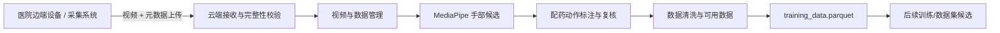
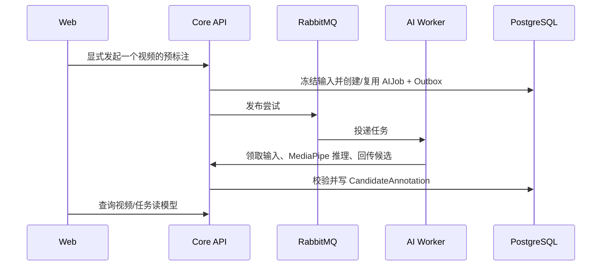

# 配药视频数据管理平台：手部预标注优先技术设计

> 版本：TD-VIDEO-DATA-V1<br>
> 状态：对应 V1.24 FLOW-FIRST P0 当前实施设计<br>
> 日期：2026-08-20<br>
> 对齐需求：[V1.24 配药视频数据管理平台需求文档](../requirements/baselines/V1.24/配药视频数据管理平台需求文档_V1.24.md)

V1.24 继承本文的单视频数据闭环设计，并在 Cleaning PASS 后提供独立、只读的最小 `training_data.parquet` 导出；人工质量结论变为 `QUALIFIED` 时，同一事务自动创建并分配唯一 `AnnotationTask`。CaptureSession、CameraSet、CameraStream 和 DeclaredSyncStatus 保留为接入事实；CaptureSync Core API runtime 及其无生产者的外围 artifact worker、消息/Frame schema 和 G0 tooling 不属于当前 P0，已按独立 Physical Reduction 批次退役。V1.19 多相机同步、V1.22 多视角 Draft、DatasetVersion/复杂 Export 与 AI Evaluation 平台化均为 DEFERRED；未来能力不进入当前单视频闭环。

## 1. 设计目标与系统边界

平台负责云端视频数据闭环：接收、管理、MediaPipe 手部预标注、配药动作标注、清洗复核、可用数据查询和最小训练数据导出。手部预标注是辅助能力，不替代人工标注；当前先保证流程与数据边界，模型准确率优化后移。

医院侧边端设备或既有采集系统负责固定相机采集医护人员配药动作、本地缓存、分段和上传策略。平台是接收端：提供安全上传协议、接收回执和云端处理状态；不控制相机、不下发采集/停止命令、不决定边端何时上传，也不直接删除边端文件。



相机是舱内固定相机，数量按一次采集动态决定。`camera_number` 仅是展示号 1…N；禁止使用相机数量或编号驱动分支业务逻辑。

## 2. 架构与模块边界

| 组件/模块 | 责任 | 用户是否直接操作 |
| --- | --- | --- |
| React Web | 视频管理、数据管理、预标注、标注清洗任务与结果播放 | 是 |
| Core API | 权限、接收状态、资产与元数据、任务命令、读模型、审计 | 是（产品语义） |
| `assetcapture` | 外部上传接收、完整性、媒体状态、视频/相机归属 | 否，经过 API |
| `aicandidate` | AIJob、候选隔离、回传校验和候选查询 | 否，经过 API |
| `annotationreview` | 配药动作标注任务、revision、提交、复核与退回 | 否，经过 API |
| `qualitycleaning` | 清洗规则、运行、质量结论和可用数据投影 | 否，经过 API |
| `tools/minimal-export` | 只读一致性快照，将 Cleaning PASS + 人工标签 + Candidate 几何写入 Parquet；与项目级导出 API 共用资格投影 | 管理员显式运行 |
| PostgreSQL / S3 | 业务真值 / 原视频与派生工件 | 否 |
| RabbitMQ / Media Worker / AI Worker | 耗时媒体检查与预标注的投递、执行、恢复 | 否 |

模块只能写自己拥有的表。AI Worker 不直接写正式标注或清洗结论；它只能通过 Core API 回传 `CandidateAnnotation`。`annotationreview` 产生正式 revision，`qualitycleaning` 产生独立 cleaning result，跨模块通过应用服务或版本化事件协调。

## 3. 边端对接与云端接收

### 3.1 对接契约

V1.18 冻结 [`external-video-ingest-v1`](../../contracts/schemas/external-video-ingest-v1.schema.json) 作为目标版本化 Manifest 契约。它必须在 OpenAPI 接入和契约测试完成后才可供真实医院边端使用；当前既有上传接口保持兼容但不得假称已采用该 Manifest。每个上传批次必须携带 `source_system`、`source_device_id`、显式 `capture_group_key`、`key_source`、采集时间与时区、预期相机编号集合，以及每路视频的 `camera_number`、文件名、声明大小和 SHA-256。

上游 `external_capture_session_id` 存在时作为 `capture_group_key`；否则必须提供稳定的 `UPSTREAM_MANIFEST_KEY`。平台禁止以文件名、时间邻近、上传顺序或相机号猜测多相机归组。`camera_number` 在同组内唯一、正整数、建立后稳定；预期相机 2 缺失时仍显示“相机 2 缺失”，不得重编号。

已有 multipart 上传、断点续传、完整性确认和媒体检查继续作为接收协议。Core API 返回接收和处理状态；接入方可按其自身策略重试。平台不依赖“采集到 N 条后上传”这一具体阈值，也不要求特定的边端实现。

### 3.2 接收后状态

```text
RECEIVING → RECEIVED → MEDIA_CHECKING → INGESTED / MEDIA_FAILED
```

只有 `INGESTED` 且未删除的视频可进入预标注、人工标注和清洗流程。外部上传的幂等键、文件摘要和服务端完整性核验防止重复接收或错误覆盖。

## 4. 面向用户的读模型与 API

内部对象不直接作为默认页面合同。Core API 按视频、任务和数据质量投影提供简洁读模型。

```text
VideoSummary
  video_id (= clip_asset_id), display_name, source_name, camera_number
  captured_at, received_at, media_status
  hand_status, hand_result
  annotation_status, cleaning_status, retention_status

DataManagementSummary
  total_videos, total_duration, storage_bytes
  counts_by_source, counts_by_camera, counts_by_status
  pending_annotation, pending_review, pending_cleaning, usable_count

AnnotationWorkItemSummary
  task_id, video_id, assignee, status, candidate_available
  label_schema_version, current_revision, review_result

CleaningWorkItemSummary
  video_id, status, blocking_codes, rule_set_version, usable
```

目标 API 在现有契约上逐步增加适配层，而不是让 Web 拼装表或队列状态：

```text
GET  /api/v1/projects/{projectId}/videos?from&to&source&cameraNumber&mediaStatus&handResult&annotationStatus&cleaningStatus&cursor&limit
GET  /api/v1/projects/{projectId}/video-data/summary?from&to&source&cameraNumber
POST /api/v1/projects/{projectId}/videos/{videoId}/hand-pose-detections
GET  /api/v1/projects/{projectId}/annotation-work-items
POST /api/v1/projects/{projectId}/annotation-work-items/{taskId}/revisions
POST /api/v1/projects/{projectId}/annotation-work-items/{taskId}/reviews
GET  /api/v1/projects/{projectId}/cleaning-work-items
POST /api/v1/projects/{projectId}/cleaning-work-items/{workItemId}/recheck
GET  /api/v1/projects/{projectId}/training-data/preview
GET  /api/v1/projects/{projectId}/training-data/download
```

`video_id` 是现有 `clip_asset_id` 的产品别名，数据库不新增第二个视频 ID。新增 API 必须同步更新 OpenAPI、契约测试和 Web client。列表固定使用 `ORDER BY received_at DESC, clip_asset_id DESC`，cursor 编码这两个字段；默认 50、最大 100 条。筛选条件放入 URL，以便恢复和分享。对象键、内部 UUID、队列、Worker、模型位置和预签名 URL 不返回普通页面。

P0 在每个视频成功进入 `INGESTED` 后自动提交一条以 `clip_asset_id` 为作用域的幂等 MediaPipe 请求；调度在入库事务提交后以独立事务执行，调度/容量/派发失败不得回写已成功的媒体状态。项目成员与管理员仍可对有权访问、已入库、未删除且 `enabled_for_hand_detection=true` 的视频提交同一单视频幂等请求，以便受控恢复；这不是批量接口或可配置策略。P1 批量 API 或自动策略配置必须在容量评审后另行冻结，届时明确最大 `video_id` 数、逐项结果、部分成功语义、权限拒绝行为和 batch/idempotency key 作用域；在此之前不创建半定义接口。

## 5. MediaPipe 预标注与人工标注

### 5.1 预标注执行与三层状态



基线为 MediaPipe Hand Landmarker `VIDEO`：每路独立、10 FPS、最多两只手，检测/存在/跟踪阈值暂为 0.5。结果包含 bbox、21 点、handedness、置信度和时间基准。handedness 只允许 `LEFT/RIGHT/UNKNOWN`，是 Candidate 辅助元数据；无法判断方向时保留结构有效的几何，不把方向正确性作为流程 Gate。原视频不被改写；Overlay 在播放器按当前时间渲染。

状态不混用：Asset 使用 `UPLOADED/INGESTING/INGESTED/INGEST_FAILED`；Hand job 使用 `NOT_REQUESTED/QUEUED/RUNNING/SUCCEEDED/FAILED`；Hand result 使用 `UNKNOWN/HAND_DETECTED/NO_HAND_DETECTED`。只有 `SUCCEEDED` 的 job 才有后两种终态结果，`NO_HAND_DETECTED` 不是失败。

每个终态 run 保存 `total_video_frames`、`inference_frame_count`、`frames_with_hand`、`frames_without_hand`、`left_hand_detection_count`、`right_hand_detection_count`、`invalid_landmark_count`、`processing_duration_ms`、输入摘要和模型摘要。无手帧不要求逐帧落库。

输入/profile 相同的请求必须幂等。任务丢失、Worker 失联或回传失败按租约、attempt、Outbox/Inbox 和受控重试恢复。候选仅是辅助证据，不能自动写入 `annotation_revision` 或把视频置为清洗通过。

### 5.2 配药动作标注

视频来自固定舱内相机。标签 schema 和标注指南版本化；动作类别、时间段与属性由获批准的 schema 定义，代码不写死医学/业务动作词表。

标注界面在同一播放器中展示原视频、可选 Overlay 和候选。标注员可保存草稿、提交 revision；复核员通过或退回。退回后创建新 revision，旧 revision 不覆盖。没有手部候选或候选质量差时，人工仍可标注。

当 ACTIVE 项目成员把已入库视频的人工质量结论新建或修订为 `QUALIFIED` 时，`qualitycleaning` 在同一数据库事务发布内部 `QualityReviewQualifiedEvent`。`annotationreview` 在提交前重新锁定视频和当前质量事实，并且仅在该版本仍为 `QUALIFIED`、视频不存在任务时，创建唯一的 P0 `AnnotationTask`，分配给作出该质量结论的成员。质量结论、任务和两项审计事实一起提交或回滚；同结论幂等重试、非合格结论和已有任务都不重复创建或改派。该内部事件不携带标注内容、不经过队列、不增加公开 API 或表；它只消除“质量合格后仍需手动补建任务”的空档，绝不替代人工 revision、独立 Review 或 Cleaning。

## 6. 数据清洗、可用数据与最小导出

清洗是独立的质量流程，不是物理删除流程。它至少检查媒体完整性/可读性、重复或近重复、必填元数据、标注完整性、时间范围、标签 schema 一致性与人工质量结论。

```text
待清洗 → 通过 → 可用数据
       ├→ 需修正（返回标注或元数据处理）
       └→ 拒绝（保留原因和审计，不自动物理删除）
```

规则运行保存输入摘要、规则版本、结果和阻断码。人工例外、复核或重跑必须审计。通过清洗的数据进入可用数据投影。

V1.24 的最小导出由 `tools/minimal-export` 与项目级 API 共同提供；两者只读取数据库权威 `training_data_eligibility` 和 `training_data_candidate_observations` 视图，不复制两套资格 SQL。API 是显式、同步、只读的 `preview/download`，要求全局 `ROLE_ADMIN` 与 ACTIVE 项目 ADMIN membership；非合成 profile 在当前没有正式授权模型时 fail closed。它们在数据库强制只读的 `REPEATABLE READ` 快照中读取当前 `INGESTED + QUALIFIED + APPROVED + Cleaning PASS/SUCCEEDED` 事实，将人工 `AnnotationRevision` 的 `[start_ms, end_ms)` 动作标签与范围内的 MediaPipe 21 点 Candidate 对齐为 `training_data.parquet`。当前 schema 为 `training-data.v2`；每行的 `action_start_ms`、`action_end_ms` 和 `action_label` 直接来自当前人工 `AnnotationRevision.annotation_document.segments`，并满足 `action_start_ms <= timestamp_ms < action_end_ms`。每行必须保留 Candidate 的 `algorithm_key`、`algorithm_version`、`model_sha256` 和 `profile_sha256` provenance；元数据固定 `hand_geometry_is_ground_truth=false` 和坐标系 `normalized_image_xy_and_mediapipe_relative_z`；只保留 Candidate 的 `handedness` 与 `handedness_score`，不提供 generic `confidence` 字段。Preview 的 `training_row_count` 是 Parquet 行数，不是视频数；下载固定 `training_data.parquet`、`no-store` 且不包含 MP4。默认元数据明确 Candidate/handedness 不是 Ground Truth，hand mask 当前不可用时不补造 landmark。当前不新建 DatasetVersion、Export Job、Worker、Queue 或业务表；旧 DatasetVersion/legacy Export 运行面及其未使用数据库对象已由 V65/V66 退役，历史 Flyway 文件和设计文档仅保留演进记录，P0 只保留同步 `training-data.v2` preview/download。

## 7. 算法评估与容量门禁

授权、隔离的后续评估样本可记录有手帧召回率、无手帧误检率、21 点有效率、左右手正确率、快速运动/遮挡可用率、Overlay 时间误差和每分钟处理耗时。没有证据的阈值写为 `PENDING`；这些准确率指标当前不作为 P0 流程 Gate。Worker 中断恢复、原视频不改写、AI 候选不自动转正式标签必须通过。评估记录绑定样本、模型和 profile 摘要及参数调整说明。

以 10 FPS、两只手估算，理论上限为每分钟 1,200 条 candidate；1,000 个 10 分钟视频可能达到约 12,000,000 条。P0 单视频结果继续使用 PostgreSQL `candidate_annotation`。P1 批量或自动策略前必须按视频时长、相机数、日量、候选密度、保留期和查询模式完成容量评审，明确选择“经过分区/索引/保留验证的 PostgreSQL dense store”或“PostgreSQL 存 job/summary/index，S3 JSONL/Parquet 存密集帧级结果”。

## 8. Web 信息架构

默认路由为 `/videos`，其余入口均与同一项目和筛选上下文联动：

```text
VideoManagementView       视频分页、筛选、播放、归档、预标注入口
DataManagementView        数据规模/来源/相机/状态概览，跳转视频或任务列表
HandDetectionView         单视频预标注进度、受控失败重试、Overlay 快捷入口
ActionAnnotationCleaningView 配药动作标注任务、revision、复核和清洗任务
UploadIntegrationView     外部上传批次状态与本地测试上传
SettingsView              接入、模型、相机与权限配置
```

简化要求是：从视频详情可以直接进入预标注或标注，AI 失败或没有 Candidate 也不能阻断人工标注；从数据概览可跳转到对应视频/任务；用户不必进入 Session、AIJob 或队列页面。播放器在普通笔记本限制为约 `60–65vh`，共同容器全屏时同时包含视频与 Overlay。高级排障信息仅管理员可见且默认折叠。

## 9. 交付切片与验证

| 切片 | 交付 | 完成定义 |
| --- | --- | --- |
| S1 | 边端对接接收 | 外部采集系统按版本化 manifest 上传；平台只回执，不控制边端 |
| S2 | 视频/数据管理 | 分页筛选、采集元数据追溯、数据概览与统计跳转一致 |
| S3a | P0 单视频 MediaPipe 预标注 | 单路候选、run summary、Overlay、幂等、失败恢复可验证 |
| S3b | P1 显式批量预标注 | 容量评审和完整 batch 语义冻结后才实现 |
| S3c | P1/P2 自动策略 | 模型/相机策略和资源评审后才实现 |
| S4 | 配药动作标注与复核 | 候选辅助、revision、退回与审计闭环 |
| S5 | 数据清洗 | 规则证据、人工结论、可用数据投影与修正回路 |
| S6 | 最小训练数据导出 | 仅当前 Cleaning PASS 数据进入可回读 Parquet；动作标签来自人工 revision；默认无 MP4 |
| S7 | 后续数据集演进与算法评估 | 复杂平台继续冻结；授权样本效果与参数调整记录不阻断当前流程 |

验证至少覆盖：外部协议上传、重复/损坏媒体、动态 N 路相机、1,000 条分页筛选、含手/无手预标注、候选与正式标注隔离、revision 不覆盖、清洗阻断码、未通过 Cleaning 的数据不导出、Parquet 回读、默认无视频，以及合成端到端回归。开发、测试和 CI 只使用合成或明确授权并隔离的数据。
