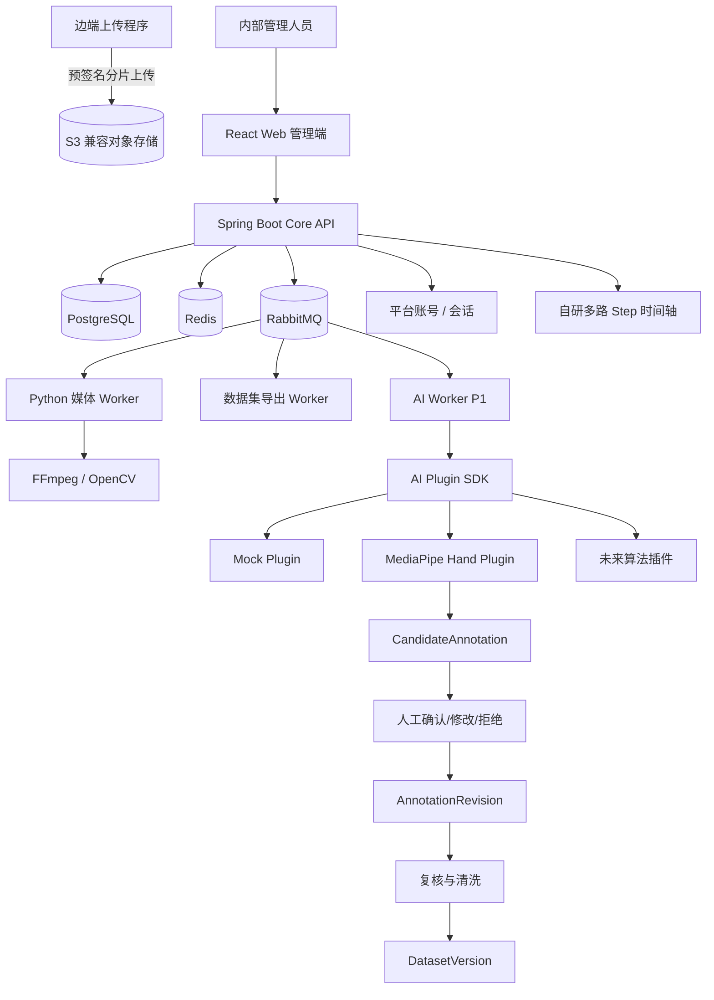

# 配药平台技术设计

> 文档版本：TD-V1.15
> 文档状态：总体技术基线（评审稿）
> 编制日期：2026-08-10
> 当前需求基线：配药视频数据管理平台需求基线 V1.15
> 继承需求基线：配药视频数据管理平台需求基线 V1.14、V1.13、V1.12、V1.11 及其历史继承基线（未变更条款）
> 适用场景：配药舱/配药工作区内，多相机 RGB 视频的内部训练数据管理平台
> 核心闭环：数据接收与管理 → 标注 → 复核 → 清洗 → 数据集冻结 → 导出可训练数据集
> 安全提示：真实医疗数据的采集授权、分级、脱敏、访问、留存、导出和销毁，须由医院责任部门确认

---

## 0. 文档定位

### 0.1 本文用途

本文是研发、测试、部署和验收使用的总体技术基线，负责：

- 需求基线 V1.15 的业务范围及其继承条款；
- 跨领域架构、模块边界、技术决策和分阶段交付顺序；
- P1 AI 插件与 MediaPipe 试点的非阻断演进路径。

后续编码以需求基线、本文、ADR、本文链接的详细设计、`contracts/` 和可执行测试共同约束。历史文档用于追溯，不再作为并列编码规格；发现冲突时必须按 `AGENTS.md` 的事实来源顺序评审，不能自行选择方便实现的一份。

### 0.2 文档集与详细设计

本文负责总体范围、技术决策、模块边界和交付顺序。下列文档负责可执行细节：

- [需求追踪矩阵](./requirements-traceability.md)：FR/NFR 到模块、契约、表和验收证据；
- [领域模型与数据所有权](./domain-model-and-data-ownership.md)：聚合、表所有权、跨模块引用和事务边界；
- [状态机与领域守卫](./state-machines.md)：允许迁移、守卫、角色、幂等和事件；
- [异步作业协议](./asynchronous-job-protocol.md)：Outbox/Inbox、Worker 回传、租约、重试、取消和 DLQ；
- [时间基准与多相机同步](./timebase-and-multicamera-sync.md)：PTS、VFR、offset、drift 和同步验收；
- [安全、隐私与保留销毁](./security-privacy-retention.md)：分级、授权、密钥、审计、保留和销毁；
- [部署、容量与灾难恢复](./deployment-capacity-and-dr.md)：拓扑、容量、性能、备份、RPO/RTO 和恢复演练；
- [Web 前端与用户体验设计规范](./web-ux-and-frontend-guidelines.md)：信息架构、页面状态、前端依赖启用门槛、可访问性和验收。

详细字段和兼容性最终以 OpenAPI、事件 JSON Schema、Flyway 和测试为可执行证据。详细设计不能覆盖已批准 ADR；契约与本文冲突时必须先修正文档或 ADR，再修改实现。

### 0.3 当前基线变化

- P0 数据闭环先于 AI，MediaPipe 只作为 P1 可替换插件；
- 核心平台采用八个领域模块和一个集成适配层，部署为一个 Core API；
- 医院现场相机/RK3588 仅采集并自动上传；内部团队是 Web 管理、数据筛选和训练数据交付的唯一用户；
- 对齐 V1.9：继承 V1.8 的桌面 Web 验收范围和此前业务规则，并将继承条款中的 Vue 质量门禁替换为 React Web 质量门禁；
- 对齐 V1.10：P0 只交付主 Step 训练数据，Object/COCO 和派生清洗视频等待真实生产者与验收样本；
- 对齐 V1.11：只有 `ROLE_ADMIN` 且拥有 ACTIVE 项目 `ADMIN` Membership 才能执行项目管理员命令；该管理员可自审标注、冻结和导出，但审计与 Web 必须标识 `SELF_ADMIN_APPROVAL`，普通成员不能借项目角色获得管理员命令权限；
- 对齐 V1.12：Ego 视频 MediaPipe Hand Landmarker 只生成双手二维姿态候选，必须经人工确认形成正式 revision；不做自动 Step/临床判断、三维重建或实时推理；
- 对齐 V1.13：先交付隔离的本地 Hand Pose PoC 和 Golden Set 评估，再由人工决定是否接入平台 AIJob/CandidateAnnotation；PoC 不新增正式 API、数据库或消息流程；
- 对齐 V1.14：手部姿态识别只产生 Ego 关键点候选；候选的写入、人工接受/修改/拒绝与正式 AnnotationRevision 的隔离，必须在 Phase A `GO` 后以单一纵向切片实现；
- 对齐 V1.15：Phase A 必须先完成 Golden Set 和书面 `GO`；Phase B 冻结 Ego 准入、完整 profile、帧级结果、存储、capability 脱敏、幂等/租约和人工审核契约，详见专题设计；
- 本文其余未标为历史证据的“另一位管理员”“申请人不能自批”表述均由 V1.11 替换为上述受限单管理员规则；Worker 机器身份、项目边界、状态/摘要校验和审计追加约束不变；
- P0 不运行独立 PrivacyAssessment、PrivacyRelease、脱敏 Variant 或 Quarantine 流程；历史迁移保留但不代表当前产品能力；
- 详细状态、数据、安全和运行规则由 0.2 节链接的专题文档维护，不在本文重复。

---

# 1. 总体结论

## 1.1 技术方案结论

基础形态：

```text
React Web 管理端
        ↓ REST / OpenAPI
Java 21 + Spring Boot 模块化单体 Core API
        ├── PostgreSQL
        ├── S3 兼容对象存储
        └── 审计与事务状态
```

出现首个跨进程耗时任务时增加 `Outbox → RabbitMQ → Python Worker`。Export Worker 和 AI 插件按对应阶段接入；CVAT 已由 V1.5 移出 P0，只有 Object 标注出现经过批准且自研轻量工具无法满足的真实需求时才重新评估。外部 IdP 只有出现明确集成需求时才评估，Redis 只有在存在测量证据时才启用。

应用形态：

```text
模块化单体核心平台
+ 独立异步 Worker
+ 外部工具适配器
+ 可插拔 AI 能力
+ 版本化数据资产
```

第一期不采用微服务。只有在出现明确的独立扩容、独立发布、团队所有权或合规隔离需求后，才拆分服务。

## 1.2 科学性边界

平台只管理和生产视频数据，不直接产生医疗业务真值。

允许标注：

- 视频中可见的动作；
- 可见对象；
- 时间边界；
- 遮挡、模糊、黑屏等质量状态；
- 隐私区域；
- 可观察事件。

禁止由视频或 MediaPipe 直接判断：

- 药品是否正确；
- 剂量是否正确；
- 扫码是否成功；
- 操作是否符合 SOP；
- 护士是否完成了医学意义上的正确复核；
- 是否存在临床差错。

上述业务真值必须来自业务系统日志、扫码记录、药柜日志、任务系统或专家复核。

## 1.3 AI 定位

```text
AI 输出 = CandidateAnnotation
人工接受或修改 = AnnotationRevision
复核通过 + 后置清洗通过 = 数据集候选
数据集冻结 = 可训练版本
```

MediaPipe 是一种可替换插件，不是核心平台框架。AI 失败时，人工标注闭环仍须完整可用。

---

# 2. 系统范围

## 2.1 P0 范围

P0 必须完成：

1. 大视频分片上传、断点续传、摘要校验和入库；
2. `capture_session` 多相机成组；
3. 相机配置快照和多路 `camera_stream` 管理；
4. 视频资产检索、预览、状态和元数据；
5. 媒体技术校验、人工质量判断和不合格数据排除；
6. 意外敏感内容通过人工质量 `REJECTED` 与管理员软删除处理；P0 不运行专门隐私、脱敏、放行或隔离流程；
7. session 级 Step 标注；
8. 标注提交、返工、复核和不可变修订；
9. 后置标签清洗；
10. 数据集筛选、防泄漏划分、冻结；
11. `manifest.jsonl`、`action_segments.jsonl` 和原始视频训练包导出；
12. 权限、审批、审计和备份恢复；
13. OpenAPI、事件 Schema、数据库迁移和测试体系；
14. 项目管理：数据项目、成员、不可变视频归属、项目内一层文件夹与筛选，普通用户仅见已加入项目；
15. 平台本地上传：用户在平台页面选择本机视频，复用 Upload/Multipart/Complete 契约，并按已确认规则建立 CaptureSession 归属；
16. 视频预览与在线播放：项目成员显式申请技术校验通过的原始 MP4 短期只读地址、HTML5 Video 播放器、无权限不返回播放地址、加载失败明确提示；P0 不以前置 Preview/Deidentified Variant 为播放条件；
17. 视频删除：管理员可以删除无用、上传错误或不合格的视频，其他视频不受影响，操作可审计。

> V1.2 曾把对象标注列入第一版；V1.10 已将 P0 收敛为主 Step 时间段标注，Object/COCO 后置到真实训练用例、工具边界和验收样本获批之后。角色界面仍收敛为管理员与普通用户；任意远程 URL 导入 P0 不支持。

## 2.2 P1 范围

P1 在 P0 闭环稳定后实施：

- camera stream 级 Object 标注和 COCO 导出；
- AI 插件接口；
- `AlgorithmRegistry`；
- `AIJob`；
- `CandidateAnnotation`；
- Mock 插件；
- AI 候选确认页面；
- MediaPipe Hand Landmarker 试点；
- 标注效率与质量对照评估；
- FiftyOne/Datumaro 类数据治理能力按需接入。

## 2.3 不在当前范围

- 摄像头硬件控制和采集触发；
- 实时视频推理；
- 模型训练、调参和部署；
- 医院 HIS/EMR 深度改造；
- 三维手部重建；
- 多相机 ReID；
- 跨视角统一 object_id；
- 自动 SOP 判断；
- 自动药品或剂量判断。
- 医院人员登录 Web 管理端、管理项目或控制边端采集。

---

# 3. 技术选型基线

## 3.1 选型表

| 层级          | 技术基线                                                      | 使用原则                                     |
| ------------- | ------------------------------------------------------------- | -------------------------------------------- |
| 前端          | React 19 + TypeScript + Vite + Ant Design + React Router      | 内部管理端，优先降低表格、表单和权限页面成本 |
| 视频播放      | HTML5 Video；需要 HLS 时使用 hls.js；自研多路同步控制器       | 不自研播放器内核                             |
| Object 标注   | 按真实用例选择轻量 Canvas/SVG 或后续批准的外部工具            | P0 不运行 CVAT；第二个稳定用例出现前不抽象通用画框框架 |
| 核心后端      | Java 21 LTS + Spring Boot 4.1 系列 + Spring Modulith          | 状态、权限、审计、事务和长期维护             |
| Java 构建     | Maven Wrapper                                                  | 单个 Spring Boot 工程，领域模块按 Java 包隔离 |
| API           | REST + OpenAPI 3.1                                            | OpenAPI 与代码同仓版本化                     |
| 数据访问      | Spring Data JPA + jOOQ/显式 SQL                               | 聚合写入用 JPA，复杂筛选和导出不用强行 ORM   |
| 数据库        | PostgreSQL 18 系列或目标部署批准的 17 系列                    | 构建和部署锁定准确补丁版本                   |
| 迁移          | Flyway                                                        | 禁止手工修改生产表结构                       |
| 消息          | RabbitMQ + Transactional Outbox                               | 第一个跨进程耗时任务出现时启用；初期一个业务队列加 DLQ |
| Python Worker | Python 3.12 + Celery + Pydantic                               | 仅运行在 Linux 容器/主机                     |
| Python 依赖   | uv + `pyproject.toml` + lockfile                              | 不修改系统 Python，不提交未锁定依赖          |
| 前端依赖      | pnpm + lockfile                                                | 不全局安装项目框架依赖                       |
| 媒体处理      | FFmpeg/ffprobe + OpenCV                                       | 探测、解码、转码、抽帧和质量指标             |
| AI            | MediaPipe Tasks API，经插件封装                               | 不使用旧 Legacy Solutions 作为新代码基线     |
| 缓存          | Redis（可选）                                                 | 有缓存、限流或短锁的测量证据后再启用，不进入 P0 默认运行清单 |
| 对象存储      | S3 Compatible API                                             | MinIO、Ceph RGW、云 S3 等均可替换            |
| 标注          | 自研 session Step 时间轴；Object 工具后续按真实用例批准       | 当前先闭合人工 Step、管理员复核和后置清洗    |
| 认证          | Spring Security + 平台账号会话                               | 内部管理账号、BCrypt、HttpOnly 会话与 CSRF；设备使用独立服务凭据 |
| 部署          | Linux 容器；开发/UAT 用 Docker Compose                        | 达到 HA/GPU/多院区门槛再上 Kubernetes        |
| 可观测性      | OpenTelemetry + Prometheus/Grafana + 集中日志                 | API、队列、Worker、算法和审计统一追踪        |

## 3.2 版本策略

架构文档固定版本系列，构建文件固定准确版本和镜像摘要：

```text
文档：Spring Boot 4.1 系列
构建：4.1.x 的已测试补丁版本

文档：PostgreSQL 17/18 系列
部署：医院批准的准确版本和镜像 digest
```

禁止：

- `latest` 镜像；
- 不带锁文件的 Python 依赖；
- 运行时自动下载模型；
- 未审批自动升级 MediaPipe 或模型文件。

## 3.3 浏览器兼容

内部管理人员使用的目标浏览器型号和版本当前尚未冻结，作为 `PENDING` 决策管理，必须在涉及视频预览、Canvas、多路同步的 P0 功能进入 UAT 前完成盘点并形成浏览器矩阵。在矩阵冻结前不得宣称兼容性已经验收。

默认按现代 Chrome/Edge 建设；若内部管理终端较旧，应：

- 配置 Vite `build.target`；
- 评估 `@vitejs/plugin-legacy`；
- 明确不支持的浏览器版本；
- 在 UAT 中使用目标内部管理终端验证视频解码、Canvas 和多路同步。

显示设备范围已经冻结为内部笔记本及 1080p、2K、4K 桌面工作站；P0 不承担手机浏览器或触摸优先布局验收。Web 以 1080p 信息密度为基础，通过分档内容宽度利用 2K/4K 空间，不使用整体缩放填充屏幕。具体视口、布局和验收规则见 [V1.8 需求基线](../requirements/baselines/V1.8/配药视频数据管理平台需求文档_V1.8.md)（由 V1.11 继续继承）与 [Web 前端与用户体验设计规范](./web-ux-and-frontend-guidelines.md)。

## 3.4 Web 信息架构与渐进启用

Web 不是实时监控端，也不控制边端采集。页面只随已闭环能力启用，不创建空页面、空 Store 或伪造数据。医院远端上传、平台本地上传和合成测试客户端复用同一 Upload/Multipart/Complete 契约。

具体信息架构、路由启用条件、前端依赖门槛、可访问性和验收规则统一由 [Web 前端与用户体验设计规范](./web-ux-and-frontend-guidelines.md) 维护；视觉方向见[设计简报](../design.md)。

---

# 4. 总体架构

## 4.1 逻辑架构



## 4.2 部署工作负载

总体架构图表示 P0 完整闭环的目标形态，不表示 Sprint 0 同时启动全部服务。工作负载按纵向能力激活：

| 阶段 | 新增工作负载 | 说明 |
| --- | --- | --- |
| Sprint 0 | Core API、Web、PostgreSQL、本地 S3 兼容对象存储 | 只建立工程、边界、契约、两服务基础设施和质量门禁，不预建空业务层 |
| 上传与资产 | 在业务代码中启用 PostgreSQL 和 S3 | 增加 Flyway、资产模型和对象操作；不新增其他基础设施 |
| 媒体处理 | RabbitMQ、Media Worker | 初期一个业务队列加 DLQ；出现跨进程耗时任务后才启用 |
| 标注与清洗 | 不新增工作负载 | 人工 Step、管理员复核和当前轻量 post-clean 在 Core API 与 PostgreSQL 中同步闭环；不启用 CVAT、专门隐私服务、Worker 或新队列 |
| 数据集与导出 | Export Worker | 已随 v2 训练包执行切片启用；使用独立身份、租约、临时对象和结果校验 |
| P1 | AI Worker、AI 插件镜像 | P0 验收后启用 |
| 有证据时 | Redis | 仅用于缓存、限流、短锁或短期进度；无证据不加入 |

模块声明可以先建立，但 Controller、Entity、Repository、事件、表和接口只随当前纵向功能创建。

## 4.3 控制面与数据面

### 控制面

- 身份和授权；
- 元数据；
- 状态机；
- 作业编排；
- 标注和复核；
- 规则和版本；
- 审批和审计。

### 数据面

- 视频分片；
- 原始/派生视频；
- 抽帧图片；
- 标注附件；
- 清洗报告；
- 数据集导出包；
- AI 模型和候选结果附件。

API 不代理大视频字节。视频通过短时预签名 URL 或受控反向代理流转。

---

# 5. 模块化边界

## 5.1 领域模块与集成适配层

| 模块                  | 拥有的业务能力                            | 主要表所有权                                                                         |
| --------------------- | ----------------------------------------- | ------------------------------------------------------------------------------------ |
| `iamproject`       | 内部账号、数据来源/项目、角色、ABAC 上下文、项目与成员   | tenant、project、membership、role_binding                                      |
| `assetcapture`     | 上传、资产、session、stream、相机配置快照、项目内文件夹和视频删除 | upload_batch、clip_asset、asset_folder、capture_session、camera_stream、camera_set_snapshot |
| `mediaprivacy`     | 探测、转码、抽帧、variant、隐私风险和放行 | media_job、asset_variant、media_report、privacy_assessment、deidentify_run、privacy_release_decision |
| `annotationreview` | 标注项目、Schema、任务、修订和复核        | annotation_project、label_schema、annotation_task、annotation_revision、step_segment、object_annotation、review_record |
| `qualitycleaning`  | 前后置清洗、隔离、重复检测和规则版本      | cleaning_rule_set、cleaning_run、cleaning_result、duplicate_group、quarantine_record、admission_override |
| `datasetexport`    | 筛选、split、冻结、导出和校验             | dataset_version、dataset_member_session、dataset_member_stream、dataset_version_validation、dataset_export |
| `aicandidate`      | 算法注册、AI 作业、候选、候选确认、评估   | algorithm_registry、ai_job、candidate_annotation、candidate_review_record             |
| `governance`        | 申请、审批、追加式审计、保留与销毁        | approval_request、audit_event、retention_policy、destruction_certificate             |

以上八项是领域代码和表所有权边界，不是八个服务。P0 只部署一个 Core API。

`integration` 是端口和适配器层，不是第九个业务领域模块。它负责 S3、RabbitMQ、未来经批准的外部标注工具和 IdP 等外部系统接入，只拥有外部 ID 映射、同步游标和适配器运行状态，不拥有资产、标注、数据集等业务真值。MVP 默认作为 `platform-api` 内的 Java 包随 Core API 构建；只有出现独立发布或安全隔离需求时才拆成独立构建模块或服务。V1.5 已把 CVAT 移出 P0，当前不得仅因适配层预留而创建 CVAT 运行代码或页面。

## 5.2 依赖方向

主链路：

```text
iamproject
    ↓
assetcapture
    ↓
mediaprivacy
    ↓
annotationreview
    ↓
qualitycleaning
    ↓
datasetexport
```

AI 是旁路增强：

```text
mediaprivacy
    ↓
aicandidate
    ↓
annotationreview
```

`governance` 为所有高风险操作提供门禁和审计，但不得成为可以任意修改全部状态的“万能流程模块”。

## 5.3 模块规则

- 模块只能写自己拥有的表；
- 跨模块读取通过公开查询接口或只读投影；
- 跨模块写入通过应用服务或领域事件；
- 禁止跨模块 Repository 注入；
- Spring Modulith 在 CI 中检查循环依赖、内部包越界和未允许依赖；
- 高风险跨模块流程使用显式编排器，不直接串改状态。

---

# 6. 核心领域模型

## 6.1 相机与采集

### CameraChannel

物理或逻辑采集通道的不可变内部实体：

```text
camera_channel_id 永不修改
```

当前最小配置由平台根据 project 内唯一的非敏感 `provisioning_key` 生成不可变
`camera_channel_id`。`provisioning_key` 是部署对接键，不是展示名、硬件凭证或相机可连接地址。
需要临时编号、正式编号和展示名时再引入带生效期的 `CameraAlias`，不得用修改
`camera_channel_id` 的方式实现重命名。

### CameraSet

服务器维护的相机组配置，按 `(project_id, camera_set_key, configuration_version)` 创建不可变版本。
成员引用已有 CameraChannel，并冻结 `camera_index`、`camera_role`、`mount_position`、enabled 和
layout version。同一版本内 CameraChannel 与 `camera_index` 分别唯一，至少一个成员 enabled。

管理或部署流程把具体 `camera_set_id` 配置给 RK3588；边端只能在后续入库请求中引用该标识，
不能创建、修改或覆盖配置。当前 P0 通过精确版本标识选择配置，不提前实现定时生效、自动发现、
连通性探测或硬件控制。

### CameraSetSnapshot

session 创建时冻结：

- 成员；
- `camera_index`；
- `camera_role`；
- `mount_position`；
- enabled；
- layout version。

配置后续变化不得改写历史 session。

### CaptureSession

一次完整配药操作的多视角集合，是：

- 状态汇总最小业务单元；
- Step 标注单位；
- 数据集成员单位；
- 最低防泄漏单位。

### CameraStream

某个 CameraChannel 在一个 CaptureSession 中产生的一路视频。

### 6.1.1 项目、文件夹与上传来源

- Project 是权限和数据归属边界；每个视频和 CaptureSession 只属于一个 Project，第一版 ProjectMembership 角色只有 `ADMIN` 和 `MEMBER`。
- 管理员可修改 ACTIVE Project 的显示名称；归档将其转为 `ARCHIVED` 并从正常入口移除，不物理删除项目、成员、视频、对象或审计。P0 不提供项目恢复或硬删除。
- AssetFolder 是项目内一层分类。`clip_asset.folder_id` 可空；移动视频只更新该字段，删除文件夹只取消分类，不移动或删除视频。
- `upload_batch.upload_source_type` 第一版只有 `HOSPITAL_REMOTE` 和 `PLATFORM_LOCAL`。两种入口共用上传契约，不创建来源表，也不支持平台主动抓取远程地址。
- UploadBatch 完成后不直接修改 `project_id`。详细不变量见[领域模型与数据所有权](./domain-model-and-data-ownership.md)。

当前实现进度：OpenAPI、Flyway V22～V50 和 Web `/uploads/new` 已完成 Project、ADMIN/MEMBER Membership、项目改名/归档、一层 AssetFolder、视频项目内分类、平台本地上传及内部账号最小闭环，包括首个管理员引导、普通用户创建/启停、成员变更幂等、最后管理员保护、项目可见性、同项目复合外键、删除文件夹不删除视频和追加式审计。平台账号密码只保存 BCrypt 哈希，Web 使用 HttpOnly 会话 Cookie 与 CSRF；医院边端与 Worker 继续使用独立服务凭据。医院侧只作为采集和自动上传的数据来源，平台 Web 仅供内部团队管理、筛选、审核、标注、清洗和训练数据交付。项目成员可上传和读取显式项目范围的 Session、ClipAsset、EVENT_LOG；涉及配置、视频删除和成员管理仍要求项目 ADMIN。视频目录支持真实文件夹和“未分类”投影筛选。平台本地上传每个文件建立独立 `PLATFORM_LOCAL` 批次，浏览器分块计算摘要并复用 Multipart/Complete 后建立单视角 CaptureSession；多文件按顺序执行，不从文件名推断多相机关系。已实现项目内人工查看：ACTIVE 项目 ADMIN/MEMBER 对已完成上传完整性校验、未删除的 MP4 显式点击后可取得短期 `DATA_REVIEW` 地址；媒体探测不是播放前置条件，而是补充时长、编码和完整解码等技术事实。签发写既有 `audit_event`，URL 不落库、不写审计详情、到期自然失效。播放只提供人工查看能力，不自动判定质量或产生标注。媒体探测终态会把 CameraStream 投影为 `PASS/REJECT`，并聚合 CaptureSession 的已入库数量、组装状态和技术检测状态；历史数据由 V35 回填。已实现最小人工质量判断、标注、不可变复核决定、返工和后置清洗：项目成员可对已入库视频记录 `QUALIFIED`、`REJECTED` 或 `NEEDS_REVIEW` 及固定原因；项目管理员只能为 `QUALIFIED` 视频创建并直接分配一个 `ASSIGNED` AnnotationTask。任务绑定不可变的 P0 主 Step LabelSchema 与摘要，受理人只能选择五个 P0 Step，并提交不重叠且不超出已验证媒体时长的 `annotation-document.v1` 时间片段修订；拥有 ACTIVE 项目 `ADMIN` Membership 的 `ROLE_ADMIN` 可记录一次不可变 `APPROVED/REJECTED` 决定，复核自己提交的 revision 时必须记录 `SELF_ADMIN_APPROVAL`；`ROLE_MEMBER` 不能记录复核。`REJECTED` 会把任务退回受理人，下一次提交创建递增 revision。V34 和 `p0-post-annotation-cleaning-v1` profile 使 `APPROVED` 在同一事务中推进任务至 `COMPLETED`，并生成绑定 revision、文档/标签规范/媒体输入摘要、人工质量版本和规则版本的不可变 post-clean run/result；缺少已验证媒体时长记录为 `WARNING`，标签、摘要或时间事实不合法时记录为 `REJECT`，其余为 `PASS`。标注任务列表在同一次一致读中汇总当前可见范围的待提交、待修改、待复核和已完成数量，前端不跨页拼接统计。Session 详情现可显示准入准备度；人工质量版本变化会使旧 post-clean PASS 失效。

项目管理员可为当前 eligible 的 CaptureSession 显式创建 `DRAFT` DatasetVersion；服务端在同一事务重新校验当前事实并固定 session/stream、媒体摘要、标注 revision/document/schema、人工质量和 post-clean 规则证据快照及审计。ACTIVE 项目成员可分页查询版本元数据及固定的 session/stream 证据，查询不解析当前状态也不暴露媒体 URL。拥有至少两个成员的草稿可由项目管理员固定一次 `CAPTURE_SESSION_HASH_RANK_V1` pilot/holdout 计划；服务端保存正整数 seed、实际分配和审计，同一草稿不得改写或建立第二份计划。标签和清洗摘要各自统一后，管理员还可固定一次 `DatasetBuildSpecification`，绑定显式候选快照、统一摘要、split 和当前 `p0-dataset-export-v2`；历史 v1 配置保持可重放。管理员随后可显式开始构建；服务端锁定项目，在同一事务重新核对当前准入和固定证据，只有零阻断时才记录启动事实与审计并迁移到 `BUILDING`。在 `BUILDING` 内可复用既有关系快照生成 `DATASET_RELATIONAL_SNAPSHOT_V1` 确定性封印，绑定原始 ClipAsset ID/摘要、revision、清洗和泄漏分组事实后进入 `VALIDATING`。管理员可在该状态执行一次冻结前技术校验，保存不可变 `PASS/FAIL`；`PASS` 同时建立待审批请求。拥有 ACTIVE 项目 `ADMIN` Membership 的 `ROLE_ADMIN` 批准时再次执行全部技术检查，并原子记录审批、审计和 `FROZEN` 状态；申请人可自批，同人必须记录 `SELF_ADMIN_APPROVAL`，`ROLE_MEMBER` 不能冻结。证据变化或 `FAIL` 必须新建版本。V45 允许管理员为 `FROZEN` 版本提交唯一 `MODEL_TRAINING` 导出申请，固定 profile、快照、validation、用途和有效期，并原子创建 `REQUESTED` 记录、待审批请求和审计。OpenAPI 0.53 与 V47 完成 v2 执行切片：同一合格管理员可批准自己的导出申请，并原子记录 `SELF_ADMIN_APPROVAL`、审批事实、首次 attempt、Outbox 和审计；`ROLE_MEMBER` 不能申请或批准导出。Export Worker 以独立身份和租约读取冻结的原始 ClipAsset，生成确定性 ZIP，Core API 校验文件集合、输入/输出摘要和批准的软件摘要后登记 `ExportArtifact`，管理员显式操作时才获得短期下载地址。V48 增加失联租约恢复：grace 后将旧 attempt 标为 `LOST` 并清理临时输出，未达上限时原子创建新 attempt/Outbox，达到上限时终止导出。上述过程不允许 WARNING override。历史 v1 事实保持可读和可校验，但真实 Object/COCO 与 clean video 生产者尚不存在，当前明确阻断 v1 执行而不伪造产物。对象框、抽样复核、更强泄漏组、AI、可播放派生 Variant、CVAT 和自动隐私流程不在当前 P0 主链路。

Web 的 Session 详情可创建单条草稿；Session 列表允许项目管理员从当前已加载记录中明确选择 1–100 条。浏览器不计算准入结论，服务端逐条重验，任一记录不符合则整个草稿不写入。

## 6.2 资产模型

### ClipAsset

不可变媒体文件。原始、脱敏、预览、裁剪等通过 `AssetVariant` 关联。

### AssetVariant

至少支持：

- `RAW`
- `PREVIEW`
- `THUMBNAIL`
- `DEIDENTIFIED`
- `TRIMMED`
- `DATASET_FRAME`

每个派生版本必须递归追溯到 raw，保存输入摘要、配方版本和软件摘要。

### 视频播放

V1.7 的首版直接播放已完成上传完整性校验的原始 MP4，不强制先生成 `PREVIEW`/`DEIDENTIFIED` AssetVariant，也不等待媒体探测完成。用户必须具有显式项目的 ACTIVE ADMIN/MEMBER Membership，资产必须未删除且属于受支持媒体；用户显式点击后服务端签发最短 TTL 的 `DATA_REVIEW` 只读地址，并以追加式审计事件记录授予证据。地址只出现在 `no-store` 响应中，不落库、不写审计详情、到期自然失效，也不代表质量合格、标注批准、下载或导出授权。媒体探测继续用于补充真实时长、编码和完整解码事实，并仍是质量结论为合格、创建标注任务和训练候选的技术前提。若后续确有带宽或浏览器兼容需要，再按证据增加派生 Variant，不把它作为当前播放前置条件。

### 视频删除

在 `clip_asset` 增加可空的 `deleted_at`、`deleted_by` 和 `delete_reason`。删除时校验管理员权限和受控下游引用，并写既有 `audit_event`，不创建 `asset_disposition`、删除事件表或独立状态机。

已删除视频退出普通列表、播放、新标注任务和新数据集候选。删除多视频 CaptureSession 中的一路视频时保留 session 和其他视频，并将 session 投影为缺流/不可用。物理销毁继续使用既有 governance 保留与销毁流程。

## 6.3 标注模型

### AnnotationTask

任务范围：

- `SESSION_STEP`
- `STREAM_OBJECT`
- `PRIVACY_REGION`
- `QUALITY_REVIEW`

### AnnotationRevision

每次提交形成不可变修订。返工创建新 revision，不覆盖旧结果。

### StepSegment

使用 session 统一时间轴，整数毫秒，左闭右开：

```text
[start_ms, end_ms)
```

### ObjectAnnotation

按 stream 和 frame 保存：

- frame index；
- stream timestamp；
- session timestamp；
- label；
- bbox；
- visibility；
- 来源修订。

## 6.4 数据集模型

DatasetVersion 冻结：

- session 成员；
- asset/variant 摘要；
- AnnotationRevision；
- Label Schema；
- CleaningRuleSet；
- privacy release；
- split policy；
- leakage group；
- random seed；
- export profile；
- sampling profile；
- software/image digest。

FROZEN 后不可原地修改。

---

# 7. 正交状态模型

禁止使用一个“大状态”表达全部流程。至少保存以下独立状态：

| 维度                        | 示例                                                                          |
| --------------------------- | ----------------------------------------------------------------------------- |
| `asset_status`            | INITIATED、UPLOADING、UPLOADED、INGESTING、INGESTED、INGEST_FAILED            |
| `session_assembly_status` | OPEN、ASSEMBLING、COMPLETE、INCOMPLETE、CLOSED                                |
| `session_quality_status`  | PENDING、PASS、WARNING、REJECT                                                |
| `stream_quality_status`   | PENDING、PASS、WARNING、REJECT                                                |
| `privacy_risk_level`      | UNKNOWN、NONE、SUSPECTED、CONFIRMED                                           |
| `deidentify_status`       | NOT_REQUIRED、PENDING、RUNNING、SUCCEEDED、FAILED、VERIFIED                   |
| `privacy_release_status`  | BLOCKED、REVIEW_PENDING、ALLOWED_ANNOTATION、ALLOWED_INTERNAL_EXPORT、REVOKED |
| `pre_clean_status`        | PENDING、PASS、WARNING、REJECT                                                |
| `annotation_status`       | PENDING、ASSIGNED、IN_PROGRESS、SUBMITTED、REWORK、COMPLETED                  |
| `review_status`           | NOT_SUBMITTED、PENDING、PASS、REJECT、ADJUDICATION_REQUIRED                   |
| `post_clean_status`       | PENDING、PASS、WARNING、REJECT                                                |
| `quarantine_status`       | NONE、ACTIVE、REVIEW_PENDING、RELEASED                                        |
| `dataset_version_status`  | DRAFT、BUILDING、VALIDATING、FROZEN、EXPORTING、AVAILABLE、RETIRED            |

所有状态变更：

- 经过领域守卫；
- 使用乐观锁；
- 写审计；
- 产生必要的 Outbox 事件；
- 禁止后台 SQL 跳过守卫。

---

# 8. 端到端 P0 流程

## 8.1 上传和入库

```text
upload/init
→ 注册完整文件清单
→ 创建 S3 multipart 会话
→ 按 part 签发短期预签名 PUT URL 并直传对象存储
→ Complete File
→ 单文件大小与完整文件 SHA-256 校验
→ UploadFile = UPLOADED
→ 所有声明文件完成后执行 Complete Batch
→ 批次清单一致性校验
→ 每个已验证 VIDEO 文件创建或复用最小 RAW ClipAsset
→ UploadBatch = COMPLETED
→ 读取唯一已验证 METADATA 对象并解析 capture-session-metadata-v1
→ 对账服务器 CameraSet、批次 device_id 和全部 VIDEO 绑定
→ 同事务创建 CaptureSession、冻结 CameraSetSnapshot、创建 BOUND CameraStream
→ 媒体探测/解码校验
→ ClipAsset/CameraStream = INGESTED 或 INGEST_FAILED
→ 依据 INGESTED 唯一通道更新 received_camera_count 和 session 组装状态
```

关键规则：

- 同一 `idempotency_key` 相同请求返回原结果；
- 相同业务 ID 不同摘要返回冲突；
- API 不代理大文件；
- 建议大对象采用 multipart upload；
- multipart 开始前，注册文件数和总字节数必须与批次声明完全一致；
- 对象存储 upload ID 只在服务端持久化，预签名 URL 不入库、不写日志；
- Complete File 必须确认单个对象已经提交，并验证最终对象大小和完整文件 SHA-256；
- Complete Batch 必须确认全部声明文件已经完成、批次清单一致，为每个 VIDEO 文件建立唯一的最小 RAW ClipAsset 绑定，并为每个 EVENT_LOG 文件建立唯一的不可变 CaptureEventLog 对象索引；
- METADATA 和 EVENT_LOG 在 Complete Batch 后仍保留原始上传对象；CaptureSession 入库要求恰好一个 `application/json` METADATA，限制为 1 MiB，重新核验对象大小和 SHA-256 后按严格 `capture-session-metadata-v1` 解析；CaptureEventLog 当前只索引对象级事实和 `indexed_at`，不解析负载、不推断硬件动作，边端事件时间及其时间基准必须等待版本化事件 Schema 后再验证；
- CameraChannel/CameraSet 由管理或部署流程预先配置并把精确 `camera_set_id` 下发给 RK3588；这些接口不连接或控制边端硬件；
- CameraSetSnapshot 只能在 CaptureSession 创建事务中由服务器 CameraSet 冻结，不能由边端单独创建或覆盖；
- 边端 `expected_camera_count`、`camera_layout_version`、`camera_index` 和 enabled 必须与服务器不可变 CameraSet 一致；`camera_role` 和 `mount_position` 只从服务器快照取得；
- 每个 VIDEO ClipAsset 必须被一个 CameraStream 精确绑定一次；缺少已启用相机可以形成 ASSEMBLING/INCOMPLETE session，但不得遗留无法解释的 VIDEO 资产；
- 边端 `record_start_utc`、`time_offset_ms` 和 `sync_status` 是声明/观测信息，不自动成为已验证媒体时间或 StreamSyncRevision；
- 新上传但未探测的资产只产生 BOUND stream，不计入 `received_camera_count`；
- 上传临时对象需要生命周期清理。发起人或项目管理员可以幂等 Abort；TTL 已到时只能记录 `EXPIRED`。活跃 Complete File 租约阻止终止，批次/文件终态、追加式审计和持久化清理任务同事务提交；S3 Multipart Abort 或遗留完整对象删除由事务外的租约执行器有限重试，状态可查询，后台调度按环境审批显式启用。

需求基线中的 `/upload/chunk` 和 `/upload/complete` 是逻辑接口草案。P0 实际契约将 `/upload/chunk` 细化为“Part 授权 + 客户端直传 S3 + 服务端确认/协调”，将 `/upload/complete` 细化为幂等的 Complete File 与 Complete Batch。该细化减少 Core API 大字节代理和凭证暴露，不构成功能削减。

## 8.2 session 完整性

服务器快照为权威：

```text
expected_camera_count = CameraSetSnapshot 中 enabled=true 的成员数
received_count = 已 INGESTED 的唯一 camera_channel 数
missing_streams = expected - received
```

边端上报只用于比对，不能覆盖服务器快照。

## 8.3 前置质量和隐私

前置检查：

- 文件损坏；
- 不支持编码；
- 解码错误；
- 黑屏、过暗、过曝；
- 模糊；
- 静帧；
- 遮挡；
- 缺流；
- 同步异常；
- 完全重复；
- 隐私风险。

自动结果只生成：

- PASS；
- WARNING；
- REJECT；
- HUMAN_REVIEW。

REJECT 不等同物理删除。

V1.11 继承 V1.10 的 P0 隐私边界，不运行专门隐私状态机。采集规范要求源视频不包含患者身份、姓名、病历号、隐私屏幕等敏感内容；项目成员在上传完整性校验通过后即可直接审核原始视频，媒体技术检测独立执行。人工发现意外敏感内容时，将质量结论记为 `REJECTED` 并选择固定原因，再由项目管理员软删除。历史 Flyway V19～V21 仅为已发布数据库演进记录，不再对应公开运行接口；只有出现真实合规或共享需求时，才通过新需求版本和新迁移重新引入专门隐私能力。

## 8.4 标注和复核

```text
固定 label_schema
→ 创建 session Step 任务
→ 创建每路 Object 任务
→ 任务执行人提交 Revision
→ 合格项目管理员 APPROVED / REJECTED（同人标记 SELF_ADMIN_APPROVAL）
→ 后置规则检查
→ 数据集候选
```

复核人不得静默修改任务执行人的结果。

当前主 Step 纵向切片比完整目标更小：任务暂按单个 ClipAsset 直接分配，复核决定使用
`APPROVED/REJECTED`。`REJECTED` 保留历史并退回下一次 revision；`APPROVED` 把任务推进到
`COMPLETED`，并在同一数据库事务中创建一个版本化、不可变的 post-clean run/result。该轻量检查
只读取已冻结或公开查询得到的事实，不调用 Worker、不发布新队列任务，也不启用通用清洗页面。

当前 post-clean 规则至少从持久化文档重新计算并核对 revision/document SHA-256，同时冻结并检查
LabelSchema ID/digest、ClipAsset 输入摘要、按 `created_at + media_report_id` 稳定选出的最新
MediaReport ID/input digest/recipe digest/时长、输入指纹和 cleaning rule set version/digest。
缺少已验证媒体时长时结果为 `WARNING`；标签不属于绑定 Schema、摘要不一致、时间段非法/重叠或
超出已验证时长等事实为 `REJECT`；全部通过为 `PASS`。同一输入指纹幂等复用，输入变化允许保留
旧结果并创建新 run，但当前切片尚不暴露人工重跑入口。`PASS` 只说明该 revision 通过当前规则
版本，不自动创建 DatasetVersion 或数据集成员。

## 8.5 数据集冻结

版本推进：

```text
BUILDING：固定选择规则和候选
VALIDATING：准入、防泄漏、引用和格式检查
FROZEN：成员、split、revision、规则不可修改
```

任何变化创建新版本。

## 8.6 新增资产操作

- 平台本地上传复用 Upload/Multipart/Complete；浏览器直传对象存储，服务端校验角色、项目、文件规则和摘要。每个本地视频独立形成单视角 CaptureSession，不从文件名或选择顺序推断多视角关系。
- 项目成员可对已完成上传完整性校验、未删除且受支持的 MP4 显式申请短期 `DATA_REVIEW` 播放地址；未加入项目、已删除或不支持的媒体不签发。媒体探测不阻断人工查看，但仍是合格判定、标注和训练候选的技术前提。播放不自动改变质量、标注或数据集状态。
- 删除只更新 ClipAsset 删除字段并写审计；受控引用存在时拒绝。删除一路视频不级联删除同一 CaptureSession 的其他视频。
- 文件夹、播放和删除的详细守卫分别见[领域模型](./domain-model-and-data-ownership.md)、[状态机](./state-machines.md)和[安全设计](./security-privacy-retention.md)。

---

# 9. 时间轴与多相机同步

## 9.1 时间定义

每个 session 保存：

- `session_origin_utc`
- `reference_stream_id`
- `time_base_version`
- `sync_method`

每路保存：

- `record_start_utc`
- `time_offset_ms`
- `drift_ppm`
- `offset_measurement_error_ms`

统一公式：

```text
t_session_ms =
    t_stream_ms
    + time_offset_ms
    + round(t_stream_ms × drift_ppm / 1,000,000)
```

所有 Step 使用 `t_session_ms`。Object 同时保存 frame index、stream time 和 session time。

## 9.2 同步阈值

同步阈值必须版本化，依据：

- 帧率；
- Step 边界误差预算；
- 实际标注任务；
- 人工同步基准；
- P95/P99 分布。

500ms 只可作为试运行严重偏差参考，不可宣称为精确同步合格线。

## 9.3 Step 证据视角

Step 是 session 级标注，依据 `evidence_camera_ids` 的可见证据综合判断。

`overview`、`side_view` 等只是推荐角色，不是标注前提。缺关键证据流时 warning 或 reject 由场景规则决定。

---

# 10. 标签和标注规则

## 10.1 标签层次

| 层                     | 规则             | P0 内容                                                                   |
| ---------------------- | ---------------- | ------------------------------------------------------------------------- |
| `primary_step`       | 同一时间最多一个 | prepare_workspace、retrieve_medicine、prepare_dose、final_review、cleanup |
| `secondary_activity` | 可重叠           | read_order、verify_medicine、package_label、place_delivery                |
| `observable_event`   | 可重叠           | recheck、pause_confirm、unclassified_observable_event                     |
| `quality_interval`   | 可重叠           | occluded、blur、dark、overexposed、camera_blocked                         |
| `object`             | 同帧多实例       | 8 类普通对象                                                              |
| `privacy_region`     | 同帧多区域       | 人脸、屏幕、工牌、处方/标签敏感区域                                       |

`privacy_region` 不进入普通目标检测类别。

## 10.2 Object 抽帧

内部可使用轨迹或关键帧插值；导出按版本化 sampling profile 确定性抽帧。

导出 COCO 必须同时包含：

- 实际 frames 文件；
- `frame_manifest.jsonl`；
- frame index；
- stream/session timestamp；
- 图片 SHA-256。

## 10.3 标注质量指标

不能只报告单一 IoU。

至少报告：

- Step 混淆矩阵；
- 百分一致率和 kappa；
- Step 边界误差 P50/P90/P95；
- temporal IoU 和 segment F1；
- Object precision/recall/F1；
- bbox IoU 分布；
- 遮挡等级分层；
- 隐私实例召回；
- 返工率和标注耗时。

20 组样例只验证闭环，不证明泛化。

---

# 11. 清洗与准入

## 11.1 清洗阶段

| 阶段     | 主要输入                     | 结果                    |
| -------- | ---------------------------- | ----------------------- |
| 入库检查 | 文件、容器、上传元数据       | 是否可解析和建档        |
| 前置清洗 | 媒体质量、完整性、重复、人工发现的意外敏感内容 | 是否值得进入标注        |
| 标注复核 | 标注、指南、人工证据         | Revision 是否可信       |
| 后置清洗 | 已复核标签、Schema/输入摘要、媒体时长和同步事实 | 是否具备后续准入前提 |

## 11.2 正式训练候选规则

```text
asset_status == INGESTED
AND asset_deleted_at IS NULL
AND session_quality_status == PASS
AND all(included_stream.quality_status != REJECT)
AND human_quality_decision == QUALIFIED
AND annotation_revision.review_decision == APPROVED
AND post_clean_status == PASS
AND label_schema_digest matches dataset
AND annotation_document_digest unchanged
AND source_asset_digest unchanged
```

V1.11 继承 V1.10 的 P0 准入边界，不要求专门 PrivacyRelease 或 Quarantine 状态才能准入；意外敏感内容通过人工质量
`REJECTED` 和软删除阻断。WARNING 不得隐式当作 PASS。允许例外时必须保存
`admission_override`、批准人、原因和适用版本。

当前 post-clean `PASS` 不自动创建 DatasetVersion。`datasetexport` 提供项目成员可读的
CaptureSession 准入预览：按实际 stream 汇总装配、session/stream 质量、软删除、人工质量、
最新 annotation revision/review 和 post-clean 结果，并返回阻断原因；若当前人工质量版本与
post-clean 冻结版本不同，则旧结果失效。项目管理员可显式创建 `DRAFT` DatasetVersion；服务端在
同一事务重新校验每个候选 Session，随后保存实际 session/stream、媒体摘要、标注 revision/document/schema、
人工质量版本和 post-clean 规则证据快照并写审计。拥有至少两个成员时，项目管理员可为该草稿固定
一次 pilot/holdout 计划；当前 `CAPTURE_SESSION_HASH_RANK_V1` 以 CaptureSession 为泄漏组，保存
正整数 seed、稳定 SHA-256 排名和实际分配。计划不可改写，改变划分必须新建 DatasetVersion。
项目成员可按需执行只读构建准备检查：服务端复用当前准入与证据差异计算，并明确报告选择规则、
统一标签规范、统一清洗规则、split、export profile 和当前证据的剩余阻断；查询不写草稿、不记审计，
也不会推进状态。草稿仍不允许 WARNING override，不冻结也不导出，不能代替冻结时的摘要一致性、增强泄漏分组或审批校验。正式数据集仍以 CaptureSession 为
成员和 split 最小单位，聚合其实际纳入的 stream，并在后续构建/冻结切片重新校验当前质量、删除状态、
review、post-clean 和全部摘要。

已有不可变 split 且候选 stream 的 label/clean 摘要各自统一时，项目管理员可固定一次
`DatasetBuildSpecification`。它只绑定 `EXPLICIT_CAPTURE_SESSION_SNAPSHOT_V1`、两个统一摘要、
split plan 和当前 `p0-dataset-export-v2` 的版本与 SHA-256，并写审计；历史 v1 配置不改写且仍可
幂等重放、校验和导出。该命令不重新解释候选、不推进
`BUILDING`，也不创建导出文件、Worker 或队列任务。

V41 的显式开始构建命令复用同一准备检查规则，但会在项目管理员锁和单一事务内重新计算当前准入与
固定证据差异。仅当状态仍为 `DRAFT` 且阻断项为空时，DatasetVersion 才保存启动人、时间和幂等指纹，
写追加式审计并进入 `BUILDING`。该命令不生成构建快照或导出产物，不启动 Worker，也不进入冻结审批。

V42 在 `BUILDING` 内生成关系快照封印，不复制既有成员表。Core API 校验 session/stream、原始 ClipAsset
ID 与摘要、annotation revision、清洗证据、leakage group、split 和构建配置关系完整后，按
`DATASET_RELATIONAL_SNAPSHOT_V1` 生成确定性 SHA-256，保存快照、幂等和审计事实，并原子进入
`VALIDATING`。当前 `RAW_CLIP_ASSET_V1` 遵循 V1.5 的 P0 简化，不创建派生 AssetVariant；冻结前的
当前准入、引用、摘要、防泄漏和审批必须独立完成。

V43 在 `VALIDATING` 内提供一次显式冻结前技术校验。Core API 重新核对当前准入、固定引用、
`DATASET_RELATIONAL_SNAPSHOT_V1` 摘要、CaptureSession 级 split 隔离和准确配对的已批准 v1/v2
构建契约，并保存不可变 `PASS/FAIL`、原因码、检查项、受检摘要、操作者、幂等指纹和审计。
校验结果不迁移 DatasetVersion；`PASS` 不能代替冻结审批，`FAIL` 不可覆盖，只能新建版本修正。
该同步事务只验证关系事实，不创建文件、Worker、队列或导出作业。

V44 在 `PASS` 校验事务内创建唯一 `PENDING` 冻结请求，并以校验执行人为申请人。按 V1.11，拥有
ACTIVE 项目 `ADMIN` Membership 的 `ROLE_ADMIN` 可执行冻结命令；Core API 必须锁定项目，重新执行
V43 的全部检查，并在单一事务内写唯一 `APPROVED` 决定、DatasetVersion 冻结事实和审计后进入
`FROZEN`。申请人与审批人为同一账号时，审计和 UI 必须记录 `SELF_ADMIN_APPROVAL`，而不是伪称独立
审批；证据变化时整条命令回滚，修正只能创建新版本。该命令不授权或创建导出，不新增 Worker 或队列。

V45 为 `FROZEN` 版本增加一次正式导出申请。项目管理员明确提交 `MODEL_TRAINING` 和未来到期时间后，
Core API 把构建规范已经固定的导出 Profile、关系快照摘要和通过的 validation 固定到
`DatasetExport`，并在同一事务创建 `PENDING` 审批请求与审计。请求按操作者幂等，同一版本/profile
只保留一条；状态保持 `REQUESTED`，不提前创建 attempt、Outbox、RabbitMQ 路由、临时对象或下载授权。
OpenAPI 0.52 在该申请上提供按需、只读的审批准备检查和准确的 v1/v2 Profile 配对。查询核对 `ROLE_ADMIN` 与 ACTIVE 项目 `ADMIN` Membership、purpose 有效期、
版本状态、导出/审批引用和 V43 当前证据，只返回 point-in-time 结果和稳定阻断码。它不写审计或审批决定；
后续批准命令仍必须在创建 attempt 和 Outbox 的同一事务内重做全部守卫，并且只与真实消费者一起启用。

---

# 12. 数据集构建和导出

## 12.1 防泄漏

最低规则是同一 session 不跨 split，但还需根据评估目标隔离：

- task token；
- operator token；
- capture run；
- device；
- layout；
- site。

推荐：

```text
leakage_group_id =
    task_token
    else capture_run_id
    else capture_session_id
```

若目标是新操作者或新设备，提升分组层级。

## 12.2 小样本

小样本采用：

```text
pilot
holdout
```

不得为了比例强行构造无统计意义的 test。正式 test 在样本扩大后冻结。

## 12.3 导出结构

```text
p0_step_dataset_v1.0.0/
├── README.md
├── label_schema.json
├── manifest.jsonl
├── action_segments.jsonl
├── splits/
├── videos/raw/
└── SHA256SUMS
```

当前 `p0-dataset-export-v2` 只冻结上述主 Step 闭环必需集合；`manifest.jsonl` 必须包含
`streams`，`videos/raw/` 必须与 `RAW_CLIP_ASSET_V1` 快照中的 ClipAsset ID 和 SHA-256 一致。
该路径不等于外部共享或隐私放行，仍须通过管理员导出审批和用途有效期守卫；同人审批时须按 V1.11
记录 `SELF_ADMIN_APPROVAL`。v1 仅用于兼容历史记录。

Object/COCO、frame、dataset card、独立 privacy/quality、派生 `videos/clean/` 和 reports 都是后续
Profile；在对应生产者、Schema 和 Golden 样例具备前，不创建空产物。

---

# 13. AI 插件化设计（P1）

## 13.1 P0 只预留什么

P0 不需要完整实现 AI 产品能力，只需保证：

- 版本化 `JobEnvelope`/`JobResult` 契约和模块自有作业聚合可扩展；
- Outbox 和队列可承载 AI 作业；
- 资产和 AnnotationRevision 有稳定扩展点；
- 数据库命名和模块依赖不阻塞 P1。

P0 不要求：

- AI 候选页面；
- MediaPipe；
- 算法注册后台；
- 模型对比报告。

## 13.2 P1 AI 模型

### AlgorithmRegistry

记录可执行算法版本：

```text
algorithm_id
provider
algorithm_name
algorithm_version
model_name
model_version
model_digest
runtime_image_digest
task_type
input_schema_version
output_schema_version
hardware_profile
status
approved_by
```

### AIJob

一次不可覆盖的推理运行：

```text
ai_job_id
project_id
algorithm_id
input_variant_id
session_id
stream_id
sampling_profile_id
parameter_json
parameter_digest
status
attempt
lease_until
started_at
completed_at
output_digest
software_digest
error_code
```

### CandidateAnnotation

修正后的完整字段：

```text
candidate_id
project_id
ai_job_id
task_type
session_id
stream_id
frame_index
candidate_index
stream_timestamp_ms
session_timestamp_ms
label
geometry_type
geometry_json
attributes_json
score_type
score_value
score_details_json
score_semantics_version
bbox_source
output_schema_version
algorithm_id
model_digest
review_status
reviewer_id
superseded_by
created_at
```

候选状态：

```text
GENERATED
PENDING_REVIEW
ACCEPTED
MODIFIED
REJECTED
EXPIRED
```

## 13.3 评分语义

禁止使用无定义的通用 `confidence`。

使用：

```text
score_type
score_value
score_details_json
score_semantics_version
```

示例：

```json
{
  "score_type": "HANDEDNESS_CATEGORY_SCORE",
  "score_value": 0.98396,
  "score_details_json": {
    "category": "Left"
  },
  "score_semantics_version": "mediapipe-hand-v1",
  "bbox_source": "LANDMARK_ENVELOPE"
}
```

关键点外接框没有天然 bbox 检测置信度，不得把 handedness score 当作 bbox confidence。

## 13.4 AI 输出门禁

```text
CandidateAnnotation
AND 来源可追溯
AND 输入摘要未变化
AND 人工接受/修改
→ AnnotationRevision
→ Review PASS
→ PostClean PASS
→ Dataset candidate
```

严禁：

```text
AIJob SUCCEEDED
→ 直接写正式 ObjectAnnotation
→ 直接导出 objects_coco.json
```

---

# 14. MediaPipe 试点（P1）

V1.15 以 [Ego Hand Pose PoC 技术设计](./hand-pose-poc.md) 约束 Phase A，以
[Ego Hand Pose Candidate Phase B 技术设计](./hand-pose-candidate-phase-b.md) 约束书面 `GO` 后的
候选闭环。旧的
`PrivacyRelease + DEIDENTIFIED Variant + Quarantine` 输入组合与当前不运行专门隐私状态机的基线
冲突，不作为 Phase A 或 Phase B 的可执行准入条件；Phase A 只使用合成或明确授权且隔离的脱敏
本地样本，Phase B 准入在平台接入前另行冻结。

## 14.1 使用范围

MediaPipe Hand Landmarker 用于：

- 手部关键点候选；
- handedness 候选；
- `human_hand` bbox 候选；
- 低置信或困难片段辅助筛选。

不用于 Step 自动识别和临床正确性判断。

## 14.2 运行模式

本平台是离线数据平台，使用 MediaPipe Tasks API 的 `VIDEO` 模式。

每帧必须提供递增的 `frame_timestamp_ms`。

输入原则：

```text
asset_status == INGESTED
AND clip_asset 未删除
AND 唯一 CameraStream 已绑定
AND camera_role 属于预先批准的 EGO role
AND 输入处于获授权、隔离范围
```

当前 P0 不运行独立 privacy/quarantine 状态机；不得以其历史字段作为可执行 Phase B 准入，也不得仅以
`content_type=video/*` 推定 Ego。

## 14.3 输出语义

Hand Landmarker 输出：

- handedness；
- 21 个图像坐标关键点；
- 21 个世界坐标关键点。

P0/P1 只把图像关键点和 handedness 作为候选辅助。世界坐标默认不进入正式数据集。

## 14.4 bbox 生成

```text
bbox =
    有效图像关键点最小外接矩形
    + margin_ratio 扩张
    + 图像边界裁剪
```

保存：

- `bbox_source=LANDMARK_ENVELOPE`
- `landmark_to_bbox_recipe_version`
- `margin_ratio`
- 有效关键点数；
- 图像尺寸；
- 越界情况；
- handedness score；
- MediaPipe 参数摘要。

## 14.5 多相机边界

每路独立运行，不做：

- 跨相机同一只手身份关联；
- 多视角三维重建；
- 跨视角统一轨迹；
- 跨视角 object ID。

## 14.6 无公网和离线验证

上线前必须验证：

1. AI Worker 禁止默认公网出站；
2. DNS 和连接尝试有审计；
3. MediaPipe 在断网环境完整运行；
4. 模型和 Python 依赖从离线仓库导入；
5. 运行时不自动下载模型；
6. 日志不包含视频帧、签名 URL 和敏感标识；
7. 升级前进行合成数据和脱敏 Golden Set 回归。

## 14.7 启用决策

只有同时满足以下条件才扩大使用：

```text
标注质量不下降
AND 人工耗时显著下降
AND 失败可恢复
AND 资源成本可接受
AND 无新增隐私或网络风险
```

否则允许：

- 仅对部分 camera_role 启用；
- 调参复测；
- 替换算法；
- 直接停用。

AI 停用不能影响 P0。

---

# 15. 数据库与约束

## 15.1 表所有权

固定查询和约束字段必须结构化。算法原始输出和外部 payload 可用 JSONB，但必须抽取标准筛选字段。

## 15.2 AI 表索引示例

```sql
CREATE UNIQUE INDEX uq_ai_job_idempotency
ON ai_job(
    algorithm_id,
    input_variant_id,
    sampling_profile_id,
    parameter_digest
);

CREATE INDEX ix_candidate_review_queue
ON candidate_annotation(
    project_id,
    review_status,
    task_type,
    created_at
);

CREATE UNIQUE INDEX uq_candidate_identity
ON candidate_annotation(
    ai_job_id,
    stream_id,
    frame_index,
    candidate_index,
    output_schema_version
);
```

## 15.3 不可变原则

以下对象不得覆盖：

- raw ClipAsset；
- AnnotationRevision；
- CleaningRun；
- MediaReport；
- DeidentifyRun；
- AIJob 输出；
- FROZEN DatasetVersion；
- 审计事件。

---

# 16. 消息、可靠性和幂等

## 16.1 可靠性模型

采用：

```text
数据库事务
+ OutboxEvent
+ RabbitMQ 持久队列
+ 幂等消费者
+ 内容寻址输出
+ 唯一约束
```

不宣称 exactly-once。实际语义是：

```text
至少一次投递 + 幂等吸收
```

## 16.2 队列

```text
media_cpu
privacy_high_priority
export_cpu
ai_cpu
ai_gpu（未来）
dead_letter
```

消息只传：

- 对象 ID；
- 版本；
- 摘要；
- 短期任务参数。

不传视频字节。

---

# 17. API 和契约

## 17.1 通用约定

- `/api/v1`
- UTF-8 JSON
- RFC 3339 时间点
- 视频内部时间为整数毫秒
- 写接口使用 `Idempotency-Key`
- 异步接口返回 `202 + job_id + status_url`
- cursor 分页
- 每次请求生成 `request_id` 和 `trace_id`
- 错误返回稳定 code，不暴露堆栈和存储内部地址

## 17.2 P0 接口域

- projects（数据项目和成员）
- asset-folders（项目内一层文件夹）
- uploads（医院远端上传和平台本地上传共用）
- clip-assets（查询、文件夹移动和删除）
- capture-sessions
- streams
- media jobs
- privacy
- playback-grants（播放授权）
- annotation（标注项目、任务、Step/Object、提交和复核）
- cleaning
- quarantines
- dataset versions
- exports
- approvals
- users（用户与角色管理）
- audit

> 接口名称在设计阶段统一；需求与技术决策冻结后再在 OpenAPI 落地。示例端点见 `contracts/openapi/openapi.yaml` 与详细设计。

## 17.3 P1 AI 接口

```text
POST /api/v1/ai/algorithms
GET  /api/v1/ai/algorithms
POST /api/v1/ai/jobs
GET  /api/v1/ai/jobs/{id}
GET  /api/v1/ai/candidates
POST /api/v1/ai/candidates/{id}/review
POST /api/v1/ai/evaluations
GET  /api/v1/ai/evaluations/{id}/report
```

OpenAPI、事件 JSON Schema、数据库字段和 Python Pydantic 模型必须进行契约一致性测试。

---

# 18. 安全、隐私和合规

## 18.1 分级

| 级别 | 示例                       | 默认控制                           |
| ---- | -------------------------- | ---------------------------------- |
| S4   | 未脱敏原始视频、身份映射   | 独立桶和密钥、双人访问、最短保留   |
| S3   | 脱敏视频、隐私框、标注修订 | 项目授权、短时凭证、禁止跨项目复制 |
| S2   | 已批准冻结训练包           | 用途绑定、审批、追踪和到期复核     |
| S1   | 无敏感内容技术指标         | 常规权限和审计                     |

## 18.2 访问模型

RBAC 决定能做什么，ABAC 决定能对哪份数据操作。

至少检查：

- tenant；
- project；
- classification；
- privacy release；
- task assignment；
- purpose；
- expiry。

未脱敏 S4 原始数据访问、隔离/隐私放行、外部共享和物理销毁继续采用申请人与审批人分离。V1.11 仅允许合格项目管理员对 P0 标注复核、DatasetVersion 冻结和 `MODEL_TRAINING` 导出审批执行同人批准，并必须记录 `SELF_ADMIN_APPROVAL`。

### 18.2.1 MVP 角色映射

第一版只提供 `ADMIN` 和 `MEMBER`：管理员负责项目、成员、文件夹、视频删除和标注任务管理；普通用户只在已加入项目内上传、查看、播放、进行质量判断并完成分配任务。所有接口同时检查登录账号、项目 Membership、资产状态和任务范围，不能仅靠隐藏按钮；只有 `ROLE_ADMIN` + ACTIVE 项目 `ADMIN` Membership 可记录复核、冻结或导出审批，同人决定标记 `SELF_ADMIN_APPROVAL`，`ROLE_MEMBER` 不可执行这些命令。物理销毁、密钥和其他未被 V1.11 放宽的高风险操作仍保持职责分离，不新增界面角色。

## 18.3 标识假名化

低熵标识不使用裸 SHA/MD5。使用 tenant scoped HMAC 或令牌服务，密钥与数据库分离。

对象路径不包含：

- 姓名；
- 病历号；
- 处方号；
- 工号；
- 科室明文。

## 18.4 对象存储

稳定契约为 S3 API，不绑定唯一产品。

上线前对具体实现进行：

- 许可证审查；
- 数据授权方或部署环境认证；
- 加密和密钥方案确认；
- 对象锁和版本能力测试；
- multipart upload 验证；
- 备份恢复和销毁验证。

---

# 19. 可观测性和运维

## 19.1 指标

### P0

- 上传成功率；
- 过期批次数、清理任务积压/年龄/失败和重试次数；
- SHA 冲突；
- ingest 时延；
- assembling 超时；
- missing stream；
- privacy 积压；
- 标注返工率；
- 清洗规则触发；
- 数据集构建时长；
- 泄漏冲突；
- API p95；
- 队列深度；
- Worker CPU/内存/临时盘；
- 对象存储错误。

### P1 AI

- AI 队列等待；
- 推理耗时；
- 空结果率；
- 候选接受率；
- 修改率；
- 拒绝率；
- 人工耗时变化；
- 新旧模型输出差异；
- 外连尝试和模型摘要异常。

## 19.2 备份和恢复

RPO/RTO 为上线前待确认项。

恢复演练必须验证：

- PostgreSQL 时间点恢复；
- 对象内容和 SHA；
- 标注修订；
- 数据集重建；
- 审计链；
- 密钥引用；
- 误删恢复；
- 对象节点故障。

---

# 20. 测试和验收

## 20.1 测试层次

- 单元测试；
- 模块测试；
- Spring Modulith 边界验证；
- OpenAPI 契约测试；
- 事件 Schema 兼容测试；
- 数据库迁移测试；
- Testcontainers 集成测试；
- Worker 集成测试；
- E2E；
- 权限越权测试；
- 媒体恶意输入测试；
- 备份恢复演练；
- UAT。

## 20.2 P0 验收

至少验证：

1. 多相机视频成组上传；
2. 摘要和冲突处理；
3. session 完整性；
4. 视频预览；
5. 媒体技术校验、人工质量判断和不合格数据排除；
6. 意外敏感内容被质量 `REJECTED` 与软删除阻断，且不存在 P0 专门隐私放行入口；
7. 主 Step 时间段标注；Object 标注按 V1.10 后置到 P1；
8. 返工和复核；
9. 后置清洗；
10. pilot/holdout 数据集；
11. `p0-dataset-export-v2` 的 Step-only 训练包及其固定文件集合、摘要和短期下载授权；
12. split 防泄漏；
13. 审批和审计；
14. 重试和故障恢复。
15. 数据项目、成员和项目内一层文件夹，删除文件夹不删除视频；
16. 平台本地上传及权限、文件规则和入库校验；
17. 视频首帧、Range seek、授权过期以及项目/删除越权拒绝；
18. 视频删除、同一 CaptureSession 其他视频不受影响和引用守卫；
19. 管理员/普通用户权限矩阵、`SELF_ADMIN_APPROVAL` 和成员越权无副作用拒绝。

20 组样例只能证明系统闭环，不证明模型泛化或阈值科学有效。

## 20.3 MediaPipe 试点评估

采用纯人工与 AI 辅助交叉对照：

- 相同类型脱敏视频；
- 参与标注的人员交叉轮换；
- 参与复核的人员盲审；
- 按 session 聚类统计；
- 按 camera_role、遮挡和分辨率分层。

报告：

- precision/recall/F1；
- bbox IoU 分布；
- 候选接受/修改/拒绝率；
- 每分钟视频耗时；
- Worker 运行成本；
- 失败率；
- 置信区间。

---

# 21. 实施顺序

## Sprint 0：技术和契约冻结

交付：

- ADR；
- 技术栈和版本策略；
- 九个 Spring Modulith 模块声明和边界测试，不生成空业务分层；
- React 最小工程以及 lint、type-check、unit test 和 build；
- OpenAPI 3.1 骨架和本地 lint；
- 模块依赖、字段、状态机、异步、安全和部署设计；
- Flyway 唯一目录和迁移规则；
- 只包含 PostgreSQL 和本地 S3 兼容实现的 Docker Compose、健康检查与基础连通性验证；
- 事件 Schema 随第一个真实领域事件创建，不预建空 Schema；
- CI 在连接远程仓库时接入，当前先保证本地质量门禁可执行；
- 合成数据生成器在第一个集成/UAT 场景前创建；
- 根 `AGENTS.md`。

## Sprint 1：上传和资产

- iamproject；
- 数据项目、成员和项目内一层 AssetFolder；
- upload；
- UploadBatch 两种来源和平台本地上传；
- S3 multipart；
- camera snapshot；
- CaptureSession；
- CameraStream；
- ClipAsset；
- 视频删除；
- MediaReport；
- Outbox；
- 审计。

## Sprint 2：人工质量、标注和清洗

- 人工质量判断与原因字典已完成最小资产级闭环；
- 项目成员在上传完整性校验通过后可直接人工查看原始 MP4；技术检测独立执行，不启用专门 privacy gate、脱敏 Variant 或 quarantine 运行入口；
- 不启用 CVAT；Step 使用平台轻量时间段标注，Object 工具待真实用例和验收边界明确后实现；
- 不可变 LabelSchema、AnnotationRevision、ReviewRecord 和返工；同人复核按 V1.11 记录 `SELF_ADMIN_APPROVAL`；
- `APPROVED → COMPLETED`，并在同一事务生成版本化不可变 post-clean run/result；
- 当前 post-clean 缺媒体事实为 WARNING、非法事实为 REJECT、规则通过为 PASS；PASS 不自动进入 Dataset；
- 管理员可对仍完成、已通过且可审阅的 revision 按当前人工质量版本和媒体事实重新核对；输入未变化返回既有结果，变化时创建新 run/result，历史不覆盖；
- 通用批量 CleaningRun、准入 override 和跨资产汇总按后续真实用例扩展。

## Sprint 3：数据集和导出

- CaptureSession 只读准入准备度、技术检测投影和证据版本一致性已完成；
- DatasetVersion；
- 准入；
- leakage group；
- pilot/holdout；
- `manifest.jsonl`、`action_segments.jsonl`、split、原始视频和 `SHA256SUMS`；
- 导出受控审批、Worker、失败恢复和短期下载授权。

Object/COCO、帧抽取、`privacy_region` 和派生清洗视频按 V1.10 后置到 P1，不创建空产物。

P0 在 Sprint 3 完成后形成可验收闭环。

## Sprint 4：AI 插件骨架

- aicandidate 模块；
- AlgorithmRegistry；
- AIJob；
- CandidateAnnotation；
- CandidateReviewRecord；
- Plugin SDK；
- Mock plugin；
- 候选确认 UI；
- 契约测试。

## Sprint 5：MediaPipe 试点

- MediaPipe Tasks API；
- VIDEO 模式；
- 关键点转 bbox；
- 无公网验证；
- Golden Set；
- AI 评估报告。

## Sprint 6：决策

根据试点结果：

- 启用；
- 仅部分视角启用；
- 调参；
- 替换；
- 停用。

---

# 22. 仓库约束

## 22.1 仓库结构

```text
medication-video-platform/
├── apps/
│   └── web/                              # React 工程；使用 pnpm lockfile
├── services/
│   └── platform-api/                     # 单个 Spring Boot + Spring Modulith 工程
│       ├── pom.xml
│       ├── mvnw
│       ├── mvnw.cmd
│       └── src/
│           ├── main/
│           │   ├── java/com/medicationvideo/platform/
│           │   │   ├── iamproject/
│           │   │   ├── assetcapture/
│           │   │   ├── mediaprivacy/
│           │   │   ├── annotationreview/
│           │   │   ├── qualitycleaning/
│           │   │   ├── datasetexport/
│           │   │   ├── aicandidate/
│           │   │   ├── governance/
│           │   │   └── integration/      # S3/RabbitMQ/未来外部工具与 IdP 端口和适配器
│           │   └── resources/
│           │       └── db/migration/     # Flyway 唯一迁移来源
│           └── test/
├── workers/
│   ├── media-worker/
│   ├── export-worker/
│   └── ai-worker/
├── plugins/
│   ├── plugin-sdk/
│   ├── mock-hand/
│   └── mediapipe-hand/
├── contracts/
│   ├── openapi/
│   ├── events/
│   └── json-schema/
├── api-tests/
│   └── bruno/                            # 本地优先、可提交 Git 的接口集合
├── infra/
│   └── docker-compose/                   # P0 不预建 Kubernetes
├── tests/                                # 只放跨工程/系统级测试
│   ├── contract/
│   ├── integration/
│   ├── e2e/
│   └── security/
├── docs/
│   ├── requirements/
│   │   └── baselines/                    # 经批准且不可覆盖的需求基线
│   ├── architecture/
│   ├── adr/
│   └── runbooks/
├── scripts/
│   ├── check-environment.ps1
│   ├── check-environment.sh
│   ├── start-local.ps1 / start-local.sh
│   ├── status-local.ps1 / status-local.sh
│   ├── stop-local.ps1 / stop-local.sh
│   └── quality-gate.ps1 / quality-gate.sh
├── .editorconfig
├── .gitattributes
├── .gitignore
├── .env.example
├── .java-version
├── .node-version
├── .python-version
├── .npmrc
├── package.json
├── pnpm-workspace.yaml
├── AGENTS.md
└── README.md
```

目录规则：

- `platform-api` 是一个 Maven/Spring Boot 工程，八个领域模块使用 Java 包隔离，不为每个领域创建独立 Spring Boot 应用；
- 单元测试跟随各工程放置：Java 使用 `src/test`，React 使用组件旁测试或前端测试目录，Python 使用各 Worker/Plugin 自己的 `tests`；
- 根 `tests` 只保存跨模块契约、跨进程集成、端到端和安全测试；
- Flyway SQL 只保存在 `platform-api/src/main/resources/db/migration`，根目录不再维护第二份迁移文件；
- `contracts` 是 OpenAPI、事件和 JSON Schema 的唯一契约来源，Bruno 集合不得替代正式契约；
- `adapters` 不作为独立顶层构建目录；外部适配器默认位于 `platform-api` 的 `integration` 包。未来确需独立发布时，通过 ADR 再拆分；
- `docs/requirements/baselines` 只保存经批准且不可覆盖的需求基线；实现归一化和追踪关系维护在 `requirements-traceability.md`；
- P0 只维护 Docker Compose，不创建空的 Kubernetes 目录；
- 根版本文件固定开发工具系列，组件构建文件和 lockfile 固定准确依赖版本；
- `scripts/check-environment.ps1` 与 `scripts/check-environment.sh` 分别检查 Windows PowerShell 7 和 macOS/Linux 本机开发工具；同名的 `start-local`、`status-local`、`stop-local`、`quality-gate` 脚本提供覆盖等价的双平台本地开发入口，macOS/Linux 不依赖 PowerShell。

开发任务粒度、数据禁区、质量门禁和人工评审规则只在根 [`AGENTS.md`](../../AGENTS.md) 维护；交付先后以第 21 节为准，本文不保存第二份代理操作规则。

---

# 23. 待确认事项

已冻结的工程基线为 Java 21、Spring Boot 4.1.0、Spring Modulith 2.1.0、Maven Wrapper 和 Java 根包 `com.medicationvideo.platform`。

以下事项按进入相应阶段前确认；未确认项不得在代码中伪装成业务常量。

P0 实现或 UAT 前确认：

1. 内部管理终端浏览器版本；
2. PostgreSQL 批准版本；
3. S3 实现和许可证；
4. 平台账号生命周期与未来外部 IdP/LDAP 是否需要对接；
5. 原始视频是否可进入部署环境；
6. retention、RPO、RTO；
7. camera_set 和时间基准；
8. P0 标签 Schema；
9. post-clean 规则版本、原因码和正式数据集准入口径；
10. 扩展导出 Profile（P0 最小 profile 已固定为 `p0-dataset-export-v2`，v1 仅历史兼容）；
11. 平台本地上传的媒体格式、单文件/批量上限和浏览器恢复边界；
12. 平台本地上传在目标部署环境中的容量和网络 UAT 范围；
13. 可播放 MP4 规格、音轨处理、首帧/seek 指标和浏览器矩阵；
14. 已删除视频的底层对象和备份清理规则；

P1 AI 试点或后续扩容前确认：

1. Object 标注的真实用例、轻量工具边界和验收样本；
2. 脱敏视频是否允许进入 AI Worker；
3. MediaPipe 试点数据范围；
4. AI Worker 网络策略；
5. Golden Set 和评估设计；
6. Kubernetes 升级门槛。

---

# 24. 参考资料

- [Spring Boot System Requirements](https://docs.spring.io/spring-boot/system-requirements.html)
- [Spring Modulith Module Verification](https://docs.spring.io/spring-modulith/reference/verification.html)
- [MediaPipe Hand Landmarker for Python](https://ai.google.dev/edge/mediapipe/solutions/vision/hand_landmarker/python)
- [Celery Introduction and Platform Support](https://docs.celeryq.dev/en/stable/getting-started/introduction.html)
- [Vite Production Build and Browser Compatibility](https://vite.dev/guide/build)
- [Amazon S3 Multipart Upload](https://docs.aws.amazon.com/AmazonS3/latest/userguide/mpuoverview.html)
- 当前需求基线：配药视频数据管理平台需求基线 V1.15
- 继承需求基线：配药视频数据管理平台需求基线 V1.14、V1.13、V1.12、V1.11 及其历史继承基线
- 历史技术基线：配药视频数据管理平台详细技术设计说明书 TD-V1.0
- AI 增量设计：TD-V1.1 AI 插件融合版
