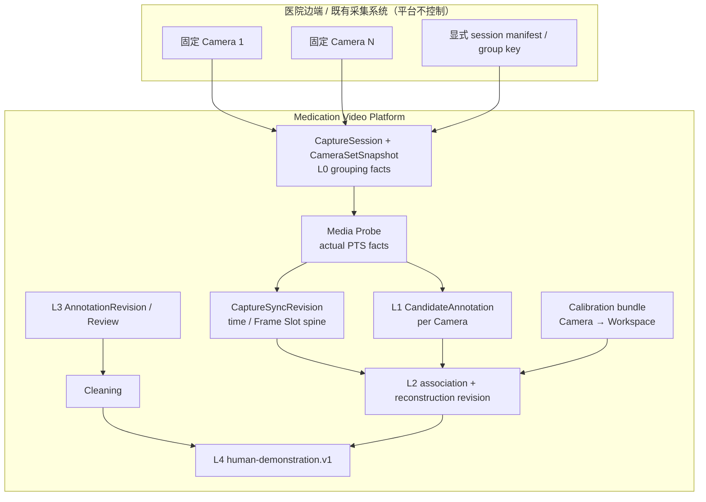

# 固定多视角 Human Demonstration 技术设计（V1.22 草案）

> 版本：TD-MULTIVIEW-HUMAN-DEMONSTRATION-V1.22-DRAFT.1<br>
> 状态：**DRAFT — 架构评审材料，不授权代码、DB、OpenAPI、Worker、真实设备或生产 profile 变更**<br>
> 日期：2026-08-18<br>
> 对齐需求：[V1.22 固定多视角 Human Demonstration 需求草案](../requirements/drafts/V1.22/配药视频数据管理平台需求文档_V1.22_DRAFT.md)<br>
> 继承基线：[V1.21 FLOW-FIRST MINIMAL EXPORT](../../requirements/baselines/V1.21/配药视频数据管理平台需求文档_V1.21.md)（FINAL FREEZE）<br>
> 评估对象：[V1.19 固定多相机同步逐帧训练数据技术设计](./multi-camera-synchronized-training-data-v1.19.md)、[时间基准与多相机同步](./timebase-and-multicamera-sync.md)、当前 `CaptureSync` 实现与 `synchronized-frame.v1` 契约。

## 1. 设计结论

下一阶段应建设的是一个固定、多视角、外部观察式的人类演示数据能力：

```text
fixed cameras in dispensing cabin
→ explicit CaptureSession
→ time-aligned per-camera evidence
→ per-camera hand Candidates
→ multi-view association
→ calibrated 3D hand reconstruction
→ human action truth + review + cleaning
→ human-demonstration.v1
```

它不是 Ego 采集平台，不是机器人控制系统，也不是 LeRobot 的内部实现。护士不佩戴采集设备；平台不驱动相机、机械臂、PLC 或医院设备。

当前 `CaptureSync` 的时间事实、Frame Slot、不可变 revision 与 Parquet artifact 非常适合作为多视角几何的**时间底座**。它不应删除，也不应直接承载标定、三维点、跨视角手 identity 或 Robot state。三维能力必须在其上游事实已经冻结后，以独立的重建输入/输出 revision 形成新的 L2 数据层。

V1.21、`training-data.v2` 及其单视频人工闭环保持冻结。本设计只定义后续候选架构，不改变当前运行系统。

## 2. 基本边界与真值层次

### 2.1 数据层

| 层 | 名称 | 权威内容 | 不得混入 |
| --- | --- | --- | --- |
| L0 | Raw Video | 原始 MP4、上传完整性、Media Probe、源 PTS、CameraStream 身份 | 覆盖过的 video、AI/人工结论、虚构帧 |
| L1 | Per-camera Candidate | 每路 MediaPipe 2D landmarks、bbox、handedness、模型/profile provenance | 正式动作标签、世界坐标、跨相机 identity |
| L2 | Multi-view Reconstruction | 时间对齐引用、关联假设、校准几何、原始 21 点 world landmarks、重建质量 | 人工动作 Ground Truth、Robot command |
| L3 | Human Annotation / Review | 人工 `AnnotationRevision`、Review、未来明确范围的几何审查事实 | 自动从 Candidate 或 L2 写入的标签 |
| L4 | Human Demonstration Dataset | 经过版本化准入的 L0–L3 引用与可复现的样本投影 | 原视频默认打包、机器人执行状态、未审核的事实 |

L2 是机器重建，不因为名称中有“Human Demonstration”就成为人工认证的几何真值。现有 `AnnotationRevision` 只对人工动作时间段和 action label 负责；未来如需人工审查关联或三维几何，应建立独立、明确范围的审查事实，而非偷偷改变既有动作 Review 的含义。

### 2.2 必须保持的 V1.21 不变量

```text
CandidateAnnotation != AnnotationRevision
HAND_DETECTED != formal action label
NO_HAND_DETECTED / FAILED / NOT_RUN do not block human annotation
Review + Cleaning remain independent human/data-quality gates
Cleaning PASS means eligible for a specified dataset projection, not robot-safe
training-data.v2 remains unchanged
```

V1.22 的读取路径可复用 V1.21 的 L0/L1/L3/L4 事实，但不允许反向写入或修改既有正式 revision。

## 3. 总体架构与事实流



关键原则：

1. Session 归组、源帧时间、相机标定、二维 Candidate、关联、三维结果和人工标签各自是独立事实；
2. 后一层只能引用和解释前一层，不能在原对象上覆盖；
3. 每一次可重算的机器输出均须冻结实际输入、算法/profile 和 digest；
4. 缺少可靠输入时生成显式拒绝/不足状态，而不是图像上看起来合理的猜测；
5. 稠密帧/landmark 数据留在版本化 analytical artifact，事务数据库仅保存业务状态、revision、摘要、索引和审计。

## 4. 逻辑领域模型（非物理存储设计）

本节是未来的逻辑对象边界，不是 SQL、JPA 类、OpenAPI 请求或迁移方案。

### 4.1 Capture 与 Camera 事实

```text
Project
└── CaptureSession (= existing capture_session_id)
    ├── explicit capture_group_key / upstream session identity
    ├── CameraSetSnapshot
    │   └── CameraSetSnapshotMember
    │       ├── camera_id (= stable CameraChannel identity)
    │       ├── camera_number (= camera_index + 1)
    │       ├── camera_role / fixed mount_position
    │       └── calibration applicability reference
    └── CameraStream
        └── ClipAsset / raw MP4 / actual media PTS
```

`capture_id` 是 `capture_session_id` 的产品别名，`video_id` 是 `clip_asset_id` 的产品别名，`camera_id` 是稳定 CameraChannel 的产品别名；三者都不得因 V1.22 创建第二套真值 ID。

`camera_number` 只在一个冻结 Snapshot 内表达稳定展示编号。Snapshot 预期 `[1,2,3,4,5]` 而实际有 `[1,3,5]` 时，2 和 4 仍是缺路成员，不能将 3/5 重编号。相机数量取决于部署 profile 与 Session，不由产品逻辑预设为固定 N。

### 4.2 Calibration bundle

一个 `CalibrationBundle` 是对一组固定安装相机与一个 Workspace 的版本化几何声明。它至少包含：

```text
calibration_id, calibration_version, calibration_digest
workspace_id, coordinate convention, physical unit
per camera:
  camera_id / snapshot member
  resolution / crop mode
  K intrinsics matrix
  distortion model and coefficients
  T_workspace_from_camera
method, calibration target/evidence, scope, created_at, invalidation facts
```

它不等同于 CameraSet 本身：同一 CameraSet 可以随安装调整产生多个 CalibrationBundle；同一个 bundle 也只能在其声明的相机、分辨率、安装位置和有效范围内使用。

### 4.3 时间、关联与重建对象

```text
CaptureSyncRevision
├── CaptureSyncStreamRevision (one expected Camera / time mapping)
└── synchronized-frame.v1 Frame Slots

ReconstructionInputManifest
├── accepted CaptureSyncRevision
├── CalibrationBundle
├── selected L1 Candidate evidence
├── association profile
└── reconstruction profile

ReconstructionRevision (immutable)
├── association observations / ambiguity results
├── world 21-landmark observations
├── per-point validity and geometry quality
└── output artifact + logical/physical digests
```

`ReconstructionRevision` 是 L2 事实。它不能覆盖 `CaptureSyncRevision`，也不能被写入 `AnnotationRevision`。若同步、标定、Candidate、关联或算法输入任一变化，必须创建新的 L2 revision 或明确使旧 L2 不可复用。

## 5. 时间模型：三种时间、一个可追溯映射

### 5.1 时间语义

| 字段族 | 来源 | 用途 | 禁止用途 |
| --- | --- | --- | --- |
| `source_pts_ns` / raw PTS | 解复用后的一个源视频帧 | 帧定位、frame mapping、原始证据 | 直接与其他 Camera PTS 相减并宣称同步 |
| `capture_timestamp_ns` | accepted SyncRevision 的共同 Capture 时间轴 | 多视角邻域、L2 样本时间、动作区间投影 | 声称纳秒级物理采集精度 |
| `record_start_utc` 等上游声明 | 边端 manifest / 设备 | 跨系统审计、时间源证据 | 未验证时取代同步映射 |
| `server_receive_time` | Core API 收到上传/回传 | 审计、监控、排障 | 推断录制顺序、动作边界或帧同步 |

Capture timestamp 是会话内共同坐标，允许没有可信 UTC origin。整数 ns 是交换精度，不等于采集硬件真的具备 ns 级精度。

### 5.2 必须复用的同步数学

每路 stream 从 Capture target 寻找源帧时，必须遵循现有 CaptureSync 的事实链：

```text
capture target
→ inverse stream mapping
→ nearest actual source PTS
→ forward stream-to-Capture mapping
→ sync_error
→ allowed tolerance
```

映射以可信 anchor 为基准：

```text
scale = 1 + drift_ppm / 1,000,000

t_capture = anchor_capture
          + ROUND_HALF_EVEN((t_source - anchor_source) × scale)
```

- 一个可信 anchor：仅 offset-only，`drift_ppm` 为未知/null；
- 至少两个可靠、来源明确且有足够时间跨度的 anchor：才可估计 drift；
- 没有可信 common clock 或 explicit anchor：同步状态为 input not ready，不得把所有视频首帧视为 Capture 0；
- source PTS 必须是真实逐帧序列，不能从 first/last PTS 与 frame count 均匀插值；
- nearest PTS 的 tie-break、精确有理数 timeline 与 tolerance 仍由不可变 SyncProfile 决定；不在本设计中写入 30 Hz、20 ms 或默认参考相机。

`sync_error` 定义为选中源帧正向映射回 Capture 后，减去 target Capture time 的误差。它不能用 `source_pts_ns - capture_timestamp_ns` 代替。

### 5.3 同步精度策略

P0 目标是**研究可测量性**，不是未验证的生产 SLA：对每个使用的 camera pair / role，保存同步来源、映射方法、anchor 数、残差、gap、Frame Slot state 和 profile digest。Golden Capture 评估的真实误差必须与浏览器 seek、视频解码或 UI 播放误差分开报告。

P1 的生产目标是**可治理、可复验的时间质量**：固定相机部署在实际工作方式下需有已批准的时间源、持续质量观测、重试/失败规则和按角色分层的阈值。何时要求 S3 或 S4、允许何种误差，必须由现场证据与任务目标决定，不能在技术草案中虚构通用数值。

### 5.4 对 L2 的时间 Gate

L2 只读取一个 accepted `CaptureSyncRevision` 的 Frame Slot；不可混合“当前最新”不同 revision 的 Camera 数据。以下任一条件必须阻止该局部观测进入三维计算：

```text
no accepted sync revision
untrusted mapping / input not ready
Frame Slot MISSING or INVALID
sync error outside profile tolerance
Candidate NOT_RUN / FAILED / unavailable for required view
candidate timestamp cannot be proved to map to the selected source frame
```

`NO_DETECTION` 不表示同步失败；它只是一个 Camera 在该 source frame 没有有效手部 Candidate，结果可能是 `INSUFFICIENT_VIEWS`。

## 6. Camera Calibration 与统一工作空间

### 6.1 坐标约定

每个 Reconstruction revision 必须明确引用一个 Workspace Coordinate System。所用变换写作：

```text
p_workspace = T_workspace_from_camera × p_camera
```

其中矩阵方向、坐标轴正方向、右/左手系、旋转表示、物理单位、workspace 原点和适用区域均须在 CalibrationBundle 中声明。不得只以字段名 `world_xyz` 暗示这些约定。

本草案不擅自把特定工作空间原点、单位或标定板类型冻结为生产标准。P0 Golden Capture 可以选用一个公开、可复现的研究约定；生产约定须经临床/设施/算法联合批准。

### 6.2 Calibration 输入与有效性

相机内参和畸变描述二维像素如何成为一条 Camera ray；外参把该 Camera 坐标关联到统一工作空间。三维结果至少依赖：

```text
same camera identity and fixed mount
matching image resolution / crop mode
approved intrinsic + distortion parameters
approved Camera → Workspace extrinsic transform
calibration digest valid for the CaptureSession
```

移动相机、重新固定、改变镜头、变焦、裁剪、分辨率、焦距、畸变模型或工作空间布置后，旧标定不可静默继续使用。必须产生新 CalibrationBundle 或明确判定该 Session 无可用标定。

### 6.3 校准质量与历史解释

标定的 target/方法、重投影评估、覆盖范围、操作来源、版本和 digest 是重建 provenance 的组成部分。若 CalibrationBundle 被撤销或被新版本取代，历史 L2/L4 仍保存实际使用的旧 digest；后续重算需要新 revision，而不是改写历史坐标。

## 7. L1 到多视角关联

### 7.1 输入单位

关联的最小输入不是“两个视频都显示左手”，而是一个明确的 observation tuple：

```text
capture_session_id
sync_revision_id + capture_timestamp_ns + sync_frame_index
camera_number + camera_stream_id + source frame / PTS
CandidateAnnotation / candidate hand index
2D landmarks + bbox + per-point validity
handedness (auxiliary only)
calibration digest
```

一个 Frame Slot 中的 `HANDS_DETECTED` 仅表明已存在至少一个 L1 Candidate；关联必须再定位到具体 candidate hand observation，且该 observation 必须和本次 source frame 的 provenance 一致。

### 7.2 关联策略

候选关联应利用多种、可记录的证据，而不是单个类别字段：

1. 同一 accepted SyncRevision 的 Capture 时间邻域；
2. 可用 Frame Slot 与其 `sync_error`；
3. 获批准 CalibrationBundle 导出的极线/重投影可行性；
4. 2D landmark/bbox 可见性和有效性；
5. handedness 的辅助概率；
6. 在明确、短范围 profile 内的轨迹连续性；
7. 多候选情况下的歧义、得分差和拒绝原因。

handedness 不得作为 cross-camera hand identity 的唯一条件，也不得成为 L3/ Cleaning/数据集准入 Gate。两只手、多人误入、交叉遮挡、单视角和 Candidate 漏检必须先表示为可审计的不确定状态。

### 7.3 关联输出状态

未来 L2 关联输出至少应区分：

| 状态 | 含义 | 是否可进入三维计算 |
| --- | --- | --- |
| `ASSOCIATED` | 有充分且版本化的证据选择该组跨视角观测 | 可以，仍须通过几何 Gate |
| `INSUFFICIENT_VIEWS` | 合格观测视角数量不足 | 不可以 |
| `AMBIGUOUS` | 有多个合理对应关系，无法无歧义选择 | 不可以 |
| `OCCLUDED_OR_MISSING` | 关键 view 缺路、无帧或可见性不足 | 不可以 |
| `REJECTED_BY_GEOMETRY` | 不满足校准/极线/重投影规则 | 不可以 |
| `INPUT_NOT_READY` | 时间、标定或 Candidate provenance 不完整 | 不可以 |

如果未来引入局部 `hand_instance_id`，其范围只能是一个 Reconstruction revision 内的一段观测序列；它不能存储或推断护士身份、跨 Session 身份或 Face/Body ReID。

## 8. L2 三维手部重建

### 8.1 输出粒度与原始结果

逻辑输出粒度为：

```text
one ReconstructionRevision
  + one capture timestamp
  + one local hand observation instance
  + one of 21 landmark indices
```

每个 landmark 记录（以未来 schema/profile 具体化）：

```text
world_x, world_y, world_z
point_validity / reason_code
views_used and source observation references
reprojection or uncertainty evidence
coordinate system / unit reference
```

整个 hand observation 还应记录 association status、reconstruction algorithm/version/profile、同步/标定 revision 和输入 digest。零填充、插值或模型补点如果未来被允许，也必须被明确标记为独立派生结果，不能伪装为可观察到的原始重建点。

### 8.2 世界坐标的硬边界

以下两类数据必须始终分离：

| 数据 | 正确语义 | 能否成为世界坐标 |
| --- | --- | --- |
| MediaPipe normalized x/y + relative z | 单个 image / 模型定义的相对输出 | 否 |
| `world_landmark_00_xyz ... 20_xyz` | Camera Calibration 与多视角几何（或未来获批准 depth）恢复的 Workspace 点 | 可以，但必须带标定与误差 provenance |

不能把 MediaPipe z 乘以一个常数、改字段名或复制到 `world_z` 后称作深度。单视角 Candidate 不满足多视角几何输入时，默认不产生该类 world landmark。

### 8.3 质量 Gate 与不确定度

重建 profile 需要将以下事实冻结为输入/输出证据：

```text
required camera roles / minimum valid views
calibration compatibility
association evidence
reprojection or geometric residual
per-landmark visibility / validity
sync quality used by each view
algorithm key, version and profile digest
```

具体阈值必须由 Golden Capture、标定复验和工作区任务需求得出。P0 不应把示意用的重投影误差或时间窗口写成生产常量。质量不足时输出稳定 reason code，而不是输出貌似连续的三维轨迹。

## 9. Human Hand Pose 派生层

在 L2 原始 21 点基础上，未来可以生成第二层、可选的派生 pose：

```text
wrist_xyz
wrist_quaternion
palm_normal
grasp_width
hand_velocity
```

其设计原则：

- `wrist_xyz` 明确对应哪一个 landmark 或哪一种聚合规则；
- `wrist_quaternion` 必须声明轴定义、坐标系、handedness 约定、旋转顺序和四元数规范化规则；
- `palm_normal` 必须声明来自哪些 landmark 和退化情况；
- `grasp_width` 必须声明使用哪些 landmark、物理单位和缺点处理；
- `hand_velocity` 必须声明时间差分、平滑、采样不均匀和 gap 处理；
- 所有派生量都保留 `derivation_algorithm_key/version/profile_digest` 与其所依赖 L2 raw point references。

派生 pose 不是 L2 原始重建的替代品，更不能回写 L1 MediaPipe 或 L3 人工标签。消费者应能精确声明使用 raw landmarks 还是某个派生 profile。

## 10. L3 动作标注与未来 taxonomy

### 10.1 当前人工动作事实

现有正式动作语义继续由：

```text
AnnotationRevision
  [start_ms, end_ms, action_label]
→ Review APPROVED
→ Cleaning PASS
```

给 L4 投影 action 时，Capture 时间与人工 action 时间的换算必须引用具体的时间依据/revision；不得通过浏览器播放位置或 server receive time 猜测动作边界。既有 `AnnotationRevision` 未在同步视图中创建时不强制持有同步 revision；若未来从同步多视角视图创建/投影，则应记录实际使用的时间 revision，而不回写旧 revision。

### 10.2 候选 Human Demonstration taxonomy

后续可以单独设计版本化的 phase taxonomy，例如：

```text
APPROACH
GRASP
MOVE
PLACE
RELEASE
```

但在以下内容未冻结前，这些术语只是设计候选，不能成为 API 枚举、现有 label schema 修改或自动标注结果：

```text
每个 phase 的临床/业务语义
开始与结束的人工标注规则
允许的层级、并发与过渡
与已有 action_label 的显式、非自动映射
label schema / guideline version
人工 Review 责任与争议处理
```

## 11. `human-demonstration.v1` 逻辑数据模型

### 11.1 定位

`human-demonstration.v1` 是平台对人类配药示范的权威逻辑投影，不是 LeRobot schema 的别名，也不是 `training-data.v2` 的扩展字段集合。其物理文件格式、分区、row group、下载 API、DatasetVersion 产品形态和是否导出任何视频都仍为后续设计决策。

### 11.2 最小字段组

| 字段组 | 最小逻辑内容 | 用途 |
| --- | --- | --- |
| Schema / identity | `schema_version`、sample ID、`session_id`、`camera_set_snapshot_id`、reconstruction revision | 确定样本属于哪个不可变事实链 |
| Time / action | `capture_timestamp`、action interval、`action_label`、`annotation_revision_id` | 将空间观测关联到人工动作语义 |
| Source observations | 参与的 camera number、CameraStream、video ID、source frame/PTS、Frame Slot state、sync error、L1 Candidate ref | 从 L2 回查每个实际输入 view |
| Raw geometry | `world_landmark_00_xyz ... world_landmark_20_xyz`、point validity、workspace coordinate / unit | 保留未覆盖的三维结果 |
| Derived pose | 可选 wrist pose、palm normal、grasp width、velocity 与 derivation provenance | 提供消费者可选特征，而非取代 raw geometry |
| Provenance | calibration version/digest、SyncRevision/Profile、MediaPipe model/profile、association/reconstruction algorithm/profile、raw MP4 digest、human revision/review/cleaning references | 让每一行能重放和审计 |
| Eligibility | profile、rule version、reason codes、生成时间 | 区分“已计算”与“可参与该数据集” |

逻辑行可以表示一个 timestamp 内的一只局部手观测，也可以采用显式嵌套形式表达两只手；无论物理布局如何，都必须保证不存在隐式“第 0 个 hand 就是左手/同一人”的假设。

### 11.3 数据集准入与文件内容

一个 L4 样本至少需要：

```text
explicit CaptureSession + camera set snapshot
accepted time revision
valid calibration bundle
traceable L1 observations
non-ambiguous association and valid L2 geometry
current approved human action revision
applicable Review and Cleaning facts
complete immutable provenance
```

默认只包含引用、摘要和结构化几何，不包含 MP4、对象键、预签名 URL、护士身份或敏感上游元数据。`Cleaning PASS` 的语义仍仅是“该版本化样本可参加此类数据投影”，不代表机器人可执行、机器人安全或绝对空间精度保证。

## 12. CaptureSync 复用评估

### 12.1 结论矩阵

| 现有对象/能力 | 分类 | V1.22 判断 | 后续边界 |
| --- | --- | --- | --- |
| `CaptureSession`、CameraSetSnapshot、CameraStream | **REUSE** | 明确 session/group、固定相机与缺路不重排已经是正确基础 | 不创建第二套 Capture/Video/Camera 身份 |
| `CaptureSyncJob` / `CaptureSyncJobAttempt` | **REUSE** | 幂等、lease、attempt、审计和失败不覆盖 accepted revision 的 job 模型适合时间同步 | 只处理 time sync；不要变成通用 3D/训练 job |
| `CaptureSyncRevision` | **REUSE** | immutable revision、输入/逻辑 digest、profile 和质量摘要直接支持可复现 L2 | 重建必须引用而非修改它 |
| `CaptureSyncStreamRevision` | **REUSE** | per-camera PTS/anchor/drift/presence/误差事实是 3D 输入 provenance | Calibration 另存为独立事实，不塞进 stream revision |
| Timeline + inverse/nearest/forward mapping | **REUSE** | 它精确定义“同一 Capture 时间附近”的候选源帧 | 保持真实 PTS、合理 tie-break 和 tolerance 行为 |
| `FrameSlot` + `PRESENT/MISSING/INVALID` | **REUSE** | 明确每个时刻每台预期相机是否可用，正是关联 fail-closed 的条件 | 缺帧不能用上/下帧冒充；不压缩相机编号 |
| `synchronized-frame.v1` / Parquet artifact | **REUSE（作为 L0/L1 时间 spine）** | 一行一个 revision + sync frame + camera 的粒度适合 source observation 回查 | 不修改 v1 去承载 L2 21 点、关联轨迹或 L4 数据；新层使用独立 artifact/schema |
| `CaptureSyncArtifact` manifest + logical/physical digest | **REUSE** | immutable artifact/provenance 模式与 L2/L4 可复现性一致 | manifest 不复制 dense L2 rows；artifact 不是业务状态仓库 |
| `SyncProfile` | **REFACTOR（语义分离）** | 现有不可变、无生产默认值的原则正确，但其职责应保持为 time profile | 新增 Calibration/Association/Reconstruction profile，不能将三者的参数混进一个 SyncProfile |
| `reference_camera_number` | **SIMPLIFY** | 仍可保留为同步审计辅助，但空间坐标不应由主相机定义 | Workspace 由 CalibrationBundle 明确定义 |
| `CaptureSyncInputAssemblyService` 的 `INPUT_NOT_READY` 守卫 | **REFACTOR（输入能力成熟后）** | 当前拒绝“仅聚合 media report/首帧对齐”的行为是正确的 | 只有媒体链能提供真实 per-frame PTS 和显式可信 mapping 后才扩展输入；不恢复 synthetic frames |
| CaptureSync HTTP/Web 查询面 | **FROZEN** | 现有接口不应因本阶段草案扩大 | L2/L4 查询设计留待新基线和容量证据批准 |
| 把 CaptureSync 当作 Calibration/3D/Robot 数据模型 | **REPLACE（不适用的职责）** | 时间同步不等于空间重建，更不等于机器人状态 | 用独立 L2 Reconstruction revision/artifact，不删除现有同步能力 |

### 12.2 已验证且必须保留的严格性

当前实现的以下行为与未来多视角三维完全一致，应保留为强约束：

```text
no real per-frame PTS or trusted mapping
→ CAPTURE_SYNC_INPUT_NOT_READY

one trusted anchor
→ offset-only

two or more trusted anchors
→ drift may be measured

selected frame
→ mapped back to Capture time
→ sync_error checked against tolerance
```

这避免了把多路“看似同时开始”的普通视频错误地当成可三角测量输入。L2 不得绕过这层而自行按上传时间、首帧或 nominal FPS 关联。

### 12.3 为什么不是直接把 V1.19 恢复为当前目标

V1.19 的核心时间模型与 artifact 仍有价值，但它的历史范围不包括 Calibration、cross-view association、3D 和 Human Demonstration。V1.22 应在其已存在事实链上增量设计 L2/L4，而不是重新激活旧的 DatasetVersion、同步播放器或大而全导出计划。任何实作仍需先完成本草案的 Golden Capture、契约和范围评审。

## 13. 模块与职责边界（未来实现原则）

| 领域 | 继续拥有的事实 | V1.22 未来读写边界 |
| --- | --- | --- |
| `assetcapture` | CaptureSession、CameraSet/Stream、原始资产、Media Probe、CaptureSync 时间事实 | 只暴露受控 L0/同步读模型；不拥有 3D 几何或人工标签 |
| `aicandidate` | AIJob、L1 `CandidateAnnotation`、模型/profile provenance | 每路独立输出；不写正式动作、Cleaning 或世界坐标 |
| future multi-view reconstruction capability | L2 reconstruction revision、关联与几何 artifact 的业务事实 | 通过公开读接口读取 L0/L1/Calibration，不跨模块写表 |
| `annotationreview` | 人工动作 revision 与 Review | 不接受 AI/L2 自动写入；未来几何审查需明确独立语义 |
| `qualitycleaning` | 资格检查、规则版本、Cleaning result | 仅根据获批准的 L2/L3 引用和 profile 作准入判定 |
| future Human Demonstration projection | L4 投影/工件元数据 | 只读整合 L0–L3 的权威投影，不改变 `training-data.v2` |

实际模块名、表、API、事件和 Worker 分配在新需求基线冻结后再设计。本草案不引入新数据库表、队列或进程。

## 14. 最小 P0 技术切片

P0 应是一条受控研究闭环，而不是“多相机 3D 平台一次到位”：

```text
G0 synthetic / authorized isolated rig
→ 1 explicit CaptureSession
→ 1 frozen two-camera CameraSetSnapshot
→ actual per-frame PTS + trusted accepted CaptureSyncRevision
→ 1 validated CalibrationBundle
→ existing per-camera MediaPipe Candidate
→ unambiguous two-view association only
→ raw 21-point workspace reconstruction with quality evidence
→ link to existing approved action AnnotationRevision + Cleaning
→ research-only human-demonstration.v1 artifact / preview
```

P0 有意不做：

- 通用 N-camera 自动重建；
- 多人或长时跨遮挡 identity tracking；
- 连续轨迹补点、手部运动学约束或机器人 retargeting；
- 多机位 Web 播放器大改造；
- DatasetVersion 产品化、批量导出、任何真实医院生产 profile；
- 机器人策略训练、推理或控制。

研究 P0 的成功标准是：对于有完整时间/标定/人工事实的合成或授权隔离样本，L4 的每一个三维点和动作区间都能回溯；对于缺失或歧义输入，系统可解释地不生成样本。

## 15. 验证与 Golden Capture 计划

在任何生产主张前，至少构造不含真实患者信息的受控 Golden Capture：

### 15.1 时间验证

- 固定 FPS、VFR、非零 PTS origin、重复 PTS、PTS gap、缺路和损坏帧；
- 已知 offset、单 anchor、正/负 drift、多 anchor；
- Capture target → inverse mapping → nearest PTS → forward mapping → `sync_error` 的逐项预期；
- `MISSING`、`INVALID`、`NOT_RUN` 与 `NO_DETECTION` 的状态不混淆；
- 证明没有首帧对齐或 aggregate report 伪造 PTS。

### 15.2 标定与几何验证

- 每 Camera 的内参/畸变/外参和 Workspace 坐标约定；
- 带已知位置的标定 target 或合成三维点；
- 重投影检查、不同 Camera role 的可见区域、分辨率/裁剪不匹配；
- calibration digest 改变必然产生新的 L2 输入/结果，而不是重解释旧结果；
- 明确 MediaPipe relative z 没有被用于 `world_z`。

### 15.3 关联与数据集验证

- 单手、两只手、单视角、遮挡、多人误入、漏检和错误 handedness；
- 歧义必须输出 `AMBIGUOUS` 或等价拒绝，而不是选择看似最接近的 hand；
- 每个 L4 sample 可以追溯到 source frame/PTS、raw MP4 digest、sync revision、calibration、模型/profile、关联/重建算法与人工 revision；
- V1.21 接收、单视频 Candidate、人工标注、Review、Cleaning、`training-data.v2` 全链严格回归。

阈值、rate、tolerance、重投影预算、相机数上限、row group、容量和延迟全部基于此类测量再冻结；没有证据时保持 `PENDING`。

## 16. Future Robot / LeRobot 接口边界

平台未来可提供受治理的、版本化 `human-demonstration.v1` 投影给外部研究工具。转换器的责任是显式转换时间轴、坐标约定、单位、采样与 provenance；它必须保留数据缺失/质量状态，不能补造：

```text
robot joint positions
robot actions / torques
end-effector pose
camera calibration absent from source
human action phase absent from annotation
```

LeRobot 是潜在**下游消费者**，不是平台的权威 schema、标注真值、数据治理模型或控制入口。任何 LeRobot/ACT/Diffusion Policy/VLA 的训练、评测、部署、IK 映射、机器人安全验证与真实执行都在平台边界之外，需另行设计和审批。

## 17. 推荐实施顺序（供后续基线评审）

```text
0. 冻结本需求/技术边界；保持 V1.21 完整回归
1. G0：合成/隔离 Golden Capture 的显式 session、实际 PTS、anchor 与 time evidence
2. G1：固定双相机 CalibrationBundle、Workspace convention 与验证证据
3. 定义并评审 L2/L4 logical contracts、provenance 和 profile 边界
4. 只读连接 accepted CaptureSyncRevision 与 per-camera Candidate evidence
5. 实现 fail-closed 的两视角 association + raw 21-point reconstruction slice
6. 连接既有 AnnotationRevision / Review / Cleaning，生成研究型 human-demonstration.v1
7. 验证容量、歧义处理、标定运维与权限后，再评审多 Camera / 生产 profile
8. 最后才讨论受控外部转换器；机器人 runtime 永远另案
```

每一步需独立通过严格质量门禁和 Golden Capture 证据后才能进入下一步。不得用后续 Robot/LeRobot 设想反向扩大当前实现范围。

## 18. 明确冻结与待决项

### 18.1 本草案冻结的架构原则

- 固定、外部视角相机；无 Ego/wearable 要求；
- 显式 CaptureSession 分组；禁止文件/时间/顺序猜测；
- 真正 PTS + 可信同步，不默认首帧对齐；
- Camera → Workspace 的版本化 calibration；
- L1 Candidate、L2 reconstruction、L3 human action 和 L4 dataset 的事实分层；
- MediaPipe relative z 不是 world z；
- CaptureSync 复用为时间底座，但不变成三维或 Robot 数据模型；
- `human-demonstration.v1` 优先于任何 LeRobot 格式作为平台权威模型。

### 18.2 仍待证据决定的内容

- 真实边端能否提供完整 PTS、共同 clock 或可审计 anchor；
- 生产相机角色、数量、工作区覆盖、时间/几何误差预算；
- calibration workflow、复验周期、失效条件、坐标单位/原点和责任人；
- P0 最小可接受 view 数、深度设备是否可作为未来替代输入；
- 自动关联与人工歧义审查的责任划分；
- action taxonomy 的最终词表、边界、迁移和人工指南；
- L4 的物理格式、导出权限、留存、数据集产品形态和容量指标。

这些待决项不应用默认参数、测试 fixture 或算法示例取代。它们在有 Golden Capture 和受控现场证据后才能成为生产规范。
