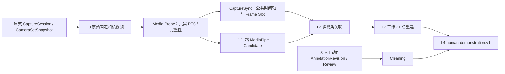

# 配药视频数据管理平台需求文档 V1.22（固定多视角 Human Demonstration 草案）

> 文档版本：V1.22-DRAFT.1<br>
> 文档状态：**DRAFT — 仅供评审，不授权编码、数据库迁移、API/契约变更或真实设备接入**<br>
> 起草日期：2026-08-18<br>
> 前一正式基线：[V1.21 配药视频数据管理平台需求基线](../../baselines/V1.21/配药视频数据管理平台需求文档_V1.21.md)（FINAL FREEZE）<br>
> 配套设计：[多视角 Human Demonstration 技术设计 V1.22（草案）](../../../history/architecture/multi-view-human-demonstration-technical-design-v1.22.md)<br>
> 生效规则：本草案经业务、数据治理、临床/隐私、算法和平台评审并冻结为新的正式基线前，不改变 V1.21、任何已发布契约、现有代码、数据库或运行行为。

## 1. 版本定位

V1.22 的方向不是 Ego 数据采集，而是：

> **Fixed Multi-view / Exocentric Human Demonstration Data Platform**：使用配药舱内多台固定安装摄像头，记录同一次人工配药过程，逐步形成可追溯的多视角手部三维观测与 Human Demonstration Dataset。

护士按现有工作方式配药，不佩戴头戴摄像头、胸前摄像头、手套传感器或其他 Ego 设备。平台只接收并处理已经产生的视频和获批准的采集元数据；不控制相机、边端、机器人、PLC 或医院业务系统。

V1.22 的目标数据链为：

```text
L0 原始固定相机视频
→ L1 每路 MediaPipe 手部 Candidate
→ L2 多视角关联与三维手部重建
→ L3 人工动作标注 / Review
→ Cleaning
→ L4 Human Demonstration Dataset
```

其中，L2 是机器计算结果，L3 中现有的人工 `AnnotationRevision` 仍是正式动作标签的唯一来源。三维几何不得因为生成了 L2 就被声明为人工 Ground Truth。

## 2. 与 V1.21 的冻结边界

V1.21 FINAL FREEZE 必须完整保留。以下事实不因 V1.22 草案而改变：

```text
视频接收
→ Media Probe
→ 单视频 MediaPipe Candidate
→ Skeleton Overlay
→ 人工配药动作标注
→ Review
→ Cleaning
→ training-data.v2 / training_data.parquet
```

特别地：

- `training-data.v2` 的字段、资格投影、导出规则和默认不导出 MP4 的规则保持冻结；
- `CandidateAnnotation != AnnotationRevision`，MediaPipe 不能自动通过 Review 或 Cleaning；
- `HAND_DETECTED`、`NO_HAND_DETECTED`、`FAILED` 与 `NOT_RUN` 的既有语义保持不变；无手、未跑或失败均不得阻断人工动作标注；
- 现有动作标签 schema 不增加三维、机器人或抓取阶段字段；
- V1.22 的 `human-demonstration.v1` 是新的、独立的数据能力，不替换、混写或伪装为 `training-data.v2`；
- 不执行 Physical Reduction，不删除或降级已存在的 `CaptureSync`、历史迁移、Worker 或契约。

## 3. 业务范围与明确非目标

### 3.1 本版本拟解决的问题

1. 将一次明确声明的配药任务表示为一个 `CaptureSession`，并让多路固定相机视频显式绑定到它；
2. 保留固定相机安装、相机集合、时间同步和标定的版本化事实；
3. 在同一 Capture 时间附近，将各视角的手部 Candidate 形成可解释的关联假设；
4. 仅在有可信时间与标定证据时，从多视角二维观测计算工作空间内的 21 点三维手部结果；
5. 将人工动作标注、Review、Cleaning 与三维结果通过版本和 provenance 关联，最终形成可复现的 `human-demonstration.v1` 数据工件。

### 3.2 明确非目标

本草案不设计、不授权也不隐含以下能力：

- Robot controller、机械臂 IK、碰撞检测、真实执行、安全联锁、PLC 或医院现场控制；
- LeRobot Policy training、ACT、Diffusion Policy、VLA inference 或任何模型训练/推理服务；
- 恢复或修改 V1.21 的 `training-data.v2`；
- 通过文件名、上传顺序、时间接近、相同 FPS、视频时长或相机编号猜测同一次采集；
- 人员身份识别、跨 Session 人脸/人体 ReID、护士身份画像或监控分析；
- 将 MediaPipe handedness、relative z 或单视角 2D Candidate 当作真实世界坐标；
- 将单视角、遮挡、歧义关联或缺乏标定的数据伪造成三维结果；
- 相机自动控制、自动标定、自动触发采集或对真实设备下发命令。

机器人和 LeRobot 仅是未来的外部消费者，不是本版本的平台权威模型或交付对象。

## 4. 核心术语与唯一身份

| 术语 | 定义 | 身份与不变量 |
| --- | --- | --- |
| `CaptureSession` / `session_id` | 一次完整、明确声明的配药任务及其采集边界 | 复用现有 `capture_session_id`，不新建第二个 Session 真值 |
| `capture_group_key` | 上游稳定会话 ID 或版本化 manifest 中的显式分组键 | 是创建/绑定 CaptureSession 的必要事实之一；不是文件名派生值 |
| `Camera` / `camera_id` | 一台固定安装、可长期识别的物理相机 | `camera_id` 是现有稳定 `CameraChannel` 身份的产品别名，不新造平行 ID |
| `CameraSet` / `camera_set_id` | 一组可复用的固定相机配置 | 复用现有相机集合配置；一次 Session 实际使用其冻结快照 |
| `CameraSetSnapshot` | 某次 CaptureSession 适用的不可变相机成员、安装位置和角色事实 | 复用现有 `camera_set_snapshot_id`；后续标定引用必须绑定此快照或明确兼容关系 |
| `camera_number` | 面向用户的稳定展示号 `1...N` | 由冻结成员的 `camera_index + 1` 得出；缺号不得重排 |
| `CameraStream` | 一个 CaptureSession 内一个预期 Camera 与一个源视频资产的绑定 | 复用现有 `camera_stream_id`；不存在视频、媒体无效与局部无帧必须分开表达 |
| Capture timestamp | CaptureSession 共同时间轴上的时间 | 仅由可信时间映射产生；不等于服务器接收时间 |
| Frame timestamp | 一个源视频帧的媒体 PTS 时间 | 以源视频实际 PTS 和同 PTS ordinal 定位；不以 `frame_index / fps` 代替 |
| Server receive timestamp | 云端收到上传/事件的时间 | 仅用于审计和运行观察，不能反推采集或同步时间 |
| Calibration bundle | 相机内参、畸变、外参、工作空间坐标系和校验摘要的版本化组合 | 是三维计算的输入事实，不是视频属性的猜测 |
| Multi-view observation | 同一 Capture 时间邻域中多个 Camera 的 Candidate 关联假设 | 不是人员身份，也不是永久全局 hand ID |
| Reconstruction revision | 对固定同步、标定、Candidate 与算法输入生成的不可变三维结果 | 新能力的概念性版本；不能覆盖同步或人工 revision |

`N` 是按部署和 Session 动态确定的相机数量，不是业务写死的常量。现有同步契约的技术上限不应被表述为医院业务可支持相机数；未来生产上限须由部署、容量和验证证据单独批准。

## 5. 新主流程



上图的箭头只表示依赖关系，不表示 AI 自动批准人工事实。任何 L2 结果均不能绕过 L3 Review 和 Cleaning 直接进入 L4。

## 6. 功能需求

### 6.1 CaptureSession 与显式分组

**V22-FR-001 — 明确的任务级会话。** 平台必须把一次完整配药任务表示为一个项目内的 `CaptureSession`。创建或绑定时必须记录明确来源的 `capture_group_key`，以及适用的 CameraSetSnapshot、预期 camera_number 集合、上游来源和录制/接收事实。一次 Session 可以包含动态数量的 CameraStream，但不能因后来上传的新文件而隐式合并其他任务。

**V22-FR-002 — 禁止隐式归组。** 文件名、对象键、上传顺序、接收时间、视频时长、相同 FPS、相近 `record_start_utc`、相机号或内容相似性均不得独立或组合用作 CaptureSession 分组依据。缺少稳定上游 session ID 时，上游必须提供版本化 `UPSTREAM_MANIFEST_KEY`；否则进入未分组接收状态而非推测归组。

**V22-FR-003 — 缺路保持事实。** 预期 Camera 2 未上传时，Session 仍保留 Camera 2 的身份和 `MISSING` 事实；实际 Camera 1、3、5 不得改写为 1、2、3。视频未到、媒体探测失败、某段 PTS gap 与候选缺手是不同层级的状态。

### 6.2 固定 CameraSet

**V22-FR-004 — 固定相机身份。** 每个 Camera 成员必须具有稳定 `camera_id`、`camera_number`、`camera_role`、固定 `mount_position`、启用状态及所属 `camera_set_id`。`camera_number` 是展示号而非物理身份；替换设备、移动安装位置或改变镜头/焦距均不得悄然复用旧标定。

**V22-FR-005 — 快照而非当前配置。** 某 CaptureSession 使用的 CameraSet 必须冻结为 Session 快照。后续修改 CameraSet 只产生新配置/快照，不能回写旧 Session 的相机角色、编号、安装位置或标定引用。

**V22-FR-006 — 标定选择显式化。** 每个用于三维重建的 CameraSetSnapshot 成员必须显式关联一个适用的 Calibration bundle version 和 digest，或明确标为“无可用标定”。不得根据 camera_number、名称或最后一次标定时间猜测使用哪个标定。

### 6.3 时间模型与同步

**V22-FR-007 — 三种时间严格区分。** 平台必须保留并在数据契约中区分：

```text
capture timestamp  = 共同 Capture 时间轴的时间
frame timestamp    = 某个源视频帧的 PTS 时间
server receive time = 云端接收事件的时间
```

`server receive time` 不得代替 `capture timestamp` 或 `frame timestamp`。`record_start_utc` 等上游声明可以保存来源和可信等级，但不能自动提升为已验证同步。

**V22-FR-008 — 真实 PTS 与可信映射。** 跨 Camera 对齐必须基于真实逐帧 PTS、可信公共时钟或显式、可追溯的 anchor 映射。禁止用 `frame_index / nominal_fps`、聚合 first/last PTS、两路首帧、上传时间或视频起点对齐来构造同步事实。

**V22-FR-009 — 同步质量分层。** 同步 profile 必须记录来源、算法/版本、anchors、残差/误差、不确定度和适用范围。建议采用以下阶段性目标，而不是在没有实验依据时写死毫秒 SLA：

| 目标等级 | 使用目的 | 最低证据 |
| --- | --- | --- |
| P0 Research target | 合成/授权隔离的双视角或小规模验证 | 真实 PTS；可信 common clock 或明确 anchor；每路映射和测量误差可复现；Golden Capture 中实际报告残差 |
| P1 Production target | 固定配药舱长期、受治理的数据生产 | 经现场验证的时间源与重标定流程；按 Camera role 和任务记录同步误差分布、异常率与失效策略；正式批准的 profile 与准入阈值 |

本草案不承诺任何尚未通过 Golden Capture 和现场验证的精度数字。单 anchor 只能产生 offset-only 映射；只有至少两个可靠且时间间隔充分的 anchor 才可估计 drift。

**V22-FR-010 — 三维前的同步 Gate。** 缺少可信同步映射、时间误差超出获批准 profile、关键 Camera 缺帧或 Frame Slot 为 `INVALID` 时，L2 必须输出不可重建/不合格事实，而不是采用“最近画面看起来合理”的静默降级。

### 6.4 Camera Calibration 与工作空间

**V22-FR-011 — 标定内容。** 每个 Calibration bundle 必须至少可表达：

```text
calibration_id / calibration_version / calibration_digest
camera_id + camera_set snapshot member
image size / intrinsics matrix / distortion model and coefficients
T_workspace_from_camera extrinsic transform
workspace coordinate convention, axis direction and physical unit
calibration method, target/evidence, operator/source, created_at
validity scope, invalidation/recalibration reason
```

`T_workspace_from_camera` 必须明确表示从 Camera Coordinate 到统一配药舱 Workspace Coordinate 的变换方向。所有 Camera 的三维输出必须引用同一工作空间坐标系和可验证的单位；不得只保留模糊的“world”名称。

**V22-FR-012 — 标定版本不可悄然替换。** 标定变化、相机移动、镜头焦距改变、分辨率/裁剪模式变化或畸变模型变化必须使后续 Reconstruction revision 使用新的标定版本。旧重建结果继续指向旧 calibration digest，不能被原地重新解释。

**V22-FR-013 — 标定质量证据。** 标定应保存重投影误差、可见 target 覆盖、验证日期与适用工作空间范围等证据。具体可接受阈值在合成 Golden Capture 与现场受控验证后由版本化 Calibration profile 冻结；无证据时三维结果只能标为不适用或研究候选。

### 6.5 每路 MediaPipe Candidate（L1）

**V22-FR-014 — 每路独立推理。** 每个 CameraStream 继续独立执行 `MEDIAPIPE_HAND_LANDMARKER`，并保留每个 Candidate 的时间戳、最多两只手的 21 landmarks、bbox、handedness、模型 SHA-256 和 profile SHA-256。推理采样率不是 Capture 同步率，未采样帧必须保持 `NOT_RUN`，不能写成 `NO_DETECTION`。

**V22-FR-015 — Candidate 继续隔离。** MediaPipe 输出是 L1 `CandidateAnnotation`，不是人工标签、不是重建正确性的证明，也不是 Ground Truth。`handedness` 仅为辅助概率元数据，`LEFT / RIGHT / UNKNOWN` 均不能独立决定多视角关联、Review、Cleaning 或导出资格。

**V22-FR-016 — 坐标系不混写。** L1 的 normalized image coordinates 与 MediaPipe relative z 必须原样保留其模型语义。它们不得被命名、单位转换或导出为 `world_xyz`、毫米深度或 Robot pose。

### 6.6 Multi-view Association

**V22-FR-017 — 关联是可审计假设。** 多视角关联必须以固定 SyncRevision 下的 Capture 时间邻域、可用 Frame Slot、每路二维观测、标定几何和版本化关联算法为输入。关联输出必须保存实际使用的 Camera/Frame/Candidate 引用、关联算法/参数版本和质量证据。

**V22-FR-018 — 不把 handedness 当 ID。** `LEFT / RIGHT` 只能是一个弱特征。关联还必须考虑时间一致性、几何可行性、重投影/极线一致性、可见性、观测数量及必要时有限范围内的轨迹连续性。不得把“同为 LEFT”或“camera_number 相同”当作同一个真实手的充分条件。

**V22-FR-019 — 歧义 fail closed。** 关联必须能明确表达至少以下情况：

```text
ASSOCIATED            可用于后续几何计算的关联假设
INSUFFICIENT_VIEWS    可见 Camera 数不足以重建
AMBIGUOUS             多个可能对应关系无法区分
OCCLUDED_OR_MISSING   遮挡、缺路或无对应 Frame Slot
REJECTED_BY_GEOMETRY  不满足几何/质量规则
```

单视角、两只手、多人误入、交叉遮挡或 Candidate 缺失时，平台宁可保留未关联事实，也不得虚构跨 Camera hand identity 或三维点。

**V22-FR-020 — 身份范围最小化。** 一个 `reconstruction_hand_instance_id` 如被引入，只能在一个 Reconstruction revision 内表示一次局部观测轨迹，不能表示护士身份、跨 Session 人体 identity 或用于人员 ReID。

### 6.7 3D Hand Reconstruction（L2）

**V22-FR-021 — 原始三维输出。** 通过校准和多视角几何，L2 可产生：

```text
world_landmark_00_xyz
...
world_landmark_20_xyz
```

每个点必须带可用性、参与视角、重投影/不确定度证据和 Reconstruction revision provenance。任何点不可重建时应表达 null/invalid/quality reason，不得插值成未经标记的事实。

**V22-FR-022 — 世界坐标来源限制。** `world_landmark_*_xyz` 只能来自获批准的 Camera Calibration 与多视角几何，或未来另行批准的深度传感器及其标定。MediaPipe normalized z 和 relative z 永远不能直接成为 workspace/world z。

**V22-FR-023 — 原始与派生分层。** 21 点三维重建结果是 L2 的原始重建输出。任何平滑、补点、骨架约束或坐标变换必须成为带算法版本的新派生结果或新 revision，不能覆盖原始 21 点、源 Candidate 或 SyncRevision。

### 6.8 Human Hand Pose 派生量

**V22-FR-024 — 可选派生量。** 在 21 个有效 world landmarks 的基础上，未来可派生：

```text
wrist_xyz
wrist_quaternion
palm_normal
grasp_width
hand_velocity
```

每项派生量必须带 coordinate convention、unit、算法/版本、所依赖 landmark 集合和有效性状态。`wrist_quaternion` 需要明确定义轴约定、旋转顺序和符号约定，不能只存四个未说明的数字。

**V22-FR-025 — 派生不覆盖证据。** 派生 pose 是计算产物，不覆盖 21-point reconstructed result，也不反写 MediaPipe Candidate 或人工动作标签。任何下游消费者必须能选择使用原始 L2 点或指定版本的派生量。

### 6.9 人工动作标注与未来 taxonomy

**V22-FR-026 — 现有动作标注保持。** 人工动作语义继续来自已有 `AnnotationRevision`，时间段仍为 `[start_ms, end_ms, action_label]`。现有 label schema 和已批准 revision 不因 V1.22 而迁移或重写。

**V22-FR-027 — 未来机器人相关 taxonomy 只做设计。** 可以设计独立、版本化的 Human Demonstration action taxonomy，例如候选 phase：

```text
APPROACH → GRASP → MOVE → PLACE → RELEASE
```

这些词不是本草案立即生效的标签，也不是对现有动作标签的自动映射。未来若要启用，必须先冻结术语定义、允许属性、边界规则、与现有 label schema 的显式映射及人工标注指南。

### 6.10 Human Demonstration Dataset（L4）

**V22-FR-028 — 新的权威数据模型。** 后续数据集使用独立的 `human-demonstration.v1` 逻辑 schema，而非直接采用 LeRobot schema，也不将 `training-data.v2` 伪装为三维演示数据。其最小逻辑内容必须能表达：

```text
schema_version
session_id / camera_set_snapshot_id
capture timestamp / action interval / action label
source observation references
world hand landmarks
optional derived wrist pose / grasp width / velocity
provenance for calibration, sync, MediaPipe, association,
reconstruction and human annotation revision
```

**V22-FR-029 — L4 准入。** L4 的每个输出样本必须可追溯到：明确 Session、具体同步 revision、各源 Camera/Frame、原视频摘要、Calibration bundle、L1 Candidate、L2 reconstruction、人工 `AnnotationRevision`、Review 与 Cleaning 事实。缺少任一被 profile 定义为必需的事实时，样本不得伪装为可用 Human Demonstration 数据。

**V22-FR-030 — 数据集不携带原视频。** L4 默认引用 `video_id`、帧/PTS 与摘要以支持受控回查，不默认打包 MP4、对象键、预签名 URL、人员身份或临床敏感元数据。是否提供受控回放仍继承平台授权和留存规则。

### 6.11 质量、版本、权限与治理

**V22-FR-031 — 版本冻结。** 时间同步、标定、L1 模型/profile、关联算法、重建算法、动作 revision、Review 和 Cleaning 的任何输入变化都必须产生新的不可变输出 revision/artifact 或使其不再可复用。不得以“当前最新配置”重新解释已产出的 L2/L4 数据。

**V22-FR-032 — 清洗语义保持收敛。** Cleaning PASS 仅表示该具体、版本化输入满足获批准的 Human Demonstration Dataset 参与条件；它不证明临床正确性、机器人安全性、三维绝对精度或策略可执行性。

**V22-FR-033 — 权限和审计。** Session、CameraSet、标定、同步、重建和数据集引用均必须在项目范围内授权。标定变更、关联人工 override（如未来启用）、重建接受、数据集生成和下载都必须可审计。普通用户接口不得暴露对象存储键、工件内部路径、Worker 租约或敏感采集元数据。

**V22-FR-034 — 隐私与样本限制。** Golden Capture、开发、测试和评审默认使用合成或明确授权、隔离的数据。平台不将手部轨迹当作可自由使用的匿名化证明；真实医院数据的处理、留存、访问和导出仍须满足获批准的治理流程。

## 7. CaptureSync 的重新评估

`CaptureSync` 不应因为 V1.21 未使用而删除。它具备成为多视角三维前置时间底座的关键价值，但它不是三维几何、相机标定或手部关联系统。

| 现有能力 | V1.22 结论 | 原因与边界 |
| --- | --- | --- |
| `CaptureSession`、CameraSetSnapshot、CameraStream 的显式事实链 | **REUSE** | 恰好支撑 Session、固定相机和缺路不重编号；不得另造 Capture/Video/Camera 真值 |
| `CaptureSyncJob` / Attempt | **REUSE（限定）** | 适合可信时间对齐的异步执行、幂等、重试和审计；不应被扩张为通用三维重建/训练 job |
| 不可变 `CaptureSyncRevision` | **REUSE** | 是 L2 输入可复现的时间 revision；接受后保持冻结 |
| `CaptureSyncStreamRevision` | **REUSE** | 每路映射、PTS、缺路和误差是三维关联的必要 provenance |
| Timeline、inverse mapping、nearest PTS、forward mapping、`sync_error` | **REUSE** | 与多视角“同一 Capture 时间邻域”的定义直接匹配 |
| `PRESENT / MISSING / INVALID` Frame Slot | **REUSE** | 能明确告诉关联/重建哪些视角在该时刻不可用，不能用旧帧冒充 |
| `synchronized-frame.v1` / `synchronized-frames.parquet` | **REUSE（仅作时间与源帧 spine）** | 保持每行一个 Camera Frame Slot；不能把 3D、无限 landmarks 或多种重建结果塞回该 v1 契约 |
| `SyncProfile` | **REFACTOR（概念演进）** | 继续只表达时间规则；未来需与 Calibration、Association、Reconstruction profile 分离，不能膨胀成全能 profile |
| reference camera | **SIMPLIFY** | 可作为时间映射审计事实，但 Workspace Coordinate 不应由“主相机”定义 |
| 当前真实 PTS / explicit anchor 输入前置条件 | **REUSE 且强化** | 无真实 PTS、可信 common clock 或 explicit anchor 时必须 `INPUT_NOT_READY`，禁止首帧对齐 |
| CaptureSync 作为 3D 数据模型 | **REPLACE（不适用）** | L2 必须有独立的 Reconstruction revision/artifact；不能把时间同步表当作世界坐标表 |

本草案的“REFACTOR / REPLACE”是未来设计决策，不是当前删除、重命名、迁移或代码改造授权。

## 8. 下一版本最小 P0（研究闭环）

V1.22 的最小 P0 应先证明一个可复现的研究闭环，而不是一次性解决任意 N 路、多人、长时段和机器人消费：

```text
显式 CaptureSession
→ 一个固定、已冻结的双相机 CameraSetSnapshot
→ 有真实 PTS 与可信映射的 accepted SyncRevision
→ 每路独立 MediaPipe Candidate
→ 仅对无歧义的双视角手部观测做关联
→ 使用已验证 Calibration bundle 的 21 点三维重建
→ 关联既有人工 Action AnnotationRevision / Review / Cleaning
→ 研究用途、可追溯的 human-demonstration.v1 预览/工件
```

P0 必须 fail closed：只有单视角、标定无效、同步不可信、关联歧义、几何验证失败或人工流程未完成时，保留原因和上游事实，不生成“可用”三维演示样本。

## 9. 验收证据与冻结门槛

在批准任何生产 profile 或编码范围前，至少需要以下非真实患者 Golden Capture / 受控证据：

1. 明确 `capture_group_key`、动态 CameraSet、缺号不重排和跨项目隔离；
2. 已知 PTS offset、单 anchor offset-only、多 anchor drift、VFR、PTS gap、缺路和损坏帧；
3. 至少两台固定相机的标定 target、Camera → Workspace 变换、重投影检查和 calibration digest 回溯；
4. 单手、双手、遮挡、单视角、多人误入和 Candidate 漏检/误检下的关联 fail-closed 行为；
5. 已知几何点或合成手部轨迹的三维重建误差报告，且明确误差预算未混入浏览器播放误差；
6. `world_landmark_*_xyz` 与 MediaPipe normalized/relative landmark 的坐标语义、单位和 provenance 分离；
7. 从 L4 任一样本回查到同步 revision、源帧/PTS、原视频摘要、标定、模型/profile、重建算法和人工 revision；
8. V1.21 当前端到端流程、`training-data.v2` 与其 strict gate 回归不受影响。

只有证据支持的时间/重投影/质量阈值才能进入获批准 profile；未测量值一律为 `PENDING`，不得以示例数字冒充生产承诺。

## 10. 后续阶段与 DEFERRED

| 阶段 | 允许在完成前序证据后评审 | 继续 DEFERRED |
| --- | --- | --- |
| P0 Research | 双视角、小规模、可复现同步 + 标定 + 21 点重建研究闭环 | 机器人控制、策略训练、生产 SLA、通用多人关联 |
| P1 Production readiness | 多 Camera 角色、标定运维、现场质量 profile、歧义审查与容量验证 | 自动采集控制、跨 Session 人员 ID、Robot runtime |
| 后续消费者 | 受控导出的显式转换器可读取 `human-demonstration.v1` | LeRobot 作为平台权威 schema、ACT/Diffusion/VLA 训练或推理、IK/PLC/安全执行 |

## 11. 待评审决策

下列问题必须在新基线冻结前由证据和业务负责人决定，而不是由代码默认：

- 哪些固定 Camera role 是不同配药任务的必需观察视角；
- 边端可提供的真实每帧 PTS、公共时钟、anchor 和同步质量证据；
- 工作空间原点、轴向、单位、标定 target、再标定触发条件和治理负责人；
- P0 是否仅支持两视角、是否允许获批准的深度输入，以及何种几何质量才可进入 L4；
- 关联歧义是否需要人工审查，以及审查事实应如何与现有动作 Review 分离；
- 新动作 taxonomy 与既有 action label schema 的语义映射、标注指南和版本策略；
- `human-demonstration.v1` 的发布/下载治理、非合成数据授权和保留策略；
- 未来 Robot/LeRobot 消费者所需的坐标约定、重采样和转换责任边界。

## 12. 版本关系

| 版本 | 状态 | 与 V1.22 的关系 |
| --- | --- | --- |
| V1.18 / V1.20 | 继承基础 | 未被 V1.21 覆盖的安全、权限、审计和领域边界继续适用 |
| V1.21 | **FINAL FREEZE** | 单视频人工数据闭环与 `training-data.v2` 保持原样 |
| V1.19 | 历史多相机同步 Draft / 已有实现事实 | CaptureSync 时间底座可评估复用；其原训练数据/播放器范围不自动恢复 |
| V1.22 | **DRAFT** | 固定多视角、标定、3D 手部重建和 Human Demonstration 的候选新基线 |
